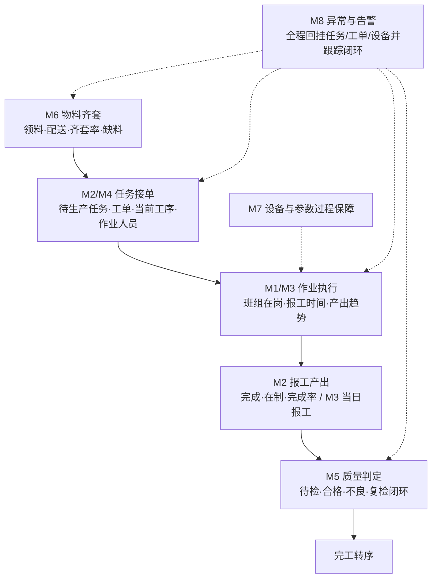
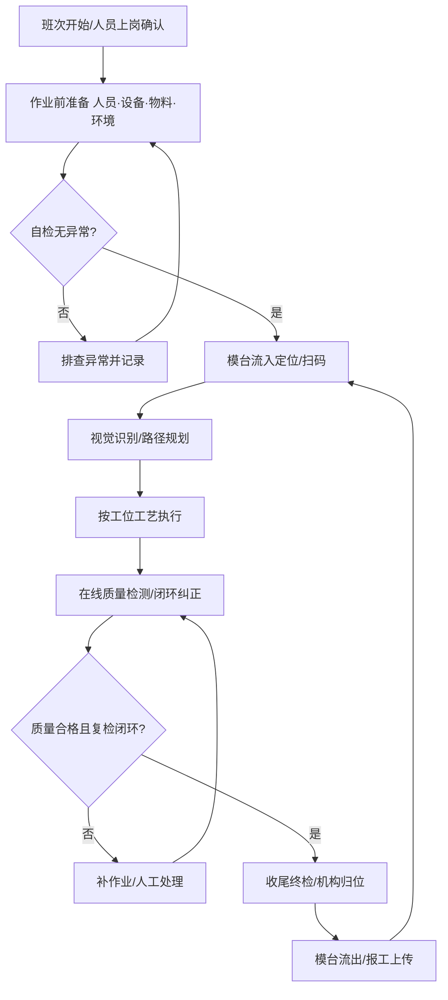
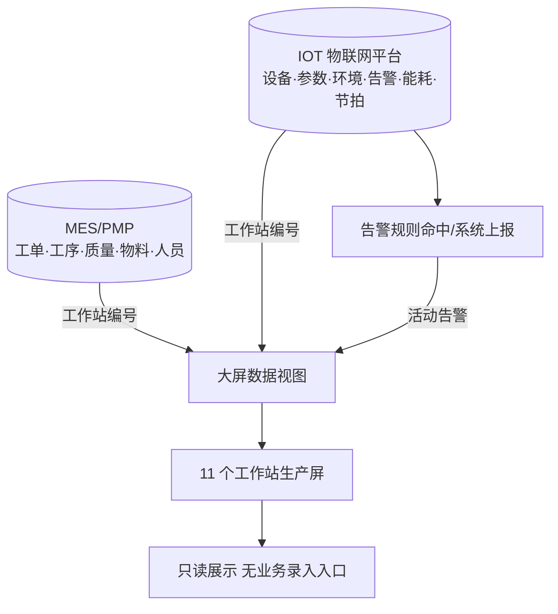
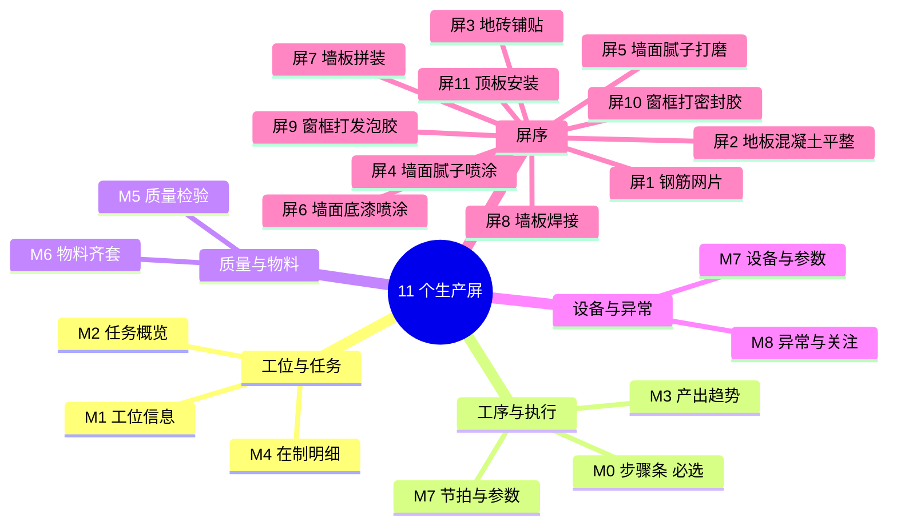

# 脉动智能产线生产大屏 · 产品需求分析报告

> 版本：v2.0（2026-11-20）｜范围：11 个工作站生产屏（只读视图）｜数据源：智能制造平台（MES/PMP，花都工厂）+ 外部 IOT 物联网平台（产线物联网智能管控）
> 核心口径：业务、计划、结果类指标取 MES；实时量测、设备运行、参数采集、环境、告警、能耗、节拍取 IOT。双源以「工作站编号」为关联主键。指标不得超出 §3.1 字段清单。

---

## 目录

1. [需求范围与目标](#1-需求范围与目标)
2. [业务理解：工艺标准作业摘要](#2-业务理解工艺标准作业摘要)
3. [工作站大屏详细需求](#3-工作站大屏详细需求)（重点章：数据来源边界 → 模块-MES功能核对 → 通用骨架 → 指标口径 → 差异化指标 → 业务闭环）
4. [枚举与口径规则](#4-枚举与口径规则)
5. [刷新与兜底规则](#5-刷新与兜底规则)
6. [业务流程图](#6-业务流程图)
7. [功能与屏构成](#7-功能与屏构成)
8. [权限与数据范围](#8-权限与数据范围)
9. [MVP 范围与分期](#9-mvp-范围与分期)
10. [风险与待确认事项](#10-风险与待确认事项)
11. [视觉与交互规范](#11-视觉与交互规范)

---

## 1. 需求范围与目标

### 1.1 建设目标

- 11 个工作站各一块生产大屏，统一模块骨架（M0–M8）、统一指标口径、统一数据来源归属；工位之间仅替换 M0 步骤条节点与差异化指标。
- 每屏跑通「物料齐套 → 任务接单 → 作业执行 → 报工产出 → 质量判定 → 完工转序」闭环，异常全程回挂来源。
- 大屏为只读展示视图，不提供报工、领料、质检录入、报修等操作入口；操作回 MES 业务端完成。

### 1.2 11 屏工位清单（工位名称以此为准）

| 屏号 | 工位名称 | 工位编码 |
|---|---|---|
| 1 | 钢筋网片工作站生产屏 | 以 MES「工作站配置」为准，前端不写死 |
| 2 | 地板混凝土平整工作站生产屏 | 同上 |
| 3 | 地砖铺贴工作站生产屏 | 同上 |
| 4 | 墙面腻子喷涂工作站生产屏 | 同上 |
| 5 | 墙面腻子打磨工作站生产屏 | 同上 |
| 6 | 墙面底漆喷涂工作站生产屏 | 同上 |
| 7 | 墙板拼装工作站生产屏 | 同上 |
| 8 | 墙板焊接工作站生产屏 | 同上 |
| 9 | 窗框打发泡胶工作站生产屏 | 同上 |
| 10 | 窗框打密封胶工作站生产屏 | 同上 |
| 11 | 顶板安装工作站生产屏 | 同上 |

### 1.3 边界

- 未绑定工作站编号的任务、报工、异常不计入单屏，汇总到产线总览层。
- 指标只能从 §3.1 两平台字段清单取值；平台未开放、未接入的字段不得写成指标，按 §5 空态兜底。
- IOT 设备/点位必须先绑定工作站编号方可上屏。

---

## 2. 业务理解：工艺标准作业摘要

### 2.1 工艺链顺序（11 屏对应工序）

模台流转主线，按作业指导书工序顺序（「养护 / 晾干」为工序间暂存等待，非独立工作站；「窗框安装 / 洁具柜体安装」无生产屏，仅作上下游衔接说明）：

```
钢筋网片 → 地板混凝土平整 →〔养护〕→ 地砖铺贴
  → 墙面腻子喷涂 → 墙面腻子打磨 → 墙面底漆喷涂 →〔底漆晾干〕
  → 墙板拼装 → 墙板焊接 → 窗框打发泡胶 → 窗框打密封胶 → 顶板安装
```


### 2.2 各工位关键作业要点（仅工艺侧）

> 严格按各工作站《设备操作指导书》原文提取，按文档作业过程顺序罗列每张工序步骤表的「文件名称 / 作业过程 / 工作要点 / 标准图片 / 注意事项」。标准图片为指导书内嵌照片/示意图，本表以「有（原图）」标注、原件为准；一张表即一个作业标准，左右并排双栏已按工序顺序合并展开。绑定工序为建议映射，以 MES「工作站配置」绑定工序为准；工序步骤条（M0）直接引用本节作业过程序列（§3.4）。

#### 钢筋网片工作站（屏1 钢筋网片工作站生产屏）

**作业标准 1：作业前准备作业标准**

| 作业过程 | 工作要点 | 标准图片 | 注意事项 |
|---|---|---|---|
| 1人员准备 | 1.1 操作人员需持证上岗（刷面识别），未刷卡或未授权人员禁止启动设备。1.2 熟悉龙门桁架、移动模台、索驱绑扎机器人、钢筋网片投放夹取末端、视觉系统等操作规范。1.3 经过专项工序培训，掌握工艺节拍、钢筋摆放间距、绑扎要求、投放精度及工作站各系统操作标准。1.4 穿戴劳保服、防滑手套、防护鞋，进入作业区佩戴安全帽及必要防护用品。 | 有（原图，见指导书） | 包含不限于以下内容身体状态良好：作业前禁止饮酒、服用影响精神状态的药物；若存在疲劳、眩晕等不适症状，应立即更换作业人员。熟悉急停按钮位置和操作；发生异常时立即停机。严禁未穿戴完整防护用品进入作业区域。 |
| 2-1设备准备(一) | 2.1 安全围栏与联锁：检查一层工作站及夹层投放口安全围栏完整性、安全门锁闭合状态、急停按钮是否处于释放位置。2.2 龙门桁架：检查机械结构、导轨、伺服电机及限位开关；空载试运行确认X/Y/Z轴运动平稳、无异响。2.3 移动模台：检查轨道、卡槽模具、限位挡块，确认流转定位功能正常。 | 有（原图，见指导书） | 包含不限于以下内容进入机械手或索驱作业区域前，须确保关闭主电源并将电源接头卸下。检查各轴限位开关、安全门、急停按钮功能正常。确认视觉系统标定状态及相机镜头清洁度。 |
| 2-2设备准备(二) | 2.4 索驱绑扎系统：检查八根钢索张力、滑轮、静平台连接状态，确认无缠绕、松弛或异常磨损。2.5 钢筋网片投放夹取末端：检查多点气动夹爪、断气保压功能、网片位置检测功能。2.6 钢筋调直切断及上料设备：检查调直切断机、上料设备运行状态，确认无报警。2.7 缓存货架：确认4个库位空置或状态正常，限位挡块可调。 | 有（原图，见指导书） | 包含不限于以下内容钢索出现异常磨损、断丝或张力不均时，禁止开机，须先处理。夹爪活动行程异常或断气保压功能失效时，禁止使用。严禁短接或屏蔽安全联锁装置。 |
| 3物料与环境准备 | 3.1 确认一层及夹层安全围栏内无人员、无工具、无杂物遗留。3.2 检查各急停按钮是否处于释放状态，安全门锁是否闭合。3.3 确认钢筋原料（盘条或直条）供应充足，备用绑丝数量满足当班需求。3.4 系统自检报警时，记录报警代码，排查后方可继续开机。 | 有（原图，见指导书） | 包含不限于以下内容严禁在安全围栏未闭合、安全门未锁闭的情况下启动设备。开机前确认移动模台轨道及一层模台轨道上无其他设备或障碍物。关机前或长时间停机时，须确认所有执行末端已回到安全位置。 |

**作业标准 2：钢筋加工与铺设作业标准**

| 作业过程 | 工作要点 | 标准图片 | 注意事项 |
|---|---|---|---|
| 1开机前准备 | 1.1 确认一层及夹层安全围栏内无人员、无工具、无杂物遗留。1.2 检查各急停按钮是否处于释放状态，安全门锁是否闭合。1.3 确认钢筋原料供应充足，缓存货架4个库位状态正常。1.4 系统自检报警时，记录报警代码，排查后方可继续开机。 | 有（原图，见指导书） | 包含不限于以下内容严禁在安全围栏未闭合、安全门未锁闭的情况下启动设备。严禁短接或屏蔽安全联锁装置。开机前确认移动模台轨道及一层模台轨道清空。 |
| 2钢筋调直切断与上料 | 2.1 系统根据图纸解析钢筋信息，启动调直切断机对盘筋进行自动矫直并定尺剪切。2.2 专用上料设备将剪切后的钢筋按间距要求自动排布、架高，并保证两端平齐。2.3 上料设备与抓取系统联动，实现一次抓取多根钢筋并稳定输送至摆放工位。2.4 调直切断机适配钢筋直径6-12mm，定尺范围满足网片需求。 | 有（原图，见指导书） | 包含不限于以下内容调直切断过程中出现卡料、断丝或定尺偏差时，立即停机排查。上料时确认钢筋两端齐平，限位挡块位置正确，避免后续抓取或摆放失败。原料切换或规格变更时，须重新确认设备参数后再启动。 |
| 3钢筋自动摆放 | 3.1 移动模台就位后，多点气动夹爪按150mm×150mm间距要求，将纵筋和横筋交叉摆放至卡槽模具内，形成待绑扎网格。3.2 夹爪具备柔性调节间距功能，活动行程能克服钢筋轻微弯曲，确保抓取稳定。3.3 摆放过程中视觉系统引导定位，保证钢筋两端齐平、网格交叉点准确。3.4 网格间距精度应满足150±2mm要求。3.5 摆放完成后，确认网片整体形态完整、无漏放、无移位。 | 有（原图，见指导书） | 包含不限于以下内容摆放前确认移动模台卡槽模具清洁、限位挡块位置正确，适配当前网片尺寸。抓取失败或个别钢筋未落入卡槽时，系统应报警并支持自动重试或人工干预。严禁在视觉系统未完成定位引导的情况下强行摆放。摆放过程中人员严禁进入移动模台作业区域。 |
| 4摆放质量确认 | 4.1 摆放完成后，视觉系统或人工抽检确认网格间距、两端齐平度及整体尺寸。4.2 网片成型尺寸精度要求：长度/宽度偏差≤±5mm，对角线偏差≤±10mm。4.3 确认无漏放、无交叉错误后，允许移动模台流转至绑扎区。 | 有（原图，见指导书） | 包含不限于以下内容质量确认不合格时，严禁流转至绑扎区，须完成整改并复检合格。抽检点应覆盖网片四角及中部关键交叉区域。确认完成后，记录相关数据便于追溯。 |

**作业标准 3：钢筋绑扎与存储作业标准**

| 作业过程 | 工作要点 | 标准图片 | 注意事项 |
|---|---|---|---|
| 1移动模台流转至绑扎区 | 1.1 钢筋自动摆放完成并确认合格后，移动模台沿轨道自动流转至绑扎区。1.2 流转定位精度应满足≤±1mm要求，到位后自动锁定。1.3 HMI显示模台已就位，允许启动绑扎程序。 | 有（原图，见指导书） | 包含不限于以下内容流转前确认绑扎区无人员、无障碍物，钢索及滑轮状态正常。流转过程中严禁人员进入轨道区域。定位失败时，须排查后重新流转，严禁强行启动绑扎。 |
| 2钢筋网绑扎 | 2.1 索驱绑扎机器人按跳绑工艺自动完成网片所有交叉点的绑扎。2.2 绑扎效率应满足≤3s/个点要求。2.3 绑扎过程中实时监控钢索张力与同步性，确保动作平稳。2.4 绑扎完成后，视觉系统或检测装置对成型质量进行检查，数据上传云端。2.5 绑扎合格率应≥95%（节点无漏绑/松绑）。 | 有（原图，见指导书） | 包含不限于以下内容绑扎前确认八根钢索张力正常、无缠绕、无异常磨损。出现漏绑、松绑或钢索异常时，系统应报警并支持补绑或停机处理。绑扎过程中人员严禁进入索驱作业区域。合格率不满足要求时，严禁流转至存储区，须完成补绑并复检。 |
| 3移动模台流转至存储区 | 3.1 绑扎合格后，移动模台沿轨道自动流转至存储区。3.2 到位后自动锁定，准备网片夹取。 | 有（原图，见指导书） | 包含不限于以下内容流转前确认存储区无人员、无障碍物。流转过程中严禁人员进入轨道区域。定位失败时，须排查后重新流转。 |
| 4钢筋网存储 | 4.1 钢筋网片投放夹取末端从移动模台夹取绑扎完成的网片。4.2 夹爪保证网片提升稳定性并减少变形，具备断气保压防坠落功能。4.3 将网片精准码放至4库位缓存货架对应库位，限位挡块适配网片尺寸。4.4 存储完成后更新库位状态，数据上传系统。 | 有（原图，见指导书） | 包含不限于以下内容夹取前确认网片已完全脱离卡槽，无卡滞。夹爪断气保压功能失效或网片检测异常时，禁止起吊。码放时确认库位空置且限位挡块位置正确，避免网片变形或坠落。库位已满时，系统应报警并禁止继续存储，须先处理后再作业。 |

**作业标准 4：钢筋网片投放和设备归位作业标准**

| 作业过程 | 工作要点 | 标准图片 | 注意事项 |
|---|---|---|---|
| 1模台就位 | 1.1 重载AGV将已拼装焊接好的墙板模台沿轨道送入投放口指定位置。1.2 模台定位后自动锁定，HMI显示“模台就位”状态。1.3 确认模台定位稳定，无倾斜、明显偏移。 | 有（原图，见指导书） | 包含不限于以下内容模台进入前，确认投放夹取末端及龙门桁架已处于安全位置。模台进入过程中，严禁人员进入一层安全围栏区域。如遇模台定位失败，应退出后重新进入，严禁强行锁定。 |
| 2钢筋网投放 | 2.1 系统根据工单从4库位缓存货架调取对应网片，投放夹取末端夹取网片。2.2 龙门桁架移动至投放口，视觉系统对网片位姿及盒子四面墙体内角进行检测，计算相对偏差并反馈调整。2.3 投放过程中，重载AGV可根据角度偏差自动进行轻微旋转，确保网片顺利进入围合墙体。2.4 网片下放至离地约25mm时，夹爪同时松开，网片落位至模台垫块上。2.5 投放位置精度应满足X/Y≤±10mm、θ≤0.5°要求；网片边线与围合墙体内边线距离应≥10mm且≤50mm。 | 有（原图，见指导书） | 包含不限于以下内容投放前确认目标库位网片与当前盒子工单匹配，视觉检测数据有效。出现角度偏差时，允许AGV自动轻微旋转纠正，精度≤0.5°；若偏差超出可纠正范围，系统应报警并停止投放。投放过程中实时监控网片与墙体出筋、门窗洞口的相对位置，防止干涉。夹爪断气保压功能失效或网片检测异常时，禁止继续下放。投放完成后确认网片落位平稳、无翘起、无碰撞。 |
| 3模台送出 | 3.1 确认投放合格后，模台解锁。3.2 重载AGV将模台沿轨道送出工作站，进入下一工序。3.3 模台送出过程中，投放夹取末端及龙门桁架须保持在安全位置。 | 有（原图，见指导书） | 包含不限于以下内容模台送出前，必须确认执行末端已完全离开投放区域并锁定。模台送出过程中，严禁人员进入一层安全围栏区域。如遇送出异常，立即停机排查，严禁强行操作。 |
| 4设备归位与清理 | 4.1 模台送出后，投放夹取末端及龙门桁架自动或手动回到初始安全位置。4.2 检查夹爪、钢索、缓存货架状态，清理作业区域残留杂物。4.3 更新库位状态，系统进入待机或准备下一循环。 | 有（原图，见指导书） | 包含不限于以下内容设备归位后确认各轴及钢索处于安全状态，安全门锁恢复正常。当班结束后须完成日常点检并记录。发现夹爪、钢索或限位挡块异常时，须及时处理后再投入下一循环。 |


#### 地板混凝土平整工作站（屏2 地板混凝土平整工作站生产屏）

**作业标准 1：作业前准备作业标准**

| 作业过程 | 工作要点 | 标准图片 | 注意事项 |
|---|---|---|---|
| 1人员准备 | 1.1操作人员需持证上岗（刷面）；1.2熟悉龙门桁架机械手、整平末端、AGV/RGV等操作规范；1.3经过专项工序培训，掌握工艺节拍、平整度标准（±3mm）、工作站各系统操作标准；1.4穿戴劳保服、防滑手套、防护鞋，进入作业区佩戴防护口罩。 | 有（原图，见指导书） | 包含不限于以下内容身体状态良好：作业前禁止饮酒、服用影响精神状态的药物；若身体存在疲劳、眩晕等不适症状，应立即更换作业人员。熟悉急停按钮位置和操作；发生异常时立即停机并清理。 |
| 2-1设备准备(一) | 2.1工作站：检查安全围栏、安全门、急停按钮、声光报警装置功能是否正常；2.2龙门桁架：检查X/Y/Z轴机械结构、导轨、拖链、电气与控制系统、安全装置（三重限位），空载试运行确认无报警；2.3控制系统：PLC、HMI开机自检，确认各轴限位正常、与MOM/AGV调度系统通讯正常。 | 有（原图，见指导书） | 包含不限于以下内容进入机械手安全区域之前，须确保关闭主电源及气压源，并将气、电源接头卸下。检查各轴限位开关、安全门、急停按钮功能正常；检查视觉系统标定状态。 |
| 2-2设备准备(二) | 2.4整平末端：检查刮板磨损及橡胶刮片状态、振动器固定及激振力、水平/垂直转向机构动作是否正常；2.5视觉系统：检查3D激光相机、激光位移传感器、激光雷达镜头清洁状态及标定数据，确认无异常；2.6清洗系统：检查清洗仓高压喷嘴、旋转毛刷、气动干燥、废料箱状态，确认与MOM/IIoT通讯正常。 | 有（原图，见指导书） | 包含不限于以下内容来料状态：混凝土塌落度180±20mm，底板钢筋网片、水电管线铺设完成；模台定位锁定机构完好。安全事项：模台进出卷帘打开前桁架末端提升至最高处，安全门打开时设备自动断电停机。 |
| 3物料&环境准备 | 3.1确认工作站安全围栏内无人员、无工具、无杂物遗留；3.2检查各急停按钮是否处于释放状态，安全门锁是否闭合；3.3系统自检报警时，记录报警代码，排查后方可继续开机。 | 有（原图，见指导书） | 包含不限于以下内容严禁在安全围栏未闭合、安全门未锁闭的情况下启动设备。严禁短接或屏蔽安全联锁装置；开机前确认模台进出通道上无其他模台。 |

**作业标准 2：整平作业准备工序作业标准**

| 作业过程 | 工作要点 | 标准图片 | 注意事项 |
|---|---|---|---|
| 1开机前准备 | 1.1确认工作站安全围栏内无人员、无工具、无杂物遗留；1.2检查各急停按钮处于释放状态，安全门锁闭合；1.3确认混凝土来料信息：塌落度180±20mm，底板浇筑完成，钢筋网片、水电管线已验收合格；1.4检查门洞临时集料槽已安装就位，可收集粗平余料。 | 有（原图，见指导书） | 包含不限于以下内容来料状态：混凝土塌落度不符合要求时严禁进入整平工序。安全事项：安全围栏未闭合、安全门未锁闭严禁启动设备。 |
| 2模台进入与定位锁定 | 2.1重载AGV/RGV与模台对接，沿Y轴方向（长度方向）匀速送入工作站，进入过程中通过监控摄像头观察模块状态；2.2模台进入过程中桁架整平末端处于最高处锁定位置，避免碰撞；2.3模台进入到位后，定位锁定机构自动动作，将模台准确定位并夹紧锁定；2.4确认锁定到位信号正常、HMI无报警；定位失败自动重试，连续3次失败触发报警。 | 有（原图，见指导书） | 包含不限于以下内容模台进入前，检查桁架整平末端位于高处，避免与模台进出碰撞；模台进入过程中，严禁人员进入工作站区域；如遇模台定位失败，应手动操作模台退出后重新进入，严禁强行锁定。 |
| 4路径规划 | 4.1系统根据扫描结果自动生成避障路径和整平作业路径（粗平往复、精平轨迹）；4.2自动识别墙根阴角区域并规划侧刮板作业路径，阴角整平覆盖率≥95%；4.3规划结果在HMI显示预览，操作工确认无误后启动整平作业。 | 有（原图，见指导书） | 包含不限于以下内容如模块型号与BIM模型不匹配，应停止作业，核实工单信息；门洞临时集料槽未就位前严禁开始粗平作业；混凝土塌落度不符合180±20mm时，严禁进入整平工序。 |
| 33D扫描建图 | 3.1确认站内照明充足、粉尘环境满足扫描要求，桁架按规划轨迹运行，3D激光相机对模块内腔进行全局扫描（精度±1mm）；3.2识别底板混凝土堆积高度及分布、墙边阴角、门洞、窗洞位置；3.3视觉定位成功率≥99.5%，定位失败自动重试，连续3次失败触发报警；3.4扫描完成后HMI显示扫描结果，操作工确认无误。 | 有（原图，见指导书） | 包含不限于以下内容严禁在视觉系统未完成识别建图的情况下直接启动整平作业；扫描数据异常（混凝土堆积过高、缺料）时，停止作业并人工核实；保持相机镜头清洁，防止粉尘影响扫描精度。 |

**作业标准 3：整体整平作业标准**

| 作业过程 | 工作要点 | 标准图片 | 注意事项 |
|---|---|---|---|
| 1粗平赶料 | 1.1按规划路径执行粗平往复作业，刮板配合振动器将混凝土向低洼处及门洞方向赶料；1.2侧刮板伸入墙根阴角沿墙根刮平，橡胶刮片防止刮花墙体，阴角整平覆盖率≥95%；1.3余料集中推至门洞临时集料区，由人工配合完成最后清理；1.4粗平后表面高度偏差控制在±5mm以内。 | 有（原图，见指导书） | 包含不限于以下内容粗平作业期间严禁人员进入工作站内；刮板碰撞墙体、门窗洞口或出现异常，立即急停排查；振动器频率50~200Hz、激振力0.8~2.5kN按工艺参数设定。 |
| 2精平（高频振捣） | 2.1调整末端水平/垂直角度（水平±90°、垂直±30°），启动高频振捣，对底板全范围进行精平；2.2精平后表面平整度≤±3mm（2m靠尺），无露筋、无明显蜂窝；2.3精平路径按规划轨迹执行，速度均匀，覆盖整个底板范围。 | 有（原图，见指导书） | 包含不限于以下内容精平过程中实时监控设备状态，振捣异常（失振、卡滞）立即停机排查；振动机构与Z轴连接处设减振垫，防止振动向桁架传递；严禁在混凝土初凝后继续振捣作业。 |
| 3质量控制（闭环反馈） | 3.1视觉系统实时分析采集到的表面数据，与平整度标准（≤±3mm/2m）进行比对；3.2识别并记录未达标区域，生成平整度偏差色谱图/热力图，在HMI显示超标区域位置与偏差值；3.3根据缺陷严重程度自动规划补平路径并执行二次精平；3.4所有检测数据、判定结果和二次作业记录结构化保存并实时上传MOM系统，实现全程可追溯。 | 有（原图，见指导书） | 包含不限于以下内容质量数据上传失败时，暂停模台流出并排查通讯，确保数据完整；未达标区域未处理完成前严禁放行模台；每班次随机抽取模块测9点（边角、中间）复核检测准确性。 |
| 4末端清洗 | 4.1整平作业完成后，桁架机械手将整平末端移至自动清洗仓对接点，末端降入清洗仓；4.2清洗仓执行滚刷水洗+气动干燥流程，废料收集至废料箱；4.3清洗完成后末端升起，目视检查确认无混凝土残留；4.4废料箱每4个模块由AGV外运一次至指定点。 | 有（原图，见指导书） | 包含不限于以下内容末端清洗不彻底严禁进行下一模块作业；清洗废料外运时确认废料箱无遗撒；清洗仓防溅防护罩完好，防止污水飞溅污染设备。 |

**作业标准 4：环境净化和设备归位作业标准**

| 作业过程 | 工作要点 | 标准图片 | 注意事项 |
|---|---|---|---|
| 1环境清理 | 1.1整平及末端清洗作业完成后，检查站内混凝土残渣、废料，清理门洞临时集料区余料（余料清理约3min）；1.2清洗废料箱及作业区域，保持工作站整洁；1.3确认站内无遗留工具、杂物，工作站具备流转条件。 | 有（原图，见指导书） | 包含不限于以下内容来料状态：整平及清洗作业全部完成，末端已离开作业区，站内无人员。动作标准：清理门洞集料区余料并检查站内无遗留物，废料统一收集至废料箱。质量标准：站内整洁无残渣，废料箱密封无遗撒。异常处理：发现混凝土初凝残渣时，人工清理并评估是否影响模台流转。安全事项：清理作业期间设备处于停机状态，严禁自动运行。设备保养：定期检查废料箱、集料槽磨损情况，及时清运废料。 |
| 2机构回初始位 | 2.1确认整平、清洗作业全部完成，整平末端已停至安全位置；2.2桁架X/Y轴移动至待命位，Z轴提升至最高处并锁定；2.3模台定位锁定机构自动解锁并复位，确认模台处于可流转状态。 | 有（原图，见指导书） | 包含不限于以下内容来料状态：整平及清洗作业全部完成，桁架、末端处于安全位置，无异常报警。动作标准：桁架提升至高处锁定，模台定位锁定机构自动解锁复位。质量标准：模台解锁到位无卡滞，各机构复位至初始状态，HMI无报警。异常处理：模台解锁失败时，人工检查定位夹紧装置，排除故障后重新执行，严禁强行拖拽模台。安全事项：复位作业期间严禁人员进入工作站内部，确认急停按钮、安全门联锁功能正常。设备保养：定期检查定位传感器、夹紧装置，做好润滑与磨损检查。 |
| 3模台流出 | 3.1确认环境清理完成、桁架末端处于高处锁定、模台已解锁；3.2出口方向卷帘门自动开启，观察门体运行是否平稳、有无卡滞异响；3.3重载AGV/RGV与模台对接，牵引模台匀速流出工作站，进入下一工序（混凝土养护）；3.4模台完全流出后，卷帘门自动关闭并锁紧，工作站恢复待机状态。 | 有（原图，见指导书） | 包含不限于以下内容来料状态：模台已解锁，出口卷帘门完全开启，下一工序接收条件就绪。动作标准：AGV牵引模台匀速流出工作站，全程通过摄像头监控模块状态。质量标准：模台流出平稳、模块无倾斜偏移、无碰撞剐蹭，流出时间符合节拍要求。异常处理：流出过程中发现模块倾斜、偏移或设备报警，立即停机，人工复位排查后重新执行。安全事项：模台流出通道上严禁人员停留，严禁站位于模台运行方向及轨道上。设备保养：定期检查AGV对接机构、模台轨道、定位传感器及卷帘门联锁。 |
| 4数据上传 | 4.1确认本模块整平质量数据、检测记录已实时上传MOM系统，上传完整率100%；4.2确认设备运行状态、节拍统计、报警记录通过OPC UA/MQTT上传IIoT数采层；4.3数据上传完成后，HMI显示本模块作业完成，接收下一生产工单。 | 有（原图，见指导书） | 包含不限于以下内容数据上传失败时，严禁放行下一模块进入，排查通讯链路；定期核对MOM工单与实绩数据一致性；保持网络（5G/4G/WiFi）稳定，异常时及时恢复并补传数据。 |


#### 地砖铺贴工作站（屏3 地砖铺贴工作站生产屏）

**作业标准 1：作业前准备作业标准**

| 作业过程 | 工作要点 | 标准图片 | 注意事项 |
|---|---|---|---|
| 1人员准备 | 1.1 操作人员需持证上岗（刷卡/刷面识别），未授权人员禁止启动设备。1.2 熟悉龙门桁架、铺贴机械臂、布料机器人、协作AGV、瓷砖胶系统、视觉系统及安全联锁的操作规范。1.3 经过专项工序培训，掌握工艺节拍、铺贴参数、双机器人轮换要求及各系统操作标准。1.4 穿戴完整劳保用品，进入作业区佩戴防护口罩及护目镜。 | 有（原图，见指导书） | 包含不限于以下内容身体状态良好：作业前禁止饮酒或服用影响精神状态的药物；若存在疲劳、眩晕等不适，应立即更换作业人员。熟悉急停按钮位置和操作，发生异常时立即停机。严禁未穿戴完整防护用品进入作业区域。 |
| 2-1设备准备(一) | 2.1 安全围栏与联锁：检查安全围栏完整性、安全门锁闭合状态、急停按钮是否处于释放位置，声光报警功能正常。2.2 龙门桁架：检查机械结构、导轨、伺服电机及限位开关；空载试运行确认X/Y/Z轴运动平稳、无异响。2.3 铺贴机械臂：开机回零，检查运动轨迹、伺服状态、末端抓取接口，确认无报警、限位正常。 | 有（原图，见指导书） | 包含不限于以下内容进入机械手或机器人安全区域前，须确保关闭主电源及气压源，并卸下气、电源接头。检查各轴限位开关、安全门、急停按钮功能正常。严禁短接或屏蔽安全联锁装置。 |
| 2-2设备准备(二) | 2.4 布料机器人与协作AGV：检查电量/气源、导航系统、真空吸盘状态，确认可正常启动与通信。2.5 瓷砖胶系统：检查拆包机构、搅拌装置、供料管路及加水系统，确认无堵塞、无泄漏。2.6 视觉与控制系统：检查HMI通信状态、相机镜头清洁度、安全回路；执行系统自检，确认无报警。 | 有（原图，见指导书） | 包含不限于以下内容真空吸盘或管路异常时，禁止启动铺贴作业。瓷砖胶系统存在泄漏或压力异常时，须先处理再开机。视觉系统标定异常或镜头污染时，须清洁并重新确认后再继续。 |
| 3物料与环境准备 | 3.1 确认工作站安全围栏内无人员、无工具、无杂物遗留。3.2 检查各急停按钮处于释放状态，安全门锁闭合。3.3 确认备用瓷砖、瓷砖胶、清水及污水容器数量满足当班需求。3.4 系统自检报警时，记录报警代码，排查完成后方可继续开机。 | 有（原图，见指导书） | 包含不限于以下内容严禁在安全围栏未闭合、安全门未锁闭的情况下启动设备。开机前确认模台轨道上无其他模台或障碍物。长时间停机后重新开机，须确认所有机器人及桁架处于安全位置。 |

**作业标准 2：前序准备与物料就位作业标准**

| 作业过程 | 工作要点 | 标准图片 | 注意事项 |
|---|---|---|---|
| 1地面预处理确认 | 1.1 确认建筑盒子地面已完成人工清灰，无明显浮尘、杂物。1.2 确认地面已预湿润，表面无明显积水或水珠。1.3 使用激光投线仪在地面标记1m标高控制线及首列铺贴参考线，线条清晰、位置准确。1.4 目视检查地面无明显空鼓、裂缝等缺陷，必要时记录并反馈前序工序。 | 有（原图，见指导书） | 包含不限于以下内容激光参考线必须在模台进入工作站前完成，禁止在设备运行期间临时补做或调整。预湿后若出现明显积水，须重新处理至表面仅潮湿、无自由水状态，否则影响瓷砖胶性能。发现地面存在明显空鼓、裂缝或平整度异常时，须暂停并反馈前序工序，不得强行进入铺贴。 |
| 2原材配送与就位 | 2.1 确认MOM系统已下达本套盒子的原材需求（瓷砖型号、规格、数量及瓷砖胶用量）。2.2 仓库AGV将瓷砖、瓷砖胶、清水配送至线边库指定位置。2.3 检查到货瓷砖规格、数量与工单一致，外观无破损；瓷砖胶包装完好、在保质期内。2.4 将瓷砖摆放至定制配送料架，清水注入移动供水水箱，污水收集水槽就位。 | 有（原图，见指导书） | 包含不限于以下内容原材配送延误或规格不符时，立即反馈生产调度，严禁使用错误型号或数量不足的物料强行生产。瓷砖搬运与码放过程中必须轻拿轻放，禁止抛掷或碰撞，破损瓷砖须即时剔除并补充。线边库物料不得占用安全通道、模台轨道及机器人活动范围，保持通道畅通。瓷砖胶须核对生产日期与保质期，过期或包装破损的胶料禁止使用。 |
| 3瓷砖胶制备 | 3.1 瓷砖胶自动拆包机器人完成拆包，将胶粉送入配料供料设备。3.2 按工艺设定水灰比自动加水（误差≤±5%），启动搅拌至均匀。3.3 搅拌完成后按工艺要求进行熟化，熟化时间满足设定要求。3.4 确认供料管路畅通、压力正常，具备向布料机器人供胶条件。 | 有（原图，见指导书） | 包含不限于以下内容加水精度超差或搅拌不均匀时，该批次胶料不得使用，须重新制备并记录原因。熟化时间不足严禁提前供胶，否则将严重影响瓷砖粘结强度和空鼓率。制备过程中出现管路堵塞、泄漏或压力异常，立即停机处理。供胶前须确认胶料状态正常，避免将未充分熟化或结块的胶料送入铺贴环节。 |
| 4瓷砖上料（人工助力） | 4.1 人工将瓷砖从配送料架转移至布料机器人上料工位。4.2 确认瓷砖摆放方向、数量满足布料机器人抓取要求。4.3 检查布料机器人真空吸盘清洁、无破损，具备抓取条件。4.4 上料完成后在HMI确认“瓷砖上料完成”状态。 | 有（原图，见指导书） | 包含不限于以下内容人工上料时布料机器人必须处于停止或安全模式，严禁在机器人运动过程中进入其作业范围。瓷砖摆放不整齐、方向错误或数量不足时，须重新整理并确认。上料过程中发现破损、缺角或污染严重的瓷砖立即剔除，并按数量补足。真空吸盘存在破损、变形或吸附力不足时，禁止确认上料完成，须更换清理。 |

**作业标准 3：铺贴作业准备工序作业标准**

| 作业过程 | 工作要点 | 标准图片 | 注意事项 |
|---|---|---|---|
| 1模台就位与锁定 | 1.1 重载AGV将搭载建筑盒子的模台沿轨道送入工作站，到达预设停止位置。1.2 模台定位后自动锁定/夹紧，HMI显示“模台就位”绿色状态指示。1.3 通过监控或现场观察确认盒子无倾斜、偏移，定位稳定后方可进入下一步。1.4 模台进入过程中，龙门桁架及铺贴机械臂须保持在最高安全位置并锁定。 | 有（原图，见指导书） | 包含不限于以下内容模台进入前，必须确认桁架及机械臂已提升至安全高度并锁定，避免碰撞盒子墙体。模台进入过程中严禁人员进入安全围栏区域。如遇模台定位失败或偏移，应手动操作退出后重新进入，严禁强行锁定。模台未完全锁定或HMI未显示就位状态时，禁止启动扫描与规划。 |
| 2安全与环境确认 | 2.1 确认工作站安全围栏内无人员、无工具、无杂物遗留。2.2 检查各急停按钮处于释放状态，安全门锁已闭合。2.3 确认布料机器人、协作AGV处于待机安全位置，真空系统正常。2.4 确认瓷砖胶供料系统、清水及污水容器状态满足本套生产需求。 | 有（原图，见指导书） | 包含不限于以下内容安全围栏未闭合或安全门未锁闭时，严禁启动任何自动程序。发现围栏内有遗留物品或人员时，必须清除并重新确认后再继续。布料机器人或AGV未回到安全位置时，不得进行模台锁定后的下一步操作。物料状态不足时，须先完成补给，避免中途停机影响节拍。 |
| 3视觉扫描与定位 | 3.1 视觉扫描前确认站内照明充足，地面无强反光或阴影干扰。3.2 视觉系统对盒子地面进行完整扫描，检测平整度、识别门洞位置及尺寸。3.3 系统获取地面点云数据，辅助后续路径规划；定位精度满足工艺要求。3.4 扫描过程中如出现识别异常，系统自动重试，连续失败则触发报警。 | 有（原图，见指导书） | 包含不限于以下内容严禁在视觉系统未完成扫描识别的情况下进入路径规划或铺贴。扫描过程中出现识别异常或数据丢失，须停止作业并排查原因（镜头污染、光照、地面反光等）。门洞位置识别不准确时，须人工复核确认，防止布料机器人进盒路径错误。地面存在明显积水、杂物或反光干扰时，须先处理后再重新扫描。 |
| 4铺贴路径规划与确认 | 4.1 系统根据BIM排砖方案与扫描点云数据，自动生成全底板铺贴路径与顺序。4.2 路径规划考虑瓷砖胶开放时间、门洞避让、双机器人轮换节点。4.3 生成结果在HMI上可视化显示，包括铺贴顺序、预计节拍、覆盖区域。4.4 操作人员在HMI上确认路径预览与参数无误后，方可启动后续铺贴作业。 | 有（原图，见指导书） | 包含不限于以下内容严禁在路径规划未完成或未经人工确认的情况下直接启动铺贴。如盒子实际规格与BIM模型不匹配，应停止作业并核实工单信息。路径确认后不得随意手动修改关键工艺参数，如需调整须经工艺人员批准。规划结果明显异常（漏铺区域、路径交叉、节拍严重超时）时，须重新规划或人工干预。 |

**作业标准 4：整体铺贴作业标准**

| 作业过程 | 工作要点 | 标准图片 | 注意事项 |
|---|---|---|---|
| 1布料机器人进盒与供胶对接 | 1.1 布料机器人与瓷砖胶供料系统完成对接，确认供胶管路连接可靠、压力正常。1.2 协作AGV携带布料机器人寻找建筑盒子门洞，确认门洞通道畅通。1.3 布料机器人通过门洞平稳进入盒子内部，到达首个作业起始位置。1.4 HMI显示布料机器人“进盒完成”状态后，方可启动铺贴程序。 | 有（原图，见指导书） | 包含不限于以下内容门洞通道有障碍或垫块铺设不到位时，严禁强行进盒，防止机器人倾覆或碰撞。供胶对接未完成或压力异常时，禁止进入铺贴流程。布料机器人进盒过程中，人员严禁进入安全围栏及门洞附近区域。进盒路径与规划不符或定位偏差过大时，须退回重新定位，不得继续作业。 |
| 2背涂胶与瓷砖铺贴 | 2.1 布料机器人按规划路径运动至目标位置，对瓷砖背面进行均匀涂胶。2.2 龙门桁架搭载铺贴机械臂完成瓷砖抓取，移动至铺贴位置。2.3 机械臂将瓷砖按设定压力与姿态铺贴至地面，完成初步压实。2.4 铺贴过程实时记录每块砖的位置、压力及时间数据，确保在瓷砖胶开放时间内完成。 | 有（原图，见指导书） | 包含不限于以下内容背涂胶量不足或不均匀时，须暂停并检查供胶系统，防止空鼓。铺贴过程中实时观察HMI压力与位置曲线，出现异常立即停机检查。严禁在真空吸盘吸附力不足或瓷砖未抓稳的情况下继续移动。发现瓷砖破损、缺胶或铺贴位置明显偏差时，立即标记并转入补铺或人工处理流程。 |
| 3双机器人轮换补给 | 3.1 一号布料机器人在盒内持续作业时，二号布料机器人由协作AGV背负完成瓷砖与瓷砖胶补给。3.2 二号机器人补给完成后进入盒子，与一号机器人完成作业交接。3.3 一号机器人退出盒子返回补给点，进行下一轮瓷砖与胶料补充。3.4 两台机器人按此循环交替，直至整盒铺贴任务完成。 | 有（原图，见指导书） | 包含不限于以下内容轮换过程中必须确认两台机器人位置互不干涉，避免碰撞。补给未完成或物料不足时，禁止进行机器人交接，防止盒内作业中断。交接信号未在HMI确认前，不得释放正在作业的机器人。轮换异常（通信中断、定位失败）时立即停机，人工介入处理后再恢复。 |
| 4过程质量检测与覆盖确认 | 4.1 铺贴过程中视觉系统实时检测砖面平整度、砖缝宽度（2～3mm）及相邻砖高低差。4.2 对检测出的超差区域进行自动标记，支持后续补铺或人工处理。4.3 整盒铺贴完成后，系统确认覆盖率达到100%，无遗漏区域。4.4 操作人员可在HMI查看实时质量数据与铺贴进度，确认无误后进入下一环节。 | 有（原图，见指导书） | 包含不限于以下内容过程质检不合格区域不得直接忽略，须完成补铺或标记交由人工处理。砖缝宽度、高低差明显超标时，须暂停分析原因（胶量、压力、定位），避免批量不良。覆盖率未达到100%或存在系统未识别区域时，严禁确认铺贴完成。质量数据须如实记录，便于追溯，禁止手动修改检测结果。 |

**作业标准 5：人工收尾与设备归位清理作业标准**

| 作业过程 | 工作要点 | 标准图片 | 注意事项 |
|---|---|---|---|
| 1人工边角收尾处理 | 1.1 对门洞边、墙根边角及非整砖区域进行人工铺贴收尾。1.2 人工铺贴后砖面应平整、砖缝均匀（2～3mm），与自动铺贴区域衔接自然，无明显高低差。1.3 使用2m靠尺配合塞尺检查收尾区域水平度与相邻砖高低差，合格标准为高低差≤0.5mm、整体水平度≤3mm/2m。1.4 收尾产生的废料、胶渍及时清理，避免污染已完成铺贴区域。 | 有（原图，见指导书） | 包含不限于以下内容人工收尾前必须确认设备已停止运行，布料机器人及铺贴机械臂处于安全位置并锁定。操作人员须穿戴完整防护用品，防止瓷砖胶接触皮肤或吸入粉尘。严禁在设备未完全停机、安全门未打开确认的情况下进入盒子内部作业。收尾区域与自动铺贴区域的接缝处须仔细处理，防止出现明显接痕或空鼓。 |
| 2质量终检与确认 | 2.1 人工收尾完成后，启动视觉终检或进行人工抽检，确认整体铺贴质量。2.2 检查全底板覆盖率是否达到100%，有无遗漏区域。2.3 抽检砖缝宽度、相邻砖高低差、整体水平度是否满足要求。2.4 终检合格后，HMI显示“铺贴合格”状态，方可进入模台送出流程。 | 有（原图，见指导书） | 包含不限于以下内容终检不合格时，须标记缺陷区域并完成补铺或返修，复检合格后方可放行。严禁跳过终检直接送出模台。抽检点应覆盖大面、门洞周边、墙根及自动与人工交接区域。终检数据须如实记录并存档，便于质量追溯。 |
| 3模台解锁与送出 | 3.1 确认视觉终检或人工终检合格后，模台解锁。3.2 重载AGV将模台沿轨道送出工作站，进入下一工序。3.3 模台送出过程中，龙门桁架及铺贴机械臂须保持在最高安全位置并锁定。3.4 模台完全离开工作站后，确认轨道清空。 | 有（原图，见指导书） | 包含不限于以下内容模台送出前，必须确认所有机器人已退出盒子并提升至安全高度，避免碰撞。模台送出过程中严禁人员进入安全围栏区域。如遇送出异常，立即停机排查，严禁强行操作。未收到“铺贴合格”状态信号时，禁止解锁送出。 |
| 4设备归位与清理 | 4.1 模台送出后，龙门桁架、铺贴机械臂、布料机器人自动或手动回到初始安全位置。4.2 检查真空吸盘、供胶管路状态，必要时清理或更换；确认污水收集水槽并及时处理。4.3 清理工作站内残留瓷砖胶、废料及杂物，保持场地整洁。4.4 关闭相关设备电源或使系统进入待机状态，为下一循环做准备；完成当班点检记录。4.4 当天作业完成后进行瓷砖胶搅拌系统清洗和布料机器人刮板清洗。 | 有（原图，见指导书） | 包含不限于以下内容清理供胶管路或更换吸盘时，须按规范操作，防止胶料滴落污染设备与地面。设备归位后确认各轴处于安全位置，安全门锁恢复正常状态。污水及废料须按环保要求分类处理，禁止随意倾倒。当班结束后须完成日常点检并如实记录，发现问题及时上报。 |


#### 墙面腻子喷涂工作站（屏4 墙面腻子喷涂工作站生产屏）

**作业标准 1：作业前准备作业标准**

| 作业过程 | 工作要点 | 标准图片 | 注意事项 |
|---|---|---|---|
| 1人员准备 | 1.1操作人员需持证上岗（刷面）；1.2熟悉龙门桁架、6轴机械臂、SCARA机械臂、AGV等操作规范；1.3经过专项工序培训，掌握工艺节拍、工艺配比、工作站各系统操作标准；1.4穿戴劳保服、防滑手套、防护鞋、进入喷涂作业区佩戴防护口罩。 | 有（原图，见指导书） | 包含不限于以下内容身体状态良好：作业前禁止饮酒、服用影响精神状态的药物；若身体存在疲劳、眩晕等不适症状，应立即更换作业人员。熟悉急停按钮位置和操作；发生异常时立即停机并清理 |
| 2-1设备准备(一) | 2.1喷涂房：检查通风与除尘系统、设备与电气安全检查、联动卷帘联动情况；2.2龙门桁架：机械结构检查、电气与控制系统检查、安全装置检查、空载试运行；2.3六轴机械臂：开机回零，检查运动轨迹、伺服电机、夹具夹紧功能，确认无报警、限位正常； | 有（原图，见指导书） | 包含不限于以下内容进入机械手安全区域之前，须确保关闭主电源及气压源，并将气、电源接头卸下。检查各轴限位开关、安全门、急停按钮功能正常；检查料罐液位；检查视觉系统标定状态。 |
| 2-2设备准备(二) | 2.4喷涂执行末端：检查是否堵塞；2.5腻子自动上料系统：检查机械臂、腻子夹具、破袋装置结构及磨损情况，检查运动轨迹、伺服电机、夹具夹紧功能，确认无报警、限位正常。2.6腻子搅拌、供料、清洗系统：检查供料系统是否干净、检查智能定量装置功能，检查各系统协调对接情况，检查与工厂MES对接通讯情况。 | 有（原图，见指导书） | 包含不限于以下内容来料状态：袋装腻子、无栏杆托盘平放；桶装清水AGV运输不遗撒。安全事项：喷涂房模台进出卷帘打开前机械臂自动伸至最高处、喷涂房人行安全门打开时设备自动断电停机。 |
| 3物料&环境准备 | 3.1确认工作站安全围栏内无人员、无工具、无杂物遗留；3.2检查各急停按钮是否处于释放状态，安全门锁是否闭合；3.3系统自检报警时，记录报警代码，排查后方可继续开机。 | 有（原图，见指导书） | 包含不限于以下内容关机前必须执行彻底清洗，防止腻子隔夜固化堵塞管路。严禁在安全围栏未闭合、安全门未锁闭的情况下启动设备、严禁短接或屏蔽安全联锁装置、开机前确认模台进出通道上无其他模台。 |

**作业标准 2：喷涂作业准备工序作业标准**

| 作业过程 | 工作要点 | 标准图片 | 注意事项 |
|---|---|---|---|
| 1开机前准备 | 1.1确认工作站安全围栏内无人员、无工具、无杂物遗留；1.2检查各急停按钮是否处于；释放状态，安全门锁是否闭合1.3腻子储存箱料位低于30%时，提前通知AGV配送腻子粉；1.4清水桶液位低于50%时及时补充，确保清洗工序可用；1.5废料桶容量超过80%时，及时通知AGV转运更换；1.6压缩空气压力应保持在0.5~0.7MPa范围内；1.7系统自检报警时，记录报警代码，排查后方可继续开机。 | 有（原图，见指导书） | 包含不限于以下内容严禁在安全围栏未闭合、安全门未锁闭的情况下启动设备严禁短接或屏蔽安全联锁装置开机前确认模台轨道上无其他模台或障碍物。 |
| 2封闭房开启、模台就位 | 2.1卷帘门开启过程中，观察门体运行是否平稳，有无卡滞异响；2.2模台进入过程中，通过监控摄像头观察盒子是否有倾斜、偏移；2.3模台定位精度应满足±20mm要求，定位偏差过大时需重新对位；2.4模台定位后，HMI应显示"模台就位"绿色状态指示；2.5进口卷帘门关闭后，确认封闭房密封性，无明显缝隙。 | 有（原图，见指导书） | 包含不限于以下内容模台进入前，检查桁架机械臂+6轴机械臂定位确保位于高处，避免与模台进出碰撞；模台进入过程中，严禁人员进入封闭房区域；如遇模台定位失败，应手动操作模台退出后重新进入，严禁强行锁定；卷帘门运行时如遇异响或卡滞，立即按下急停，排查机械故障。 |
| 3视觉扫描和喷涂方案规划 | 3.1视觉扫描前，确认站内照明充足，墙面无明显反光或阴影干扰；3.2视觉定位成功率应≥99.5%，定位失败时自动重试，连续3次失败触发报警；3.3尺寸偏差补偿量超过±10mm时，系统应提示人工复核；3.4门窗洞口区域自动标记为"非喷涂区"，喷涂路径自动绕行；3.5阴阳角、凸窗四周等细部区域自动规划精细喷涂路径；3.6喷涂方案确认后，HMI显示喷涂路径预览，操作工确认无误后启动喷涂。 | 有（原图，见指导书） | 包含不限于以下内容严禁在视觉系统未完成识别补偿的情况下直接启动喷涂如盒子型号与BIM模型不匹配，应停止作业，核实工单信息墙面存在明显缺陷（大面积空鼓、裂缝）时，应人工评估是否适合喷涂。 |
| 4腻子上料与腻子搅拌 | 4.1腻子粉配比严格按产品说明书执行，水灰比误差控制在±2%以内；4.2搅拌时间不少于5分钟，确保腻子充分熟化，无干粉结块4.3搅拌完成后，观察腻子状态：均匀膏状、无颗粒、无气泡、流动性适中4.4腻子储存量低时（低于单桶用量），系统自动报警并触发补料4.5可根据生产节拍提前搅拌1~2个模块的腻子，减少等待时间搅拌桶配备高低液位传感器，超低液位自动停机保护 | 有（原图，见指导书） | 包含不限于以下内容腻子搅拌好后应在2小时内使用完毕，超时腻子需重新评估可用性不同品牌、不同型号腻子严禁混合使用自动拆包装置需定期检查，防止包装袋碎片混入腻子搅拌站内壁应保持清洁，每次换料或停机时清。 |

**作业标准 3：整体喷涂作业标准**

| 作业过程 | 工作要点 | 标准图片 | 注意事项 |
|---|---|---|---|
| 1腻子供料 | 1.1供料压力根据腻子粘度和喷涂厚度调整，一般控制在10~20MPa；1.2供料流量调节范围1~10L/min，匹配喷涂效率；1.3腻子搅拌工艺动作应在喷涂间隙完成，避免影响连续喷涂；1.4供料管路沿支架固定，泵机、泵管、旋转装置等，定期检查管路磨损和接头密封性；1.5过滤器每班次检查，堵塞时及时清洗或更换；1.6长时间停机时，系统自动切换清水桶冲洗管路，观察设备运动状态及清洗效果。 | 有（原图，见指导书） | 包含不限于以下内容供料压力异常波动时，立即检查管路是否堵塞、料桶是否缺料管路接头处如发现腻子渗漏，立即停机处理，防止污染设备严禁在供料系统运行时拆卸管路接头 |
| 2腻子喷涂 | 2.1喷涂顺序：从长墙向短墙逐排喷涂，从底至顶（程序自定规划、人工确认）；2.2每遍喷涂厚度控制在1~1.5mm，单遍最大厚度不超过2.0mm；2.3喷枪与墙面距离保持30~50cm，垂直角度偏差≤5°；2.4走枪速度均匀，一般0.3~0.8m/s，根据腻子粘度调整2.5阴阳角、门窗洞口、凸窗四周等细部降低速度，精细喷涂；2.6喷涂过程中实时监控喷涂外观：无漏底、无流挂、无堆积、无气泡；2.7墙面喷涂完成后，自动检测覆盖率，未达标区域自动补喷。 | 有（原图，见指导书） | 包含不限于以下内容堵枪污染墙面时应立即人工停机检查设备并处理墙面污染，避免污染更多墙面。 |
| 3喷涂质量控制 | 3.1搭接宽度控制在10~20cm，过窄易漏底，过宽易堆积；3.2搭接区域走枪速度提高10~20%，减少腻子堆积3.3视觉引导搭接精度≤±5mm，确保搭接缝顺直3.4阴阳角处搭接应特别注意，避免一侧过厚一侧漏底3.5门窗洞口周边搭接缝应与洞口边缘平行，整齐美观 | 有（原图，见指导书） | 包含不限于以下内容视觉系统受光照影响导致识别失败时，自动切换为纯机械定位模式搭接缝出现明显接茬痕迹时，调整搭接宽度和走枪速严禁为追求覆盖率而过度搭接，导致墙面厚度不均。 |
| 4喷涂系统清洗 | 4.1清洗用水量一般为5~10L/次，根据管路长度和腻子残留量调整。4.2清洗压力与喷涂压力相当，确保管路内壁冲洗干净。4.3喷嘴拆卸清洗时，使用专用毛刷，严禁用钢丝刷损伤喷嘴孔4.4废料桶液位达到80%时，系统提示AGV转运更换4.5每日下班前必须进行一次彻底清洗，确保管路无残留腻子 | 有（原图，见指导书） | 包含不限于以下内容清洗废水严禁直排地面或下水道，必须统一收集处置清洗过程中注意观察接头处是否有漏水现象清洗后二次施工前段喷涂不可直接喷于墙面，需挤出管路污水严禁使用有机溶剂或强酸强碱清洗腻子管路。 |

**作业标准 4：环境净化和设备归位作业标准**

| 作业过程 | 工作要点 | 标准图片 | 注意事项 |
|---|---|---|---|
| 1环境净化 | 1.1腻子喷涂及系统清洗完成后，自动启动供/排风系统，进行站内空气置换净化；1.2净化过程中监测漆雾颗粒和粉尘含量，排放口颗粒物浓度≤10mg/m³，漆雾收集效率≥95%，确保无颗粒、粉尘飘散污染环境；1.3净化时间不少于2分钟，净化完成后确认站内空气质量达标，方可进行下一步作业。 | 有（原图，见指导书） | 包含不限于以下内容来料状态：喷涂完成的模块盒子，站内无人员，供/排风系统及过滤装置完好。动作标准：喷涂完成后自动启动供/排风系统，2分钟内完成站内空气置换净化，净化达标后桁架及机械臂提升至高处锁。质量标准：站内无漆雾、粉尘飘散，排放口颗粒物浓度≤10mg/m³，漆雾收集效率≥95%。异常处理：空气质量监测超标时，延长净化时间并检查过滤装置、排风系统，严禁在未达标情况下开启卷帘门。安全事项：净化期间严禁人员进入封闭房，进入前须停机并确认空气质量达标。设备保养：定期检查、清洗或更换空气过滤装置，检查风机及风道运行状态。 |
| 2定位机构回初始位 | 2.1确认喷涂、清洗、净化作业全部完成，喷涂执行末端已停至安全位置；2.2桁架X/Y轴移动至待命位，Z1/Z2轴提升至最高处并锁定，机械臂回零；2.3模台定位锁定机构自动解锁并复位，确认模台处于可流转状态。 | 有（原图，见指导书） | 包含不限于以下内容来料状态：喷涂及清洗作业全部完成，桁架、机械臂处于安全位置，无异常报警。动作标准：桁架及机械臂提升至高处锁定，模台定位锁定机构自动解锁复位。质量标准：模台解锁到位无卡滞，各机构复位至初始状态，HMI无报警。异常处理：模台解锁失败时，人工检查定位夹紧装置，排除故障后重新执行，严禁强行拖拽模台。安全事项：复位作业期间严禁人员进入工作站内部，确认急停按钮、安全门联锁功能正常。设备保养：定期检查定位传感器、夹紧装置，做好润滑与磨损检查。 |
| 3喷涂房开启 | 3.1确认环境净化完成、站内空气质量达标，桁架及机械臂已提升至高处锁定；3.2确认模台已解锁，出口方向卷帘门自动开启，观察门体运行是否平稳、有无卡滞异响；3.3卷帘门开启到位后，确认出口通道无人员、无障碍物，允许模台流出。 | 有（原图，见指导书） | 包含不限于以下内容来料状态：环境净化完成、空气质量达标，出口侧通道无人员、无障碍物。动作标准：确认净化达标后自动开启出口方向卷帘门，门体运行平稳到位。质量标准：卷帘门开启顺畅、无卡滞异响，到位信号正常。异常处理：卷帘门开启时出现异响或卡滞，立即按下急停，排查机械故障后方可继续。安全事项：卷帘门运行期间严禁人员站立于门体下方或进出通道，严禁手扶门体。设备保养：定期检查卷帘门导轨、驱动电机、限位开关及门体密封条。 |
| 4模台带模块流出 | 4.1重载AGV与模台对接，牵引搭载模块盒子的模台匀速流出工作站，进入下一工序（腻子养护/底漆喷涂）；4.2流出过程中通过监控摄像头观察盒子是否有倾斜、偏移，确认无碰撞剐蹭；4.3模台完全流出后，出口方向卷帘门自动关闭并锁紧，工作站恢复待机状态。 | 有（原图，见指导书） | 包含不限于以下内容来料状态：模台已解锁，出口卷帘门完全开启，下一工序接收条件就绪。动作标准：重载AGV牵引模台匀速流出工作站，全程通过摄像头监控盒子状态。质量标准：模台流出平稳、盒子无倾斜偏移、无碰撞剐蹭，流出时间符合节拍要求。异常处理：流出过程中发现盒子倾斜、偏移或设备报警，立即停机，人工复位排查后重新执行。安全事项：模台流出通道上严禁人员停留，严禁站位于模台运行方向及轨道上。设备保养：定期检查AGV对接机构、模台轨道、定位传感器及卷帘门联锁。 |


#### 墙面腻子打磨工作站（屏5 墙面腻子打磨工作站生产屏）

**作业标准 1：作业前准备作业标准**

| 作业过程 | 工作要点 | 标准图片 | 注意事项 |
|---|---|---|---|
| 1人员准备 | 1.1 操作人员需持证上岗（刷面识别），未刷卡或未授权人员禁止启动设备。1.2 熟悉龙门桁架、6轴机械臂、打磨执行末端、吸尘系统、视觉系统等操作规范。1.3 经过专项工序培训，掌握工艺节拍、打磨压力/转速参数、恒力控制要求及工作站各系统操作标准。1.4 穿戴劳保服、防滑手套、防护鞋，进入打磨作业区佩戴防护口罩及护目镜。 | 有（原图，见指导书） | 包含不限于以下内容身体状态良好：作业前禁止饮酒、服用影响精神状态的药物；若存在疲劳、眩晕等不适症状，应立即更换作业人员。熟悉急停按钮位置和操作；发生异常时立即停机并清理。严禁未穿戴完整防护用品进入作业区域。 |
| 2-1设备准备(一) | 2.1 安全围栏与联锁：检查安全围栏完整性、安全门锁闭合状态、急停按钮是否处于释放位置。2.2 龙门桁架：检查机械结构、导轨防尘罩、伺服电机及限位开关；空载试运行确认X/Y/Z轴运动平稳、无异响。2.3 六轴机械臂：开机回零，检查运动轨迹、伺服状态、末端快换接口，确认无报警、限位正常。 | 有（原图，见指导书） | 包含不限于以下内容进入机械手安全区域之前，须确保关闭主电源及气压源，并将气、电源接头卸下。检查各轴限位开关、安全门、急停按钮功能正常。检查视觉系统标定状态及相机镜头清洁度。 |
| 2-2设备准备(二) | 2.4 打磨执行末端：检查恒力浮动机构、主轴运转、砂纸安装是否牢固、吸尘口是否畅通。2.5 吸尘系统：检查集尘箱料位、滤芯状态、吸尘管路连接密封性；确认吸尘器可正常启动。2.6 视觉与控制系统：检查HMI通信状态、伺服驱动器状态、安全回路；执行系统自检，确认无报警。 | 有（原图，见指导书） | 包含不限于以下内容砂纸磨损或破损时立即更换，禁止使用不合格砂纸。集尘箱料位超过80%或滤芯堵塞报警时，须先清理再开机。严禁短接或屏蔽安全联锁装置。 |
| 3物料与环境准备 | 3.1 确认工作站安全围栏内无人员、无工具、无杂物遗留。3.2 检查各急停按钮是否处于释放状态，安全门锁是否闭合。3.3 确认备用砂纸、集尘袋数量充足。3.4 系统自检报警时，记录报警代码，排查后方可继续开机。 | 有（原图，见指导书） | 包含不限于以下内容严禁在安全围栏未闭合、安全门未锁闭的情况下启动设备。开机前确认模台轨道上无其他模台或障碍物。关机前或长时间停机时，须确认打磨头已抬离墙面并回到安全位置。 |

**作业标准 2：打磨作业准备工序作业标准**

| 作业过程 | 工作要点 | 标准图片 | 注意事项 |
|---|---|---|---|
| 1开机前准备 | 1.1 确认工作站安全围栏内无人员、无工具、无杂物遗留。1.2 检查各急停按钮是否处于释放状态，安全门锁是否闭合。1.3 确认集尘箱料位低于报警阈值、滤芯无堵塞提示；备用砂纸与集尘袋数量满足当班生产需求。1.4 系统自检报警时，记录报警代码，排查完成后方可继续开机。 | 有（原图，见指导书） | 包含不限于以下内容严禁在安全围栏未闭合、安全门未锁闭的情况下启动设备。严禁短接或屏蔽安全联锁装置。开机前确认模台轨道上无其他模台或障碍物。 |
| 2模台就位 | 2.1 重载AGV将搭载建筑盒子的模台沿轨道送入工作站，到达预设停止位置。2.2 模台定位后自动锁定/夹紧，HMI应显示“模台就位”绿色状态指示。2.3 通过监控或现场观察确认盒子无倾斜、偏移，定位稳定后方可进入下一步。2.4 模台进入过程中，桁架及机械臂须保持在最高安全位置并锁定。 | 有（原图，见指导书） | 包含不限于以下内容模台进入前，确认桁架及机械臂已提升至安全高度并锁定，避免碰撞。模台进入过程中，严禁人员进入安全围栏区域。如遇模台定位失败，应手动操作退出后重新进入，严禁强行锁定。 |
| 3视觉定位扫描 | 3.1 视觉扫描前，确认站内照明充足，墙面无反光或阴影干扰。3.2 视觉系统对盒子地板、内墙立面及外墙立面进行完整扫描，检测墙面垂直度、平整度，识别凹凸面、门窗洞口位置及尺寸。3.3 立面基准定位精度应满足X/Y≤0.5mm要求；定位失败时自动重试，连续失败触发报警。3.4 系统支持CAD图纸、BIM模型及点云数据输入，扫描数据用于辅助路径规划。3.5 墙面存在明显缺陷（大面积空鼓、裂缝）时，系统应提示人工评估是否适合继续打磨。 | 有（原图，见指导书） | 包含不限于以下内容严禁在视觉系统未完成识别的情况下直接进入路径规划或打磨。扫描过程中如出现识别异常，须停止作业并排查原因。外墙扫描时注意确认桁架工作范围覆盖完整，避免遗漏。 |
| 4腻子打磨路径规划 | 4.1 系统根据三维点云模型自动规划打磨路径，识别高区与低区，生成对应打磨路径与压力参数。4.2 根据窗洞、门洞位置自动生成避障路径，匹配打磨压力和移动速度等工艺参数。4.3 路径规划须覆盖内墙与外墙目标区域，相邻路径重叠率不低于30%，确保打磨区域覆盖率达到100%。4.4 操作工在HMI上确认路径预览、参数无误后，方可启动后续打磨作业。 | 有（原图，见指导书） | 包含不限于以下内容严禁在视觉系统未完成识别与路径规划的情况下直接启动打磨。如盒子型号与BIM模型不匹配，应停止作业，核实工单信息。路径确认后，不得随意手动修改关键工艺参数，如需调整须经工艺人员确认。 |

**作业标准 3：整体打磨作业标准**

| 作业过程 | 工作要点 | 标准图片 | 注意事项 |
|---|---|---|---|
| 1大面打磨 | 1.1 桁架搭载6轴机械臂按规划路径执行大面打磨，覆盖内墙、外墙立面、凸窗侧面及线盒洞口区域。1.2 打磨头通过力传感器实时监测打磨压力，自动补偿墙面不平导致的压力波动，实现恒压打磨；具备削峰填谷能力。1.3 恒力控制精度应满足≤±1 N要求。1.4 打磨过程中吸尘系统同步运行，除尘率≥98%。1.5 打磨完成后墙面应平整光滑，无砂纸痕、无波纹、无起皮、无裂缝；2m靠尺检查垂直度、平整度≤2 mm。 | 有（原图，见指导书） | 包含不限于以下内容打磨过程中实时观察HMI压力曲线及设备运行状态，出现异常立即停机检查。严禁在吸尘系统未启动或报警状态下继续打磨。发现砂纸磨损明显或打磨效果异常时，须暂停更换砂纸后再继续。 |
| 2补磨 | 2.1 对大面未打磨到位的区域、线盒洞口位置、靠近阴角和门窗洞口周边的边角位置进行补磨。2.2 同样采用力传感器实时监测与恒压控制，具备削峰填谷能力，确保均匀打磨。2.3 吸尘系统同步运行，除尘率≥98%。2.4 补磨后墙面细腻光滑，垂直度、平整度满足≤2 mm/2m要求，覆盖率100%。 | 有（原图，见指导书） | 包含不限于以下内容补磨时注意控制打磨头姿态，避免与已打磨完成面产生明显接痕。线盒洞口及门窗洞口周边补磨时，须严格按避障路径执行，防止碰撞。补磨完成后，不得遗漏任何规划区域。 |
| 3打磨质量控制 | 3.1 打磨过程中通过视觉或人工抽检确认表面无砂纸痕、无波纹、无起皮、无裂缝。3.2 使用2m靠尺配合塞尺多点检测垂直度与平整度，合格标准为≤2 mm/2m。3.3 发现局部超差区域，系统应支持标记并自动或手动触发补磨。3.4 恒力打磨实时曲线、垂直度/平整度指标可在HMI上查看。 | 有（原图，见指导书） | 包含不限于以下内容质检不合格时，严禁直接进入下一工序，须完成补磨并复检合格。抽检点应覆盖大面、线盒周边、门窗洞口附近等关键位置。记录打磨压力数据、质检结果，便于追溯。 |
| 4吸尘系统运行与维护提示 | 4.1 打磨全程开启集成式吸尘系统，末端吸尘口紧贴打磨点。4.2 实时监控集尘箱料位与滤芯状态；料位达到报警阈值或滤芯堵塞时，系统自动提示。4.3 除尘率须保持≥98%，工作区粉尘浓度满足相关要求。 | 有（原图，见指导书） | 包含不限于以下内容集尘箱满料或滤芯堵塞报警时，须暂停打磨并及时清理/更换，严禁继续作业。清理集尘箱或更换滤芯时，须按规范操作，防止粉尘二次污染。吸尘管路如有破损或连接不牢，立即停机处理 |

**作业标准 4：人工打磨和设备归位作业标准**

| 作业过程 | 工作要点 | 标准图片 | 注意事项 |
|---|---|---|---|
| 1阴角与门窗洞口边角打磨 | 1.1 对阴角、窗洞和门洞边角100mm范围进行人工打磨。1.2 人工打磨后墙面应细腻光滑，无砂纸痕、无波纹、无起皮、无裂缝。1.3 使用直角检测尺检查阴阳角方正度，合格率应≥99%。1.4 使用2m靠尺配合塞尺检查垂直度、平整度，合格标准为≤2 mm/2m。1.5 打磨过程中注意与自动打磨区域的衔接，避免明显接痕。 | 有（原图，见指导书） | 包含不限于以下内容人工打磨前确认设备已停止运行，机械臂处于安全位置并锁定。操作人员须穿戴完整防护用品，防止粉尘吸入。人工打磨产生的粉尘应及时清理，避免污染已完成墙面。严禁在设备未完全停机、安全门未打开确认的情况下进入作业区域。 |
| 2视觉终检 | 2.1 人工打磨完成后，启动视觉终检，确认整体打磨质量。2.2 检查内墙与外墙目标区域覆盖率是否达到100%，有无遗漏。2.3 抽检垂直度、平整度是否满足≤2 mm/2m要求，阴阳角是否合格。2.4 终检合格后，HMI显示“打磨合格”状态，方可进入模台送出。 | 有（原图，见指导书） | 包含不限于以下内容终检不合格时，须标记缺陷区域并完成补磨或人工返修，复检合格后方可放行。严禁跳过终检直接送出模台。终检数据须记录并存档，便于质量追溯。 |
| 3模台送出 | 3.1 确认视觉终检合格后，模台解锁。3.2 重载AGV将模台沿轨道送出工作站，进入下一工序（喷底漆施工）。3.3 模台送出过程中，桁架及机械臂须保持在最高安全位置并锁定。3.4 模台完全离开工作站后，确认轨道清空。 | 有（原图，见指导书） | 包含不限于以下内容模台送出前，必须确认机械臂已提升至安全高度，避免碰撞。模台送出过程中，严禁人员进入安全围栏区域。如遇送出异常，立即停机排查，严禁强行操作。 |
| 4设备归位与清理 | 4.1 模台送出后，桁架及机械臂自动或手动回到初始安全位置。4.2 检查打磨头、砂纸状态，必要时更换；清理集尘箱，确认滤芯状态。4.3 清理工作站内残留粉尘及杂物，保持场地整洁。4.4 关闭相关设备电源或使系统进入待机状态，为下一循环做准备。 | 有（原图，见指导书） | 包含不限于以下内容清理集尘箱或更换砂纸时，须按规范操作，防止粉尘二次扬起。设备归位后确认各轴处于安全位置，安全门锁恢复正常状态。当班结束后须完成日常点检并记录。 |


#### 墙面底漆喷涂工作站（屏6 墙面底漆喷涂工作站生产屏）

**作业标准 1：作业前准备作业标准**

| 作业过程 | 工作要点 | 标准图片 | 注意事项 |
|---|---|---|---|
| 1人员准备 | 1.1操作人员需持证上岗（刷面）；1.2熟悉龙门桁架、6轴机械臂、SCARA机械臂、AGV等操作规范；1.3经过专项工序培训，掌握工艺节拍、工艺配比、工作站各系统操作标准；1.4穿戴劳保服、防滑手套、防护鞋、进入喷涂作业区佩戴防护口罩。 | 有（原图，见指导书） | 包含不限于以下内容身体状态良好：作业前禁止饮酒、服用影响精神状态的药物；若身体存在疲劳、眩晕等不适症状，应立即更换作业人员。熟悉急停按钮位置和操作；发生异常时立即停机并清理 |
| 2-1设备准备(一) | 2.1喷涂房：检查通风与除尘系统、设备与电气安全检查、联动卷帘联动情况；2.2龙门桁架：机械结构检查、电气与控制系统检查、安全装置检查、空载试运行；2.3六轴机械臂：开机回零，检查运动轨迹、伺服电机、夹具夹紧功能，确认无报警、限位正常； | 有（原图，见指导书） | 包含不限于以下内容进入机械手安全区域之前，须确保关闭主电源及气压源，并将气、电源接头卸下。检查各轴限位开关、安全门、急停按钮功能正常；检查料罐液位；检查视觉系统标定状态。 |
| 2-2设备准备(二) | 2.4喷涂执行末端：检查是否堵塞；2.5底漆自动上料系统：检查上料装置、桶装底漆夹具结构及磨损情况，检查运动轨迹、伺服电机、夹具夹紧功能，确认无报警、限位正常。2.6底漆搅拌、供料、清洗系统：检查供料系统是否干净、检查智能定量装置功能，检查各系统协调对接情况，检查与工厂MES对接通讯情况。 | 有（原图，见指导书） | 包含不限于以下内容来料状态：桶装底漆、无栏杆托盘平放；桶装清水AGV运输不遗撒。安全事项：喷涂房模台进出卷帘打开前机械臂自动伸至最高处、喷涂房人行安全门打开时设备自动断电停机。 |
| 3物料&环境准备 | 3.1确认工作站安全围栏内无人员、无工具、无杂物遗留；3.2检查各急停按钮是否处于释放状态，安全门锁是否闭合；3.3系统自检报警时，记录报警代码，排查后方可继续开机。 | 有（原图，见指导书） | 包含不限于以下内容关机前必须执行彻底清洗，防止底漆隔夜固化堵塞管路。严禁在安全围栏未闭合、安全门未锁闭的情况下启动设备、严禁短接或屏蔽安全联锁装置、开机前确认模台进出通道上无其他模台。 |

**作业标准 2：喷涂作业准备工序作业标准**

| 作业过程 | 工作要点 | 标准图片 | 注意事项 |
|---|---|---|---|
| 1开机前准备 | 1.1确认工作站安全围栏内无人员、无工具、无杂物遗留；1.2检查各急停按钮是否处于；释放状态，安全门锁是否闭合1.3底漆储存箱料位低于30%时，提前通知AGV配送桶装底漆；1.4清水桶液位低于50%时及时补充，确保清洗工序可用；1.5废料桶容量超过80%时，及时通知AGV转运更换；1.6压缩空气压力应保持在0.5~0.7MPa范围内；1.7系统自检报警时，记录报警代码，排查后方可继续开机。 | 有（原图，见指导书） | 包含不限于以下内容严禁在安全围栏未闭合、安全门未锁闭的情况下启动设备严禁短接或屏蔽安全联锁装置开机前确认模台轨道上无其他模台或障碍物。 |
| 2封闭房开启、模台就位 | 2.1卷帘门开启过程中，观察门体运行是否平稳，有无卡滞异响；2.2模台进入过程中，通过监控摄像头观察盒子是否有倾斜、偏移；2.3模台定位精度应满足±20mm要求，定位偏差过大时需重新对位；2.4模台定位后，HMI应显示"模台就位"绿色状态指示；2.5进口卷帘门关闭后，确认封闭房密封性，无明显缝隙。 | 有（原图，见指导书） | 包含不限于以下内容模台进入前，检查桁架机械臂+6轴机械臂定位确保位于高处，避免与模台进出碰撞；模台进入过程中，严禁人员进入封闭房区域；如遇模台定位失败，应手动操作模台退出后重新进入，严禁强行锁定；卷帘门运行时如遇异响或卡滞，立即按下急停，排查机械故障。 |
| 3视觉扫描和喷涂方案规划 | 3.1视觉扫描前，确认站内照明充足，墙面无明显反光或阴影干扰；3.2视觉定位成功率应≥99.5%，定位失败时自动重试，连续3次失败触发报警；3.3尺寸偏差补偿量超过±10mm时，系统应提示人工复核；3.4门窗洞口区域自动标记为"非喷涂区"，喷涂路径自动绕行；3.5阴阳角、凸窗四周等细部区域自动规划精细喷涂路径；3.6喷涂方案确认后，HMI显示喷涂路径预览，操作工确认无误后启动喷涂。 | 有（原图，见指导书） | 包含不限于以下内容严禁在视觉系统未完成识别补偿的情况下直接启动喷涂如盒子型号与BIM模型不匹配，应停止作业，核实工单信息墙面存在明显缺陷（大面积空鼓、裂缝）时，应人工评估是否适合喷涂。 |
| 4底漆上料与底漆搅拌 | 4.1底漆配比严格按产品说明书执行（底漆:水），配比误差控制在±2%以内；4.2搅拌时间不少于5分钟，确保底漆充分搅拌均匀，无结块、无沉淀；4.3搅拌完成后，观察底漆状态：混合均匀、无颗粒、无气泡、流动性适中；4.4底漆储存量低时（低于单桶用量），系统自动报警并触发补料；4.5可根据生产节拍提前搅拌1~2个模块的底漆，减少等待时间；搅拌桶配备高低液位传感器，超低液位自动停机保护。 | 有（原图，见指导书） | 包含不限于以下内容底漆搅拌好后应在2小时内使用完毕，超时底漆需重新评估可用性不同品牌、不同型号底漆严禁混合使用自动上料装置及开盖工位需定期检查，防止异物混入底漆搅拌站内壁应保持清洁，每次换料或停机时清。 |

**作业标准 3：整体喷涂作业标准**

| 作业过程 | 工作要点 | 标准图片 | 注意事项 |
|---|---|---|---|
| 1底漆供料 | 1.1供料压力根据底漆粘度和喷涂厚度调整，一般控制在10~20MPa；1.2供料流量调节范围1~10L/min，匹配喷涂效率；1.3底漆搅拌工艺动作应在喷涂间隙完成，避免影响连续喷涂；1.4供料管路沿支架固定，泵机、泵管、旋转装置等，定期检查管路磨损和接头密封性；1.5过滤器每班次检查，堵塞时及时清洗或更换；1.6长时间停机时，系统自动切换清水桶冲洗管路，观察设备运动状态及清洗效果。 | 有（原图，见指导书） | 包含不限于以下内容供料压力异常波动时，立即检查管路是否堵塞、料桶是否缺料管路接头处如发现底漆渗漏，立即停机处理，防止污染设备严禁在供料系统运行时拆卸管路接头当料位低于阈值时触发补料请求应及时补料 |
| 2底漆喷涂 | 2.1喷涂顺序：从长墙向短墙逐排喷涂，从底至顶（程序自定规划、人工确认）；2.2喷涂干膜厚度30~50μm，单遍按约40μm控制；2.3喷枪与墙面距离保持30~50cm，垂直角度偏差≤5°；2.4走枪速度均匀，一般0.3~0.8m/s，根据底漆粘度调整2.5阴阳角、门窗洞口、凸窗四周等细部降低速度，精细喷涂；2.6喷涂过程中实时监控喷涂外观：无漏涂、无堆积、无刷痕、无起皮、无起皱、无针孔；2.7墙面喷涂完成后，自动检测覆盖率，未达标区域自动补喷。 | 有（原图，见指导书） | 包含不限于以下内容堵枪污染墙面时应立即人工停机检查设备并处理墙面污染，避免污染更多墙面。 |
| 3喷涂质量控制 | 3.1搭接宽度控制在10~20cm，过窄易漏底，过宽易堆积；3.2搭接区域走枪速度提高10~20%，减少底漆堆积3.3视觉引导搭接精度≤±5mm，确保搭接缝顺直3.4阴阳角处搭接应特别注意，避免一侧过厚一侧漏底3.5门窗洞口周边搭接缝应与洞口边缘平行，整齐美观3.6涂层颜色均匀一致，与色卡对比色差ΔE≤1.5； | 有（原图，见指导书） | 包含不限于以下内容视觉系统受光照影响导致识别失败时，自动切换为纯机械定位模式搭接缝出现明显接茬痕迹时，调整搭接宽度和走枪速严禁为追求覆盖率而过度搭接，导致墙面厚度不均。 |
| 4喷涂系统清洗 | 4.1清洗用水量一般为5~10L/次，根据管路长度和底漆残留量调整。4.2清洗压力与喷涂压力相当，确保管路内壁冲洗干净。4.3喷嘴拆卸清洗时，使用专用毛刷，严禁用钢丝刷损伤喷嘴孔4.4废料桶液位达到80%时，系统提示AGV转运更换4.5每日下班前必须进行一次彻底清洗，确保管路无残留底漆 | 有（原图，见指导书） | 包含不限于以下内容清洗废水严禁直排地面或下水道，必须统一收集处置清洗过程中注意观察接头处是否有漏水现象清洗后二次施工前段喷涂不可直接喷于墙面，需挤出管路污水严禁使用有机溶剂或强酸强碱清洗底漆管路。 |

**作业标准 4：环境净化和设备归位作业标准**

| 作业过程 | 工作要点 | 标准图片 | 注意事项 |
|---|---|---|---|
| 1环境净化 | 1.1底漆喷涂及系统清洗完成后，自动启动供/排风系统，进行站内空气置换净化；1.2净化过程中监测漆雾颗粒和粉尘含量，排放口颗粒物浓度≤10mg/m³，漆雾收集效率≥95%，确保无颗粒、粉尘飘散污染环境；1.3净化时间不少于2分钟，净化完成后确认站内空气质量达标，方可进行下一步作业。 | 有（原图，见指导书） | 包含不限于以下内容来料状态：喷涂完成的模块盒子，站内无人员，供/排风系统及过滤装置完好。动作标准：喷涂完成后自动启动供/排风系统，2分钟内完成站内空气置换净化，净化达标后桁架及机械臂提升至高处锁。质量标准：站内无漆雾、粉尘飘散，排放口颗粒物浓度≤10mg/m³，漆雾收集效率≥95%。异常处理：空气质量监测超标时，延长净化时间并检查过滤装置、排风系统，严禁在未达标情况下开启卷帘门。安全事项：净化期间严禁人员进入封闭房，进入前须停机并确认空气质量达标。设备保养：定期检查、清洗或更换空气过滤装置，检查风机及风道运行状态。 |
| 2定位机构回初始位 | 2.1确认喷涂、清洗、净化作业全部完成，喷涂执行末端已停至安全位置；2.2桁架X/Y轴移动至待命位，Z1/Z2轴提升至最高处并锁定，机械臂回零；2.3模台定位锁定机构自动解锁并复位，确认模台处于可流转状态。 | 有（原图，见指导书） | 包含不限于以下内容来料状态：喷涂及清洗作业全部完成，桁架、机械臂处于安全位置，无异常报警。动作标准：桁架及机械臂提升至高处锁定，模台定位锁定机构自动解锁复位。质量标准：模台解锁到位无卡滞，各机构复位至初始状态，HMI无报警。异常处理：模台解锁失败时，人工检查定位夹紧装置，排除故障后重新执行，严禁强行拖拽模台。安全事项：复位作业期间严禁人员进入工作站内部，确认急停按钮、安全门联锁功能正常。设备保养：定期检查定位传感器、夹紧装置，做好润滑与磨损检查。 |
| 3喷涂房开启 | 3.1确认环境净化完成、站内空气质量达标，桁架及机械臂已提升至高处锁定；3.2确认模台已解锁，出口方向卷帘门自动开启，观察门体运行是否平稳、有无卡滞异响；3.3卷帘门开启到位后，确认出口通道无人员、无障碍物，允许模台流出。 | 有（原图，见指导书） | 包含不限于以下内容来料状态：环境净化完成、空气质量达标，出口侧通道无人员、无障碍物。动作标准：确认净化达标后自动开启出口方向卷帘门，门体运行平稳到位。质量标准：卷帘门开启顺畅、无卡滞异响，到位信号正常。异常处理：卷帘门开启时出现异响或卡滞，立即按下急停，排查机械故障后方可继续。安全事项：卷帘门运行期间严禁人员站立于门体下方或进出通道，严禁手扶门体。设备保养：定期检查卷帘门导轨、驱动电机、限位开关及门体密封条。 |
| 4模台带模块流出 | 4.1重载AGV与模台对接，牵引搭载模块盒子的模台匀速流出工作站，进入下一工序（底漆晾干）；4.2流出过程中通过监控摄像头观察盒子是否有倾斜、偏移，确认无碰撞剐蹭；4.3模台完全流出后，出口方向卷帘门自动关闭并锁紧，工作站恢复待机状态。 | 有（原图，见指导书） | 包含不限于以下内容来料状态：模台已解锁，出口卷帘门完全开启，下一工序接收条件就绪。动作标准：重载AGV牵引模台匀速流出工作站，全程通过摄像头监控盒子状态。质量标准：模台流出平稳、盒子无倾斜偏移、无碰撞剐蹭，流出时间符合节拍要求。异常处理：流出过程中发现盒子倾斜、偏移或设备报警，立即停机，人工复位排查后重新执行。安全事项：模台流出通道上严禁人员停留，严禁站位于模台运行方向及轨道上。设备保养：定期检查AGV对接机构、模台轨道、定位传感器及卷帘门联锁。 |


#### 墙板拼装工作站（屏7 墙板拼装工作站生产屏）

**作业标准 1：作业前准备作业标准**

| 作业过程 | 工作要点 | 标准图片 | 注意事项 |
|---|---|---|---|
| 1人员准备 | 1.1操作人员需持证上岗（刷面）；1.2熟悉KBK桁架、机械臂、AGV操作规范；1.3经过专项工序培训，掌握拼装基准对位公差标准；1.4穿戴劳保服、防滑手套、防护鞋。 | 有（原图，见指导书） | 包含不限于以下内容来料状态：无。动作标准：穿戴规范。质量标准：培训合格上岗。异常处理：有处理异常能力。安全事项：熟知安全知识。设备保养：定期检查保养。 |
| 2-1设备准备(一) | 2.1KBK桁架：检查轨道固定牢固、行走小车滑动顺畅、制动器灵敏有效，无卡顿、异响、变形；2.2机械手臂：开机回零，检查运动轨迹、伺服电机、夹具夹紧功能，确认无报警、限位正常； | 有（原图，见指导书） | 包含不限于以下内容来料状态：无。动作标准：检查各轴和机器人运行是否正常。质量标准：运行顺畅、制动器灵敏有效，无卡顿、异响、变形。异常处理：上报专业技术人员处理。安全事项：检查设备状态。设备保养：定期检查保养。 |
| 2-2设备准备(二) | 2.3重载AGV：检查电量充足、导航轨迹无遮挡、避障传感器正常、升降承载平台无变形；2.4. 线边区工装：清理作业台面，检查定位工装基准面无磨损、锁紧机构灵活、安全防护装置完好。 | 有（原图，见指导书） | 包含不限于以下内容来料状态：检查电量充足、导航轨迹无遮挡、避障传感器正常。动作标准：AGV移动正常。质量标准：运行正常。异常处理：专业技术人员解决。安全事项：检查设备状态。设备保养：定期检测保养。 |
| 3物料&环境准备 | 3.1核对拼装零部件型号、规格、数量，确认物料无变形、磕碰、尺寸偏差；3.2清理作业区域杂物，保证AGV通行通道、机械臂运动空间、KBK作业范围无遮挡，环境整洁无安全隐患。 | 有（原图，见指导书） | 包含不限于以下内容来料状态：检查墙板放置是否正确。动作标准：方向正确。质量标准：墙板放置正确。异常处理：专业技术人员解决。安全事项：检查设备状态。设备保养：定期检测保养。 |

**作业标准 2：首面墙板吊装和精拼装作业标准**

| 作业过程 | 工作要点 | 标准图片 | 注意事项 |
|---|---|---|---|
| 1开机初始化 | 1.1依次开启设备总电源、控制系统电源、AGV调度系统、机械臂控制系统、KBK桁架控制系统，设备自检无故障报警后，完成各机构回零复位，等待作业指令。 | 有（原图，见指导书） | 包含不限于以下内容来料状态：物料已经到位。动作标准：先开电源，检查无障碍物、无故障后复位设备。质量标准：工作区域无障碍物、设备无异常报警。异常处理：移除障碍物，处理异常报警。安全事项：检查有无障碍物和异常报警。设备保养：定期检查线路是否老化，开关是否正常。 |
| 2AGV自动上料 | 2.1调度重载AGV行驶至墙板存放库区，搭载单/双墙板及专用载具，按照预设轨迹自动行驶至设备线边作业区，精准对位后完成物料卸料、定位，AGV复位调取其他物料。 | 有（原图，见指导书） | 包含不限于以下内容来料状态：检查墙板方向、位置是否正确。动作标准：方向正确。质量标准：停靠位置准确。异常处理：专业技术人员解决。安全事项：AGV 运行、对接上料过程，人员严禁进入 AGV 行驶及对接区域。设备保养：定期检查保养。。 |
| 3自动识别和吊装 | 3.1 吊环识别相机机构移动至墙板吊环上方，下降到视野范围尺寸后拍照识别吊环精准位置；3.2 吊钩移动至抓取位后自动抓取吊环；3.3 相机拍照检测吊钩抓取无误后开始吊起墙板；（若有异常，设备报警人工分析处理） | 有（原图，见指导书） | 包含不限于以下内容来料状态：墙板在AGV上方向、位置正确。动作标准：吊装机构升降正常，吊钩开合正常。质量标准：墙板识别和吊起正常。异常处理：专业技术人员解决。安全事项：吊装过程中禁止人员入内。设备保养：定期检查保养。 |
| 4首面拼装与自检确认 | 4.1 吊起墙板后移到内定位基准面；4.2 墙板外侧推压机构移动到推压位；4.3 外侧定位机构下降，磁吸打开；4.4推压机构伸出调整墙板，内检测机构反馈检测数据（拼装调整） | 有（原图，见指导书） | 包含不限于以下内容来料状态：墙板已吊起移到粗定位。动作标准：吊装移动平稳。质量标准：拼装正常。异常处理：专业技术人员解决。安全事项：吊装过程中禁止人员入内。设备保养：定期检查保养。 |

**作业标准 3：其余墙板吊装和整体拼装作业标准**

| 作业过程 | 工作要点 | 标准图片 | 注意事项 |
|---|---|---|---|
| 1其余墙板拼装(一) | 1.1.AGV料架墙板来料，精准对位后定位停稳；1.2 吊环识别相机机构移动至墙板吊环上方，下降到视野范围尺寸后拍照识别吊环精准位置；1.3 吊钩移动至抓取位后自动抓取吊环；1.4 相机拍照检测吊钩抓取无误后开始吊起墙板；（若有异常，设备报警人工分析处理）1.5 吊起墙板后移到内定位基准面；1.6 墙板外侧推压机构移动到推压位； | 有（原图，见指导书） | 包含不限于以下内容来料状态：墙板在AGV上方向、位置正确。动作标准：吊装机构升降正常，吊钩开合正常。质量标准：墙板识别和吊起正常。异常处理：专业技术人员解决。安全事项：吊装过程中禁止人员入内。设备保养：定期检查保养。 |
| 2其余墙板拼装(二) | 2.1.AGV料架墙板来料，精准对位后定位停稳；2.2 吊环识别相机机构移动至墙板吊环上方，下降到视野范围尺寸后拍照识别吊环精准位置；2.3 吊钩移动至抓取位后自动抓取吊环；2.4 相机拍照检测吊钩抓取无误后开始吊起墙板；（若有异常，设备报警人工分析处理）2.5 吊起墙板后移到内定位基准面；2.6 墙板外侧推压机构移动到推压位； | 有（原图，见指导书） | 包含不限于以下内容来料状态：墙板在AGV上方向、位置正确。动作标准：吊装机构升降正常，吊钩开合正常。质量标准：墙板识别和吊起正常。异常处理：专业技术人员解决。安全事项：吊装过程中禁止人员入内。设备保养：定期检查保养。 |
| 3整体拼装与精调(一) | 3.1 外侧定位机构下降，磁吸打开；3.2外侧推压机构伸出推压调整墙板，内检测机构反馈检测数据（拼装调整）3.3 根据检测数据智能分析，驱动外侧推压机构调整推压行程拼装。 | 有（原图，见指导书） | 包含不限于以下内容来料状态：四面墙板已吊装完成。动作标准：吊装机构、内定位机构、压紧装置移动正常。质量标准：拼装调整正常。异常处理：专业技术人员解决。安全事项：吊装过程中禁止人员入内。设备保养：定期检查保养。 |
| 4整体拼装与精调(二) | 4.1 外侧定位机构下降，磁吸打开；4.2外侧推压机构伸出推压调整墙板，内检测机构反馈检测数据（拼装调整）4.3 根据检测数据智能分析，驱动外侧推压机构调整推压行程拼装。 | 有（原图，见指导书） | 包含不限于以下内容来料状态：四面墙板移到粗拼装位。动作标准：吊装机构、内定位机构、压紧装置移动正常、尺寸检查正常。质量标准：拼装调整正常。异常处理：专业技术人员解决。安全事项：吊装过程中禁止人员入内。设备保养：定期检查保养。 |

**作业标准 4：焊缝焊接和设备归位作业标准**

| 作业过程 | 工作要点 | 标准图片 | 注意事项 |
|---|---|---|---|
| 1墙板外部焊缝焊接 | 1.1 焊接升降平台移动到模块焊缝合适位置；1.2 人工焊接外侧焊缝；1.3 焊接完成，焊接升降平台移动到下一焊缝处焊接，外侧3条焊缝焊接完成，焊接升降平台移出。 | 有（原图，见指导书） | 包含不限于以下内容来料状态：四面墙板拼装已完成。动作标准：人工焊接。质量标准：焊缝符合焊接要求标准。异常处理：专业技术人员解决。安全事项：穿戴安全头盔、防护罩等。设备保养：定期检查保养。 |
| 2墙板内部焊缝焊接 | 2.1 焊接机械手移动到内焊缝上方；2.2 焊缝识别系统自动识别焊缝精准位置；2.3 焊枪移到焊缝处焊接；2.4 焊接完成，机械手回初始位。 | 有（原图，见指导书） | 包含不限于以下内容来料状态：四面墙板拼装已完成。动作标准：自动焊接。质量标准：焊缝符合焊接要求标准。异常处理：专业技术人员解决。安全事项：禁止人员入内。设备保养：定期检查保养。 |
| 3定位机构回初始位 | 3.1 内侧长、宽定位机构退回到初始位；3.2 外侧推压机构退回到初始位；3.2 升降机构上升到初始位； | 有（原图，见指导书） | 包含不限于以下内容来料状态：拼装焊接完成。动作标准：自动按程序设定回位。质量标准：回位正常无报警。异常处理：专业技术人员解决。安全事项：禁止人员入内。设备保养：定期检查保养。 |
| 4模台带模块流出 | 4.1 模台带模块流出 | 有（原图，见指导书） | 包含不限于以下内容来料状态：墙板拼装焊接完成动作标准：下一工位轨道上无异物、无模台，启动出料程序。质量标准：模台带模块正常出料。异常处理：卡料找专业技术人员处理。安全事项：需保证轨道畅通，设备不干涉。设备保养：日常检查维护。 |


#### 墙板焊接工作站（屏8 墙板焊接工作站生产屏）

**作业标准 1：作业前准备作业标准**

| 作业过程 | 工作要点 | 标准图片 | 注意事项 |
|---|---|---|---|
| 1人员准备 | 1.1操作人员需持证上岗（刷面）；1.2熟悉桁架、机器人、视觉系统操作规范；1.3经过专项工序培训，掌握焊丝补料操作流程，掌握焊渣清理流程；1.4穿戴劳保服、防滑手套、防护鞋。 | 有（原图，见指导书） | 包含不限于以下内容来料状态：无。动作标准：穿戴规范。质量标准：培训上岗。异常处理：处理异常情况、不能解决的问题及时上报。安全事项：检查桁架下方有无障碍物。设备保养：定期加润滑油。 |
| 2-1设备准备(一) | 2.1桁架：检查轨道固定牢固、行走小车滑动顺畅、制动器灵敏有效，无卡顿、异响、变形；2.2机械手臂：开机回零，检查运动轨迹、伺服电机、夹具夹紧功能，确认无报警、限位正常； | 有（原图，见指导书） | 包含不限于以下内容来料状态：无。动作标准：检查X/Y/Z三轴和机器人运行是否正常。质量标准：运行顺畅、制动器灵敏有效，无卡顿、异响、变形。异常处理：上报专业技术人员处理。安全事项：检查设备运动范围内有无异物。设备保养：定期加润滑油。 |
| 2-2设备准备(二) | 2.3焊接系统组件：检查焊丝是否缺料，清枪工站焊渣是否满料； | 有（原图，见指导书） | 包含不限于以下内容来料状态：检查焊丝是否缺料。动作标准：检查焊接组件是否正常。质量标准：焊丝不可缺料，送丝顺畅至焊枪，不可卡顿堵塞。。异常处理：不能解决的问题及时上报，专业技术人员解决。安全事项：检查设备状态。设备保养：日常检查维护。 |
| 3物料&环境准备 | 3.1核对焊丝型号、规格、数量，确认无误；3.2清理作业区域杂物，保证桁架作业范围无遮挡，环境整洁无安全隐患。 | 有（原图，见指导书） | 包含不限于以下内容来料状态：检查物料信息。动作标准：检查物料信息准确，作业环境安全。质量标准：物料正常、作业环境整洁无安全隐患。异常处理：物料异常上报处理。安全事项：保证作业区畅通。设备保养：日常检查维护。 |

**作业标准 2：墙板焊接作业标准**

| 作业过程 | 工作要点 | 标准图片 | 注意事项 |
|---|---|---|---|
| 1开机初始化 | 1.1依次开启设备总电源、控制系统电源、机械臂控制系统、桁架控制系统，设备自检无故障报警后，完成各机构回零复位，等待作业指令 | 有（原图，见指导书） | 包含不限于以下内容来料状态：物料已经到位。动作标准：先开电源，检查无障碍物、无故障后复位设备。质量标准：工作区域无障碍物、设备无异常报警。异常处理：移除障碍物，处理异常报警。安全事项：检查有无障碍物和异常报警。设备保养：定期检查线路是否老化，开关是否正常。 |
| 模台带模块流入 | 2.1调度模台和模块按照预设轨迹自动行驶至设备作业区，自动定位。 | 有（原图，见指导书） | 包含不限于以下内容来料状态：检查模台是否准确到位。动作标准：轨道上无异物、无模台，启动叫料程序。质量标准：模台带模块准确到位。异常处理：无料、卡料找专业技术人员处理。安全事项：保证轨道畅通。设备保养：日常检查维护。 |
| 3桁架机器人焊接 | 3.1视觉/激光扫描系统进行焊缝识别3.2机器人焊接系统自动焊接。 | 有（原图，见指导书） | 包含不限于以下内容来料状态：模台精准到位，焊丝顺畅送料。动作标准：视觉对位，自动焊接。质量标准：满足焊接要求。异常处理：处理异常报警。安全事项：桁架运行时，不要进入桁架区域，处理设备异常时确保设备处于停机状态。设备保养：定期加润滑油。 |
| 4模台带模块流出 | 4.1调度模台和模块按照预设轨迹自动驶出设备作业区 | 有（原图，见指导书） | 包含不限于以下内容来料状态：检查下一工作位有无模台动作标准：下一工位轨道上无异物、无模台，启动出料程序。质量标准：模台带模块正常出料。异常处理：卡料找专业技术人员处理。安全事项：需保证轨道畅通，设备不干涉。设备保养：日常检查维护。 |


#### 窗框打发泡胶工作站（屏9 窗框打发泡胶工作站生产屏）

**作业标准 1：作业前准备作业标准**

| 作业过程 | 工作要点 | 标准图片 | 注意事项 |
|---|---|---|---|
| 1人员准备 | 1.1操作人员需持证上岗（刷面）；1.2熟悉桁架、机器人、视觉系统操作规范；1.3经过专项工序培训，掌握更换胶桶操作流程；1.4穿戴劳保服、防滑手套、防护鞋。 | 有（原图，见指导书） | 包含不限于以下内容来料状态：桶装胶水提前来料到工作位置。动作标准：穿戴规范。质量标准：培训上岗。异常处理：处理异常情况、不能解决的问题及时上报。安全事项：检查桁架下方有无障碍物。设备保养：定期加润滑油。 |
| 2-1设备准备(一) | 2.1桁架：检查轨道固定牢固、行走小车滑动顺畅、制动器灵敏有效，无卡顿、异响、变形；2.2机械手臂：开机回零，检查运动轨迹、伺服电机、夹具夹紧功能，确认无报警、限位正常； | 有（原图，见指导书） | 包含不限于以下内容来料状态：检查桶装胶水是否到位。动作标准：检查X/Y/Z三轴和机器人运行是否正常。质量标准：运行顺畅、制动器灵敏有效，无卡顿、异响、变形。异常处理：上报专业技术人员处理。安全事项：检查设备状态。设备保养：定期加润滑油。 |
| 2-2设备准备(二) | 2.2扫码组件：检查扫码组件是否正常； | 有（原图，见指导书） | 包含不限于以下内容来料状态：检查桶装胶水是否到位。动作标准：检查扫码组件是否正常。质量标准：检查扫码组件正常。异常处理：不能解决的问题及时上报，专业技术人员解决。安全事项：检查设备状态。设备保养：日常检查维护。 |
| 3物料&环境准备 | 3.1核对胶水型号、规格、数量，确认无误；3.2清理作业区域杂物，保证桁架作业范围无遮挡，环境整洁无安全隐患。 | 有（原图，见指导书） | 包含不限于以下内容来料状态：检查物料信息。动作标准：检查物料信息准确，作业环境安全。质量标准：物料正常、作业环境整洁无安全隐患。异常处理：物料异常上报处理。安全事项：保证作业区畅通。设备保养：日常检查维护。 |

**作业标准 2：门框窗框安装作业标准**

| 作业过程 | 工作要点 | 标准图片 | 注意事项 |
|---|---|---|---|
| 1开机初始化 | 1.1依次开启设备总电源、控制系统电源、机械臂控制系统、桁架控制系统，设备自检无故障报警后，完成各机构回零复位，等待作业指令 | 有（原图，见指导书） | 包含不限于以下内容来料状态：物料已经到位。动作标准：先开电源，检查无障碍物、无故障后复位设备。质量标准：工作区域无障碍物、设备无异常报警。异常处理：移除障碍物，处理异常报警。安全事项：检查有无障碍物和异常报警。设备保养：定期检查线路是否老化，开关是否正常。 |
| 模台带模块流入 | 2.1调度模台和模块按照预设轨迹自动行驶至设备作业区，自动定位。 | 有（原图，见指导书） | 包含不限于以下内容来料状态：检查模台是否准确到位。动作标准：轨道上无异物、无模台，启动叫料程序。质量标准：模台带模块准确到位。异常处理：无料、卡料找专业技术人员处理。安全事项：保证轨道畅通。设备保养：日常检查维护。 |
| 3桁架机器人打胶 | 3.1视觉系统对位门缝/窗缝位置；3.2机器人打胶系统自动打胶。 | 有（原图，见指导书） | 包含不限于以下内容来料状态：人工装好桶装胶水。动作标准：视觉对位，自动打胶。质量标准：正常打胶。异常处理：处理异常报警。安全事项：桁架运行时，不要进入桁架区域。设备保养：定期加润滑油。 |
| 4模台带模块流出 | 4.1调度模台和模块按照预设轨迹自动驶出设备作业区 | 有（原图，见指导书） | 包含不限于以下内容来料状态：检查下一工作位有无模台动作标准：下一工位轨道上无异物、无模台，启动出料程序。质量标准：模台带模块正常出料。异常处理：卡料找专业技术人员处理。安全事项：需保证轨道畅通，设备不干涉。设备保养：日常检查维护。 |


#### 窗框打密封胶工作站（屏10 窗框打密封胶工作站生产屏）

**作业标准 1：作业前准备作业标准**

| 作业过程 | 工作要点 | 标准图片 | 注意事项 |
|---|---|---|---|
| 1人员准备 | 1.1操作人员需持证上岗（刷面）；1.2熟悉桁架、机器人、视觉系统操作规范；1.3经过专项工序培训，掌握更换胶桶操作流程；1.4穿戴劳保服、防滑手套、防护鞋。 | 有（原图，见指导书） | 包含不限于以下内容来料状态：桶装胶水提前来料到工作位置。动作标准：穿戴规范。质量标准：培训上岗。异常处理：处理异常情况、不能解决的问题及时上报。安全事项：检查桁架下方有无障碍物。设备保养：定期加润滑油。 |
| 2-1设备准备(一) | 2.1桁架：检查轨道固定牢固、行走小车滑动顺畅、制动器灵敏有效，无卡顿、异响、变形；2.2机械手臂：开机回零，检查运动轨迹、伺服电机、夹具夹紧功能，确认无报警、限位正常； | 有（原图，见指导书） | 包含不限于以下内容来料状态：检查桶装胶水是否到位。动作标准：检查X/Y/Z三轴和机器人运行是否正常。质量标准：运行顺畅、制动器灵敏有效，无卡顿、异响、变形。异常处理：上报专业技术人员处理。安全事项：检查设备状态。设备保养：定期加润滑油。 |
| 2-2设备准备(二) | 2.2扫码组件：检查扫码组件是否正常； | 有（原图，见指导书） | 包含不限于以下内容来料状态：检查桶装胶水是否到位。动作标准：检查扫码组件是否正常。质量标准：检查扫码组件正常。异常处理：不能解决的问题及时上报，专业技术人员解决。安全事项：检查设备状态。设备保养：日常检查维护。 |
| 3物料&环境准备 | 3.1核对胶水型号、规格、数量，确认无误；3.2清理作业区域杂物，保证桁架作业范围无遮挡，环境整洁无安全隐患。 | 有（原图，见指导书） | 包含不限于以下内容来料状态：检查物料信息。动作标准：检查物料信息准确，作业环境安全。质量标准：物料正常、作业环境整洁无安全隐患。异常处理：物料异常上报处理。安全事项：保证作业区畅通。设备保养：日常检查维护。 |

**作业标准 2：门框窗框安装作业标准**

| 作业过程 | 工作要点 | 标准图片 | 注意事项 |
|---|---|---|---|
| 1开机初始化 | 1.1依次开启设备总电源、控制系统电源、机械臂控制系统、桁架控制系统，设备自检无故障报警后，完成各机构回零复位，等待作业指令 | 有（原图，见指导书） | 包含不限于以下内容来料状态：物料已经到位。动作标准：先开电源，检查无障碍物、无故障后复位设备。质量标准：工作区域无障碍物、设备无异常报警。异常处理：移除障碍物，处理异常报警。安全事项：检查有无障碍物和异常报警。设备保养：定期检查线路是否老化，开关是否正常。 |
| 模台带模块流入 | 2.1调度模台和模块按照预设轨迹自动行驶至设备作业区，自动定位。 | 有（原图，见指导书） | 包含不限于以下内容来料状态：检查模台是否准确到位。动作标准：轨道上无异物、无模台，启动叫料程序。质量标准：模台带模块准确到位。异常处理：无料、卡料找专业技术人员处理。安全事项：保证轨道畅通。设备保养：日常检查维护。 |
| 3桁架机器人打胶 | 3.1视觉系统对位门缝/窗缝位置；3.2机器人打胶系统自动打胶。 | 有（原图，见指导书） | 包含不限于以下内容来料状态：人工装好桶装胶水。动作标准：视觉对位，自动打胶。质量标准：正常打胶。异常处理：处理异常报警。安全事项：桁架运行时，不要进入桁架区域。设备保养：定期加润滑油。 |
| 4模台带模块流出 | 4.1调度模台和模块按照预设轨迹自动驶出设备作业区 | 有（原图，见指导书） | 包含不限于以下内容来料状态：检查下一工作位有无模台动作标准：下一工位轨道上无异物、无模台，启动出料程序。质量标准：模台带模块正常出料。异常处理：卡料找专业技术人员处理。安全事项：需保证轨道畅通，设备不干涉。设备保养：日常检查维护。 |


#### 顶板安装工作站（屏11 顶板安装工作站生产屏）

**作业标准 1：作业前准备作业标准**

| 作业过程 | 工作要点 | 标准图片 | 注意事项 |
|---|---|---|---|
| 1人员准备 | 1.1操作人员需持证上岗（刷面）；1.2熟悉桁架、机器人、视觉系统操作规范；1.3经过专项工序培训，掌握焊丝补料操作流程，掌握焊渣清理流程；1.4穿戴劳保服、防滑手套、防护鞋。 | 有（原图，见指导书） | 包含不限于以下内容来料状态：无。动作标准：穿戴规范。质量标准：培训上岗。异常处理：处理异常情况、不能解决的问题及时上报。安全事项：检查桁架下方有无障碍物。设备保养：定期加润滑油。 |
| 2-1设备准备(一) | 2.1桁架：检查轨道固定牢固、行走小车滑动顺畅、制动器灵敏有效，无卡顿、异响、变形；2.2机械手臂：开机回零，检查运动轨迹、伺服电机、自动吊钩开合顺畅，正常； | 有（原图，见指导书） | 包含不限于以下内容来料状态：无。动作标准：检查X/Y/Z三轴和机器人运行是否正常。质量标准：运行顺畅、制动器灵敏有效，无卡顿、异响、变形。异常处理：上报专业技术人员处理。安全事项：检查设备运动范围内有无异物。设备保养：定期加润滑油。 |
| 2-2设备准备(二) | 2.3焊接系统组件：检查焊丝是否缺料，清枪工站焊渣是否满料； | 有（原图，见指导书） | 包含不限于以下内容来料状态：检查焊丝是否缺料。动作标准：检查焊接组件是否正常。质量标准：焊丝不可缺料，送丝顺畅至焊枪，不可卡顿堵塞。异常处理：不能解决的问题及时上报，专业技术人员解决。安全事项：检查设备状态。设备保养：日常检查维护。 |
| 2-3设备准备(三) | 2.4顶板形态正常无破损无变形，上料区无异物，安全防护装置完好。 | 有（原图，见指导书） | 包含不限于以下内容来料状态：检查物料信息。动作标准：检查物料信息准确，作业环境安全。质量标准：物料正常、作业环境整洁无安全隐患。异常处理：物料异常上报处理。安全事项：保证作业区畅通。设备保养：日常检查维护。 |
| 3物料&环境准备 | 3.1核对焊丝型号、规格、数量，确认无误；3.2清理作业区域杂物，保证桁架作业范围无遮挡，环境整洁无安全隐患。 | 有（原图，见指导书） | 包含不限于以下内容来料状态：检查物料信息。动作标准：检查物料信息准确，作业环境安全。质量标准：物料正常、作业环境整洁无安全隐患。异常处理：物料异常上报处理。安全事项：保证作业区畅通。设备保养：日常检查维护。 |

**作业标准 2：墙板焊接作业标准**

| 作业过程 | 工作要点 | 标准图片 | 注意事项 |
|---|---|---|---|
| 1开机初始化 | 1.1依次开启设备总电源、控制系统电源、机械臂控制系统、桁架控制系统，设备自检无故障报警后，完成各机构回零复位，等待作业指令 | 有（原图，见指导书） | 包含不限于以下内容来料状态：所有物料已到位动作标准：先开电源，检查无障碍物、无故障后复位设备。质量标准：工作区域无障碍物、设备无异常报警。异常处理：移除障碍物，处理异常报警。安全事项：检查有无障碍物和异常报警。设备保养：定期检查线路是否老化，开关是否正常。 |
| 模台带模块流入 | 2.1调度模台和模块按照预设轨迹自动行驶至设备作业区，自动定位。 | 有（原图，见指导书） | 包含不限于以下内容来料状态：检查模台是否准确到位。动作标准：轨道上无异物、无模台，启动叫料程序。质量标准：模台带模块准确到位。异常处理：无料、卡料找专业技术人员处理。安全事项：保证轨道畅通。设备保养：日常检查维护。 |
| 3顶板吊环识别 | 3.1视觉系统扫描整面顶板，识别吊环位置 | 有（原图，见指导书） | 包含不限于以下内容来料状态：顶板准确上料到位动作标准：桁架视觉自动扫描质量标准：精准识别吊环位置，精度±1mm异常处理：处理异常报警。安全事项：桁架运行时，不要进入桁架区域，处理设备异常时确保设备处于停机状态。设备保养：定期加润滑油。 |
| 4顶板吊装 | 4.1自动吊钩移动到吊环位置，自动勾住吊环，吊起顶板后移动到模块上方准确安装 | 有（原图，见指导书） | 包含不限于以下内容来料状态：检查吊环形态正常动作标准：自动准确勾住吊环，起升、移载，安装。质量标准：吊环全部勾住，安装误差±5mm异常处理：卡料找专业技术人员处理。安全事项：设备运行期间严禁进入桁架范围内设备保养：日常检查维护。 |

**作业标准 3：墙板焊接作业标准**

| 作业过程 | 工作要点 | 标准图片 | 注意事项 |
|---|---|---|---|
| 5桁架机器人焊接 | 3.1视觉/激光扫描系统进行焊缝识别3.2机器人焊接系统自动焊接。 | 有（原图，见指导书） | 包含不限于以下内容来料状态：模台精准到位，焊丝顺畅送料。动作标准：视觉对位，自动焊接。质量标准：满足焊接要求。异常处理：处理异常报警。安全事项：桁架运行时，不要进入桁架区域，处理设备异常时确保设备处于停机状态。设备保养：定期加润滑油。 |
| 6模台带模块流出 | 6. 1调度模台和模块按照预设轨迹自动驶出设备作业区 | 有（原图，见指导书） | 包含不限于以下内容来料状态：检查下一工作位有无模台动作标准：下一工位轨道上无异物、无模台，启动出料程序。质量标准：模台带模块正常出料。异常处理：卡料找专业技术人员处理。安全事项：需保证轨道畅通，设备不干涉。设备保养：日常检查维护。 |


#### 门框窗框安装工作站（无生产屏·上下游衔接）

**作业标准 1：作业前准备作业标准**

| 作业过程 | 工作要点 | 标准图片 | 注意事项 |
|---|---|---|---|
| 1人员准备 | 1.1操作人员需持证上岗（刷面）；1.2熟悉KBK桁架、AGV操作规范；1.3经过专项工序培训，掌握KBK吊装操作流程；1.4穿戴劳保服、防滑手套、防护鞋。 | 有（原图，见指导书） | 包含不限于以下内容来料状态：AGV提前来料，需要检查是否放到规定地方。动作标准：穿戴规范。质量标准：培训上岗。异常处理：处理异常情况、不能解决的问题及时上报。安全事项：检查有无障碍物。设备保养：定期加润滑油。 |
| 2-1设备准备(一) | 2.1KBK桁架：检查轨道固定牢固、行走小车滑动顺畅、制动器灵敏有效，无卡顿、异响、变形，检查夹具夹紧功能，确认无报警、限位正常。 | 有（原图，见指导书） | 包含不限于以下内容来料状态：检查物料是否在吊装位置。动作标准：检查X/Y/Z三个方向空载运行是否正常。质量标准：小车滑动顺畅、制动器灵敏有效，无卡顿、异响、变形。异常处理：上报专业技术人员处理。安全事项：检查设备状态。设备保养：定期加润滑油。 |
| 2-2设备准备(二) | 2.2搬运AGV：检查电量充足、导航轨迹无遮挡、避障传感器正常、升降承载平台无变形；2.3.线边库：清理作业台面，检查笼车/货架无损坏、安全防护装置完好。 | 有（原图，见指导书） | 包含不限于以下内容来料状态：AGV来料，需要放到规定地方。动作标准：按要求检查AGV和线边库。质量标准：AGV和线边库无异常。异常处理：不能解决的问题及时上报，专业技术人员解决。安全事项：检查设备状态。设备保养：日常检查维护。 |
| 3物料&环境准备 | 3.1核对门框窗框零部件型号、规格、数量，确认物料无变形、磕碰、尺寸偏差；3.2清理作业区域杂物，保证AGV通行通道、KBK作业范围无遮挡，环境整洁无安全隐患。 | 有（原图，见指导书） | 包含不限于以下内容来料状态：检查物料信息。动作标准：检查物料信息准确，作业环境安全。质量标准：物料正常、作业环境整洁无安全隐患。异常处理：物料异常上报品质部门处理。安全事项：保证作业区畅通。设备保养：日常检查维护。 |

**作业标准 2：门框窗框安装作业标准**

| 作业过程 | 工作要点 | 标准图片 | 注意事项 |
|---|---|---|---|
| 1开机初始化 | 1.1依次开启设备总电源、控制系统电源、AGV调度系统、KBK桁架控制系统，设备自检无故障报警后，完成各机构回零复位，等待作业指令。 | 有（原图，见指导书） | 包含不限于以下内容来料状态：物料已经在吊装位置。动作标准：先开电源，检查无障碍物、无故障后复位设备。质量标准：工作区域无障碍物、设备无异常报警。异常处理：移除障碍物，处理异常报警。安全事项：检查有无障碍物和异常报警。设备保养：定期检查线路是否老化，开关是否正常。 |
| 模台带模块流入 | 2.1调度模台和模块按照预设轨迹自动行驶至设备作业区，自动定位。 | 有（原图，见指导书） | 包含不限于以下内容来料状态：检查模台是否准确到位。动作标准：轨道上无异物、无模台，启动叫料程序。质量标准：模台带模块准确到位。异常处理：无料、卡料找专业技术人员处理。安全事项：保证轨道畅通。设备保养：日常检查维护。 |
| 3KBK吊装 | 3.1操作KBK桁架夹取门框/窗框；3.2人工将KBK桁架移动到门框/窗框安装位置，保持夹取状态，人工安装门框/窗框 | 有（原图，见指导书） | 包含不限于以下内容来料状态：物料已经在吊装位置。动作标准：人工操作KBK吊装门框窗框。质量标准：平稳安装吊装到位。异常处理：处理异常报警。安全事项：控制吊装高度，夹爪尽量不要在人上方行走。设备保养：定期加润滑油。 |
| 4模台带模块流出 | 4.1调度模台和模块按照预设轨迹自动驶出设备作业区 | 有（原图，见指导书） | 包含不限于以下内容来料状态：检查下一工作位有无模台动作标准：下一工位轨道上无异物、无模台，启动出料程序。质量标准：模台带模块正常出料。异常处理：卡料找专业技术人员处理。安全事项：需保证轨道畅通，设备不干涉。设备保养：日常检查维护。 |


#### 柜体安装工作站（无生产屏·上下游衔接）

**作业标准 1：作业前准备作业标准**

| 作业过程 | 工作要点 | 标准图片 | 注意事项 |
|---|---|---|---|
| 1人员准备 | 1.1操作人员需持证上岗（刷面）；1.2熟悉KBK桁架、AGV操作规范；1.3经过专项工序培训，掌握KBK吊装操作流程；1.4穿戴劳保服、防滑手套、防护鞋。 | 有（原图，见指导书） | 包含不限于以下内容来料状态：AGV提前来料，需要检查是否放到规定地方。动作标准：穿戴规范。质量标准：培训上岗。异常处理：处理异常情况、不能解决的问题及时上报。安全事项：检查有无障碍物。设备保养：定期加润滑油。 |
| 2-1设备准备(一) | 2.1KBK桁架：检查轨道固定牢固、行走小车滑动顺畅、制动器灵敏有效，无卡顿、异响、变形，检查夹具夹紧功能，确认无报警、限位正常。 | 有（原图，见指导书） | 包含不限于以下内容来料状态：检查物料是否在吊装位置。动作标准：检查X/Y/Z三个方向空载运行是否正常。质量标准：小车滑动顺畅、制动器灵敏有效，无卡顿、异响、变形。异常处理：上报专业技术人员处理。安全事项：检查设备状态。设备保养：定期加润滑油。 |
| 2-2设备准备(二) | 2.2搬运AGV：检查电量充足、导航轨迹无遮挡、避障传感器正常、升降承载平台无变形；2.3.线边库：清理作业台面，检查笼车/货架无损坏、安全防护装置完好。 | 有（原图，见指导书） | 包含不限于以下内容来料状态：AGV来料，需要放到规定地方。动作标准：按要求检查AGV和线边库。质量标准：AGV和线边库无异常。异常处理：不能解决的问题及时上报，专业技术人员解决。安全事项：检查设备状态。设备保养：日常检查维护。 |
| 3物料&环境准备 | 3.1核对柜体零部件型号、规格、数量，确认物料无变形、磕碰、尺寸偏差；3.2清理作业区域杂物，保证AGV通行通道、KBK作业范围无遮挡，环境整洁无安全隐患。 | 有（原图，见指导书） | 包含不限于以下内容来料状态：检查物料信息。动作标准：检查物料信息准确，作业环境安全。质量标准：物料正常、作业环境整洁无安全隐患。异常处理：物料异常上报品质部门处理。安全事项：保证作业区畅通。设备保养：日常检查维护。 |

**作业标准 2：柜体安装作业标准**

| 作业过程 | 工作要点 | 标准图片 | 注意事项 |
|---|---|---|---|
| 1开机初始化 | 1.1依次开启设备总电源、控制系统电源、AGV调度系统、KBK桁架控制系统，设备自检无故障报警后，完成各机构回零复位，等待作业指令。 | 有（原图，见指导书） | 包含不限于以下内容来料状态：物料已经在吊装位置。动作标准：先开电源，检查无障碍物、无故障后复位设备。质量标准：工作区域无障碍物、设备无异常报警。异常处理：移除障碍物，处理异常报警。安全事项：检查有无障碍物和异常报警。设备保养：定期检查线路是否老化，开关是否正常。 |
| 模台带模块流入 | 2.1调度模台和模块按照预设轨迹自动行驶至设备作业区，自动定位。 | 有（原图，见指导书） | 包含不限于以下内容来料状态：检查模台是否准确到位。动作标准：轨道上无异物、无模台，启动叫料程序。质量标准：模台带模块准确到位。异常处理：无料、卡料找专业技术人员处理。安全事项：保证轨道畅通。设备保养：日常检查维护。 |
| 3KBK吊装 | 3.1操作KBK桁架夹取柜体/台板；3.2人工将KBK桁架移动到柜体/台板房间门口位置，，人工安装柜体/台板 | 有（原图，见指导书） | 包含不限于以下内容来料状态：物料已经在吊装位置。动作标准：人工操作KBK吊装柜体。质量标准：平稳安装吊装到位。异常处理：处理异常报警。安全事项：控制吊装高度，夹爪尽量不要在人上方行走。设备保养：定期加润滑油。 |
| 4模台带模块流出 | 4.1调度模台和模块按照预设轨迹自动驶出设备作业区 | 有（原图，见指导书） | 包含不限于以下内容来料状态：检查下一工作位有无模台动作标准：下一工位轨道上无异物、无模台，启动出料程序。质量标准：模台带模块正常出料。异常处理：卡料找专业技术人员处理。安全事项：需保证轨道畅通，设备不干涉。设备保养：日常检查维护。 |


#### 洁具安装工作站（无生产屏·上下游衔接）

**作业标准 1：作业前准备作业标准**

| 作业过程 | 工作要点 | 标准图片 | 注意事项 |
|---|---|---|---|
| 1人员准备 | 1.1操作人员需持证上岗（刷面）；1.2熟悉KBK桁架、AGV操作规范；1.3经过专项工序培训，掌握KBK吊装操作流程；1.4穿戴劳保服、防滑手套、防护鞋。 | 有（原图，见指导书） | 包含不限于以下内容来料状态：AGV提前来料，需要检查是否放到规定地方。动作标准：穿戴规范。质量标准：培训上岗。异常处理：处理异常情况、不能解决的问题及时上报。安全事项：检查有无障碍物。设备保养：定期加润滑油。 |
| 2-1设备准备(一) | 2.1KBK桁架：检查轨道固定牢固、行走小车滑动顺畅、制动器灵敏有效，无卡顿、异响、变形，检查夹具夹紧功能，确认无报警、限位正常。 | 有（原图，见指导书） | 包含不限于以下内容来料状态：检查物料是否在吊装位置。动作标准：检查X/Y/Z三个方向空载运行是否正常。质量标准：小车滑动顺畅、制动器灵敏有效，无卡顿、异响、变形。异常处理：上报专业技术人员处理。安全事项：检查设备状态。设备保养：定期加润滑油。 |
| 2-2设备准备(二) | 2.2搬运AGV：检查电量充足、导航轨迹无遮挡、避障传感器正常、升降承载平台无变形；2.3.线边库：清理作业台面，检查笼车/货架无损坏、安全防护装置完好。 | 有（原图，见指导书） | 包含不限于以下内容来料状态：AGV来料，需要放到规定地方。动作标准：按要求检查AGV和线边库。质量标准：AGV和线边库无异常。异常处理：不能解决的问题及时上报，专业技术人员解决。安全事项：检查设备状态。设备保养：日常检查维护。 |
| 3物料&环境准备 | 3.1核对洁具零部件型号、规格、数量，确认物料无变形、磕碰、尺寸偏差；3.2清理作业区域杂物，保证AGV通行通道、KBK作业范围无遮挡，环境整洁无安全隐患。 | 有（原图，见指导书） | 包含不限于以下内容来料状态：检查物料信息。动作标准：检查物料信息准确，作业环境安全。质量标准：物料正常、作业环境整洁无安全隐患。异常处理：物料异常上报品质部门处理。安全事项：保证作业区畅通。设备保养：日常检查维护。 |

**作业标准 2：洁具安装作业标准**

| 作业过程 | 工作要点 | 标准图片 | 注意事项 |
|---|---|---|---|
| 1开机初始化 | 1.1依次开启设备总电源、控制系统电源、AGV调度系统、KBK桁架控制系统，设备自检无故障报警后，完成各机构回零复位，等待作业指令。 | 有（原图，见指导书） | 包含不限于以下内容来料状态：物料已经在吊装位置。动作标准：先开电源，检查无障碍物、无故障后复位设备。质量标准：工作区域无障碍物、设备无异常报警。异常处理：移除障碍物，处理异常报警。安全事项：检查有无障碍物和异常报警。设备保养：定期检查线路是否老化，开关是否正常。 |
| 模台带模块流入 | 2.1调度模台和模块按照预设轨迹自动行驶至设备作业区，自动定位。 | 有（原图，见指导书） | 包含不限于以下内容来料状态：检查模台是否准确到位。动作标准：轨道上无异物、无模台，启动叫料程序。质量标准：模台带模块准确到位。异常处理：无料、卡料找专业技术人员处理。安全事项：保证轨道畅通。设备保养：日常检查维护。 |
| 3KBK吊装 | 3.1操作KBK桁架夹取洁具/厨具；3.2人工将KBK桁架移动到洁具/厨具房间门口位置，，人工安装洁具/厨具 | 有（原图，见指导书） | 包含不限于以下内容来料状态：物料已经在吊装位置。动作标准：人工操作KBK吊装洁具。质量标准：平稳安装吊装到位。异常处理：处理异常报警。安全事项：控制吊装高度，夹爪尽量不要在人上方行走。设备保养：定期加润滑油。 |
| 4模台带模块流出 | 4.1调度模台和模块按照预设轨迹自动驶出设备作业区 | 有（原图，见指导书） | 包含不限于以下内容来料状态：检查下一工作位有无模台动作标准：下一工位轨道上无异物、无模台，启动出料程序。质量标准：模台带模块正常出料。异常处理：卡料找专业技术人员处理。安全事项：需保证轨道畅通，设备不干涉。设备保养：日常检查维护。 |

> 绑定工序为建议映射，最终以 MES「工作站配置」绑定的标准工序为准；工序调整后 M0 步骤条自动同步（§3.4）。

---

## 3. 工作站大屏详细需求

### 3.1 数据来源边界（先定边界，再设计指标）

#### 3.1.1 智能制造平台（MES/PMP）可提供数据

> 字段实测自平台菜单与页面。大屏指标只能从本表取值，清单外字段须先回 MES 确认开放后再上屏。

| 数据域 | 可用字段 | 对应菜单 |
|---|---|---|
| 工位主数据 | 工作站编号、工作站名称、所属车间、所属产线、工位类型(智能/常规)、上位机编号、绑定标准工序、启用状态 | 工厂设定-工作站配置 |
| 工序主数据 | 工序编号、工序名称、工序类型(PC/MIC/CM)、参考工时(分钟)、工序状态、关键工艺参数(参数名/标准值/单位)、检验项目、作业指导书附件(文件名/类型)、工序授权人员 | 工厂设定-生产工序配置 |
| 班组人员 | 班组编码、班组名称、班组状态、劳务公司、班长、在编人数、班组成员(工号/姓名/部门/班组角色) | 工厂设定-班组资源配置 |
| 计划工单 | 工单号、产品名称、项目名称、工单类型、产线、班组/接单人、当前工序、工单状态、计划数量、完成数量、未完成数量、完成率、计划日期/交期、延期标识 | 生产管理-主计划 / 生产计划 / 工单生产监控 / 生产执行总览 |
| 执行报工 | 工位状态、生产中任务数、暂停任务数、待生产任务数、最近报工时间、超期/需关注任务数、当日任务数、当日报工数、未关闭异常数、累计报工数量、在制数量、最近动作时间、暂停原因、当前作业人员 | 生产管理-生产执行 / 工作站生产看板 / 工位生产详情 |
| 物料齐套 | 领料状态、配送状态、齐套率、缺料物料项、物料需求数量、在库数量、出入库变化、安全库存预警 | 生产管理-物料计划 / 仓储管理 |
| 质量检验 | 检验类别、待检任务数、检验单/检验项目、合格判定、合格数、不良数、一次合格率、缺陷/不良类型分布、复检状态、整改闭环 | 质量管理 |
| 设备台账维保 | 设备编号、设备名称、所属产线、绑定工位、维保计划/记录、点检记录、报修单(待闭环/已闭环) | 设备管理 |

#### 3.1.2 IOT 物联网平台可提供数据（按平台菜单逐页核对）

> 平台菜单：首页（设备概览/能源概览/物联网一张图）、核心设施（工作站/立体仓库/物流AGV/安防监控）、设备管理（设备列表/类型/厂商/连接器/物模型/协议统计）、告警管理（告警记录/告警统计）、能源管理（综合能源/能耗设置）、配置中心（对外接口/数据维护/大屏管理/告警规则/系统类型）。MES 内「IOT 物联网」菜单为「功能建设中」，实时数据来自此外部平台。

| 数据域 | 菜单归属 | 可用字段（平台实有） |
|---|---|---|
| 设备实时状态 | 首页-设备概览 / 设备管理-设备列表 | 运行状态（运行/待机/离线/保养中，以平台状态字典为准）、在线/离线、设备心跳、在线率、设备总数与在线数 |
| 运行时长 / 稼动率 | 首页-设备概览 / 配置中心-大屏管理 | 平均运行时长、设备综合效率 OEE、目标值与对比值 |
| 上位机/通讯状态 | 首页-设备概览 / 设备管理-设备列表 | 设备心跳、通讯在线/离线；IPC 在线/离线点位待确认，未确认按心跳口径展示 |
| 工艺参数实时值 | 设备管理-设备列表/物模型管理 / 告警管理-告警规则 | 按设备实有点位取值：运行状态、设备心跳、振动速度、温度、压力、流量、电流、电压、功率、VOC 浓度、粉尘浓度、任务节拍；逐站取值见 §3.5 |
| 环境量测 | 首页-设备概览 / 首页-能源概览 | 温度、VOC 浓度、粉尘浓度；湿度在环境看板配置口径中出现但传感器点位未确认，按待接入处理 |
| 实时告警 | 告警管理-告警记录/告警统计 | 告警类型（阈值/趋势/状态/离线/AI识别）、告警级别（高/中/低）、告警状态（活动/已恢复）、来源（规则触发/系统上报）、所属工作站、告警时间 |
| 能耗 | 首页-能源概览 / 能源管理-综合能源 | 总用电量(kWh)、总用水量(m³)、综合能源成本、单位产品电耗、生产用水占比（如点位已接入） |
| 点位绑定 | 核心设施-工作站 / 配置中心-数据维护 | 工厂→车间→产线→工站四级站点建模；设备台账按工站归属；采集点位、映射关系、单位与数据质量规则 |
| 节拍 | 首页-生产任务监控 / 配置中心-生产数据看板 | 任务节拍、节拍达成、实时产量（秒级）；业务量口径仍以 MES 为准 |

#### 3.1.3 归属红线

1. 业务、计划、结果类（工单、任务、报工、完成率、人员、质量判定、物料状态、库存、报修闭环）→ MES。
2. 实时量测、设备运行、参数采集、环境、告警、能耗、节拍 → IOT。
3. 设备状态/稼动率在 MES 设备监控页可见，但大屏指标卡标注采集源为 IOT；MES 仅保留台账与报修闭环。
4. 双源统一以「工作站编号」为关联主键；设备/点位未绑定工位编号不上屏。
5. 平台未开放、未接入的字段，不得写成大屏指标；按 §5 空态兜底处理。

#### 3.1.4 平台核对差异与处理（指标边界修正）

> 对参考清单逐项核对两平台后的差异结论。**标准值来自 MES 工序配置，实时值必须有 IOT 点位方可上屏**；无点位只展示标准值 + 待接入，不生成实时指标。

| 参考指标 | MES 侧 | IOT 侧实际点位 | 大屏处理 |
|---|---|---|---|
| 保护层厚度 ≥20mm（PC-002） | 工序/检验标准有 | 未接入 | M7 展示标准值 ≥20mm + 「待接入」，不显示实时值 |
| 模板拼缝 ≤2mm（PC-001） | 工序参数标准有 | 未接入 | 同上，标准值 + 待接入 |
| 焊接速度 0.3 m/min（MIC-002） | 工序参数标准有 | 未接入 | 同上；IOT 侧展示温度/电流/电压/功率/任务节拍 |
| 脱模强度 ≥15 MPa（PC-005） | 工序参数标准有 | 未接入 | 不属 11 屏工位，仅保留参数标准供配置参考 |
| 振捣/喷涂/焊接时长 | 参考工时（分钟） | 无时长点位；有任务节拍 | 用任务节拍（IOT）替代时长口径；未接入显示待接入 |
| 喷涂/打胶压力、流量、VOC、打磨粉尘、振动速度、温度 | 无 | 有对应设备点位（逐站取值见 §3.5） | 纳入对应工位 M7 差异化指标 |
| 环境湿度 | 无 | 传感器点位未确认 | 显示待接入，不显示假值 |
| IPC 在线/离线 | 上位机编号（台账） | 设备心跳/通讯在线状态 | 以设备心跳口径展示并标注来源；IPC 点位确认后替换 |
| 产量/任务/节拍达成 | 工单与报工为准 | IOT 生产任务监控有展示 | 业务量取 MES；IOT 只提供单站任务节拍 |

#### 3.1.5 单屏模块—MES / IOT 功能数据来源核对（以钢筋网片屏为例）

> 依据原型《钢筋网片工作站生产屏.html》四大模块逐字段核对智能制造平台（http://101.96.196.177/）与 IOT 告警管理页。四张来源表对应四个模块：① 工位任务清单取 MES「生产管理 → 生产执行 → 工单生产监控」(/execution/work-order)；② 人员信息取 MES「工厂设定 → 班组资源配置」(platform/team) + 「工单生产监控详情 → 工艺路线 → 工序执行任务」；③ 绑扎质量与库位缓存取 MES「质量检验（成品入库检验/过程检验）+ 仓储管理 warehouse/mould + 工单报工」；④ 故障告警取 MES「物料计划/仓储 safeStock」+ IOT「告警管理-告警记录」。**凡 MES 与 IOT 均无对应字段者一律不作为大屏指标**，原型中的自造字段已在 HTML 中删除。

**① 工位任务清单 —— 来源：MES 工单生产监控（按页面列逐列对应）**

| 工单生产监控页面列 | 系统取数字段 | 大屏展示 | 处理 / 口径 |
|---|---|---|---|
| 工单 / 产品 | workOrderNo + projectName | 工单编号 + 项目名称（同格两行） | 直出 |
| 类型 / 产线 | type / lineName + productName | 产品名称 + 产线 | 直出；不显示前端自造的"网片编号 W-01～W-03" |
| 班组 / 接单人 | teamName / leaderName | 班组 + 接单人 | 直出（与人员信息模块同源） |
| 计划日期 / 交期 | planDate / deliveryDate | 计划日期 + 交期，延期标红 | 直出；**删除自造"任务时长 31min/33min"** |
| 数量 / 进度 | planQty + reportQty | 计划数 / 已完成数 + 完成率 | 完成率 = 累计报工 ÷ 计划数 × 100%；**删除自造"网片整体完成 14.4%"及前序完成率 0%** |
| 当前工序 | currentProcess / processName | 当前工序 | 直出，与 M0 当前节点一致 |
| 工单状态 | productionStatus / phase（字典 mes_wo_status） | 待接单 / 待生产 / 生产中 / 已完成 / 异常 | 严格按 §4 五值枚举，前端不新增"待执行/执行中"等状态；不显示"在线"类自造状态 |
| 数量 / 进度 | planQty + reportQty | 进度条内显式百分比 | 完成率 = 累计报工 ÷ 计划数 × 100%，百分比直接标在进度条上 |

**② 人员信息 —— 来源：MES 班组资源配置 platform/team + 工单生产监控详情·工艺路线·工序执行任务**

| 页面可取字段 | 系统取数字段 | 大屏展示 | 处理 / 口径 |
|---|---|---|---|
| 班组名称 | teamName（班组资源配置） | 班组名称 | 直出 |
| 班组长 | leaderName / 班长 | 班组长 | 直出 |
| 在编人数 | memberIds 数量 / 在编人数 | 在编人员 N 人 | 直出；系统无人员在线状态，**删除"在线 4/4"** |
| 班组成员：头像 / 姓名 / 部门 / 班组角色 | userId+头像 / nickName / deptName / role | 成员卡片四字段 | 直出，无头像时用姓名首字占位；**删除工位编码、节拍、工号等冗余字段** |
| 工序执行任务：工序 | processName（工序执行任务） | 工序 | 直出 |
| 工序执行任务：状态 | status / 执行状态 | 状态 | 按 §4 状态枚举，不新增自造状态 |
| 工序执行任务：计划数量 / 实际报工 | planQty / reportQty | 计划数量 / 实际报工 | 直出 |
| 工序执行任务：开始时间 / 结束时间 | startTime / endTime | 开始时间 / 结束时间 | 直出，未发生显示「—」 |

> 展示与联动口径：人员信息为**成员+任务合成的一张竖卡**——每卡上部一名班组成员（头像/姓名，姓名行右侧跟「班长/组员」标签，下一行部门）、中部横线分隔、下部该成员对应的一条工序执行任务（工序/状态/计划数量/实际报工/开始时间/结束时间）；不使用表格，也不设「班组成员/工序执行任务」小标题。卡片**一行两张左右并排**，纵向轮播翻页、一页两张，带指示点。左侧工位任务清单选中一条工单后按该工单班组与工序执行任务联动刷新、页码重置；无关联记录显示「暂无关联记录」。模块标题右侧仅保留模块名称，不显示来源、条数、轮播组号等冗余文案；模块高度与工位任务清单对齐。

**③ 绑扎质量与库位缓存 —— 来源：MES 质量检验（成品入库检验/过程检验）+ 仓储管理 warehouse/mould + 工单报工**

| 系统功能 | 可取字段 | 大屏展示 | 处理 / 口径 |
|---|---|---|---|
| 成品入库检验 / 过程检验 | result（合格/不合格） | 绑扎合格率 | 合格率 = 合格数 ÷ 检验总数 × 100%；**删除自造"网格间距合格率 98.2%""投放一次成功率 97.5%"**（检验结果无该统计） |
| 仓储管理 warehouse/mould | zoneName / locName / 在库数量 | K1–K4 库区库位、占用/空闲、关联工单 | 直出；**删除自造"3900×2400mm 网片规格"**，改展示 MES 物料/产品型号 |
| 工单生产监控 + 工单报工 | planQty + 累计报工 | 计划数 / 累计报工 / 数量进度趋势 | 直出，计划与实绩同口径 |
| 质量检验按日聚合 | result + 检验时间 | 合格率趋势 | 折线口径=当日合格数 ÷ 当日检验总数 × 100% |

**④ 故障告警 —— 来源：MES 物料计划/仓储（安全库存预警）+ IOT 告警管理-告警记录**

告警卡统一展示 8 项字段：**告警级别 / 告警编号 / 告警描述 / 告警类型 / 告警设备 / 触发条件 / 告警值 / 告警时间**；卡内**不展示** MES、IOT、质量管理、物料计划/仓储等来源徽标或来源文案。MES 库存预警含**低于安全库存、超最高库存**两种告警类型。

| 告警来源 | 页面实有列 / 字段 | 大屏展示（8 字段映射） | 处理 / 口径 |
|---|---|---|---|
| MES 物料计划 / 仓储 | 预警类型、安全库存 safeStock、最高库存、库存量 | 告警类型=低于安全库存 / 超最高库存；告警值=当前库存；触发条件=当前库存与阈值比较 | 库存预警编号作告警编号；直出，不冒充 IOT 实时告警 |
| IOT 告警记录 | 告警级别（高/中/低） | 告警级别 | 直出 |
| IOT 告警记录 | 告警编号 / 名称 | 告警编号 | 取 ALM-xxxxx 实有编号 |
| IOT 告警记录 | 告警描述、告警设备 / 所属系统 | 告警描述、告警设备 | 直出 |
| IOT 告警记录 | 告警类型（状态/阈值/趋势/AI 识别）、触发条件、实际值 | 告警类型、触发条件、告警值 | 直出，如卡丝停机、粉尘 12.8 mg/m³、VOC 0.38 ppm |
| IOT 告警记录 | 发生时间 | 告警时间 | 直出；MES 未关闭异常单并入 M8 |
| — | 无点位 / 无告警规则 | **删除**"视觉系统连续定位失败""索驱机器人张力同步偏差""网片投放 X 向偏差" | 无取数字段，不作为告警指标 |

**裁剪结论（大屏只保留可取数数据）**：

1. **已删除（MES/IOT 均无字段）**：网片编号 W-01～W-03、任务时长、"网片整体完成"与前序完成率、人员在线 4/4、人员卡网片尺寸/卡槽模数、网格间距合格率、投放一次成功率、视觉定位失败、索驱张力偏差、投放 X 向偏差。
2. **已改名/改口径**：工单表改为工单监控实有七列；任务进度与网片完成合并为 MES 完成率（累计报工÷计划数）；库位尺寸改为 MES 物料/产品型号。
3. **来源落表不落屏**：四模块来源逐字段写入上表，模块标题右侧不再显示来源、条数、轮播组号等冗余文案；告警卡内亦不展示 MES / IOT / 质量管理 / 物料计划·仓储 等来源徽标或来源文案，只展示告警级别、编号、描述、类型、设备、触发条件、告警值、时间八项业务字段。
4. **已修正笔误**：作业标准区工位编码 SC-02 → SC-01。
5. **已保留（MES/IOT 实有）**：工单编号、项目名称、产品/产线、班组/接单人、计划日期/交期、数量/进度（进度条带百分比）、当前工序、工单状态（五值枚举）、班组名称/班组长/在编人员、成员头像/姓名/部门/班组角色、工序执行任务六列、检验合格率、库位占用、累计报工趋势；告警统一八字段（级别/编号/描述/类型/设备/触发条件/告警值/时间），其中 MES 库存预警含低于安全库存、超最高库存两种类型。
6. **交互联动**：左侧任务清单选中工单后，右侧人员信息按该工单班组与工序执行任务联动刷新，无关联记录显示「暂无关联记录」。


### 3.2 单屏通用模块骨架（11 屏统一）

| 区域 | 模块 | 模块名称 | 主要内容 | 来源 |
|---|---|---|---|---|
| 顶部通栏 | M1 | 工位信息条 | 工位编号/名称、车间/产线、绑定工序、工位状态、当前班组与作业人员、统计日期、数据更新时间 | MES |
| 信息条下方通栏 | M0 | 工序步骤条（必选） | 本工位绑定工序链节点、节点状态、当前工序高亮、挂载作业指导书文件名 | MES（状态联动报工） |
| 左列上 | M2 | 生产任务概览(KPI 卡片组) | 计划数量、完成数量、在制数量、待生产任务数、完成率、参考工时/节拍 | MES（节拍 IOT） |
| 左列下 | M3 | 当日工序产出趋势 | 计划产量 vs 实际报工趋势、当日任务数、当日报工数、未关闭异常数 | MES |
| 中部主区 | M4 | 在制任务明细表 | 工单/产品、工序、状态/作业人员、计划/累计报工/在制、计划结束/最近动作、暂停原因 | MES |
| 右列上 | M5 | 质量检验 | 待检任务、合格数、不良数、一次合格率、缺陷/不良清单、复检与闭环状态 | MES |
| 右列中 | M6 | 物料齐套 | 领料状态、配送状态、齐套率、缺料项、在库/安全库存预警 | MES |
| 右列下 | M7 | 设备与工艺参数 | 设备实时状态、运行时长、稼动率、上位机/心跳状态、工艺参数实时值 vs 标准值、环境量测、实时告警 | IOT（台账 MES） |
| 底部通栏 | M8 | 异常与关注事项 | 超期任务、未关闭异常、异常类型、最近动作时间、事项清单、IOT 告警联动 | MES（告警 IOT） |


### 3.2.1 逐屏模块明细表（11 屏，每屏一张）

> 每屏沿用 §3.2 的 M0–M8 模块位置与 §3.3 统一口径；下表逐屏列明各区域模块的内容、来源与口径公式。M0 工序步骤条引用 §2.2 对应工位指导书的作业过程顺序（按作业标准分组），前端不写死。**黄色高亮为本站差异化指标**（其余为 11 屏通用指标），差异化只从 §3.1 字段取值，无点位参数按 §3.1.4 处理。

#### 屏 8.1　钢筋网片工作站生产屏

| 区域 | 模块名称 | 主要内容 | 数据来源 | 口径公式 |
|---|---|---|---|---|
| 顶部通栏 | M1 工位信息条 | 工位编号/名称、车间/产线、绑定工序、工位状态、当前班组与作业人员、统计日期与更新时间 | MES | 主数据直出；状态取最新枚举；班组/人员取在岗，无则 —；主数据 5 min、状态 30 s 刷新 |
| 信息条下方通栏 | M0 工序步骤条（必选） | 作业前准备作业标准：人员准备 → 设备准备(一) → 设备准备(二) → 物料与环境准备；钢筋加工与铺设作业标准：开机前准备 → 钢筋调直切断与上料 → 钢筋自动摆放 → 摆放质量确认；钢筋绑扎与存储作业标准：移动模台流转至绑扎区 → 钢筋网绑扎 → 移动模台流转至存储区 → 钢筋网存储；钢筋网片投放和设备归位作业标准：模台就位 → 钢筋网投放 → 模台送出 → 设备归位与清理 | MES | 节点序列取 §2.2 作业过程顺序（作业标准分组）；节点状态取工单+报工+复检闭环映射；前序未完不得推进；挂载作业指导书文件名，未上传显示「未上传作业指导书」 |
| 左列上 | M2 生产任务概览(KPI) | 计划数量、完成数量、在制数量、待生产任务数、完成率、参考工时/节拍；<mark style="background:#FFF2A8">本站强化：绑扎完成件数、在制骨架数、待检骨架数</mark> | MES（节拍 IOT） | 计划=当日工单计划合计；完成=当日已完成合计；在制=工位在制合计；完成率=完成÷计划×100%（按产品单位分列）；节拍取 IOT，未接入显示参考工时；<mark style="background:#FFF2A8">差异口径：件数取 MES 当日报工与在制；骨架按件/模台统计，不含已转序</mark> |
| 左列下 | M3 当日工序产出趋势 | 计划产量 vs 实际报工趋势、当日任务数、当日报工数、未关闭异常数 | MES | 横轴时间、计划产量与实际报工两序列；无计划无报工显示「统计日无计划、无有效报工」 |
| 中部主区 | M4 在制任务明细表 | 工单/产品、工序、状态/作业人员、计划/累计报工/在制、计划结束/最近动作、暂停原因 | MES | 范围=全部未完成任务+统计日有计划或报工的已完成任务；状态/当前工序与 M0 当前节点一致 |
| 右列上 | M5 质量检验 | 待检任务、合格数、不良数、一次合格率、缺陷/不良清单、复检与闭环状态；<mark style="background:#FFF2A8">本站强化：绑扎一次合格率、待检骨架数</mark> | MES | 一次合格率=一次合格数÷检验总数×100%；缺陷按工单回挂；未合格/未闭环不得转序，并与 M0 异常节点一致；<mark style="background:#FFF2A8">差异口径：一次合格率=一次合格数÷检验总数（MES 质量检验）；不合格骨架不得转序</mark> |
| 右列中 | M6 物料齐套 | 领料状态、配送状态、齐套率、缺料项、在库/安全库存预警；<mark style="background:#FFF2A8">本站强化：钢筋配套齐套率、缺料规格清单</mark> | MES | 齐套率=已齐套物料项÷需求物料项×100%；齐套率<100% 或缺料时任务不得置可开工；缺料/延期领料/配送进 M8；<mark style="background:#FFF2A8">差异口径：齐套率=已齐套钢筋项÷需求项（MES 物料齐套）；缺料项进 M8</mark> |
| 右列下 | M7 设备与工艺参数 | 设备实时状态、运行时长、稼动率、上位机/心跳、工艺参数实时值 vs 标准值、环境量测、实时告警；<mark style="background:#FFF2A8">本站强化：振动速度、电流、功率、任务节拍实时值；保护层厚度标准 20mm</mark> | IOT（台账 MES） | 状态/参数/环境/告警取 IOT；台账取 MES；标准值取 MES 工序配置；无 IOT 点位显示标准值 + 待接入；稼动率不可计算展示原因；<mark style="background:#FFF2A8">差异口径：实时值取 IOT 设备点位；保护层厚度 IOT 未接入，仅显示 MES 标准值 + 待接入</mark> |
| 底部通栏 | M8 异常与关注事项 | 超期任务、未关闭异常、异常类型、最近动作时间、事项清单、IOT 告警联动；<mark style="background:#FFF2A8">本站强化：抓取失败/钢筋弯曲、骨架库满告警</mark> | MES（告警 IOT） | 每条标注来源(任务/物料/质量/设备)并可回链工单或设备；闭环后移除或置已闭环；不允许悬空告警；<mark style="background:#FFF2A8">差异口径：告警取 IOT 告警记录 + MES 未关闭异常，回挂工单/设备并跟踪闭环</mark> |

#### 屏 8.2　地板混凝土平整工作站生产屏

| 区域 | 模块名称 | 主要内容 | 数据来源 | 口径公式 |
|---|---|---|---|---|
| 顶部通栏 | M1 工位信息条 | 工位编号/名称、车间/产线、绑定工序、工位状态、当前班组与作业人员、统计日期与更新时间 | MES | 主数据直出；状态取最新枚举；班组/人员取在岗，无则 —；主数据 5 min、状态 30 s 刷新 |
| 信息条下方通栏 | M0 工序步骤条（必选） | 作业前准备作业标准：人员准备 → 设备准备(一) → 设备准备(二) → 物料&环境准备；整平作业准备工序作业标准：开机前准备 → 模台进入与定位锁定 → 路径规划 → D扫描建图；整体整平作业标准：粗平赶料 → 精平（高频振捣） → 质量控制（闭环反馈） → 末端清洗；环境净化和设备归位作业标准：环境清理 → 机构回初始位 → 模台流出 → 数据上传 | MES | 节点序列取 §2.2 作业过程顺序（作业标准分组）；节点状态取工单+报工+复检闭环映射；前序未完不得推进；挂载作业指导书文件名，未上传显示「未上传作业指导书」 |
| 左列上 | M2 生产任务概览(KPI) | 计划数量、完成数量、在制数量、待生产任务数、完成率、参考工时/节拍；<mark style="background:#FFF2A8">本站强化：整平件数、在制整平件数</mark> | MES（节拍 IOT） | 计划=当日工单计划合计；完成=当日已完成合计；在制=工位在制合计；完成率=完成÷计划×100%（按产品单位分列）；节拍取 IOT，未接入显示参考工时；<mark style="background:#FFF2A8">差异口径：件数取 MES 当日报工与在制，按模台统计</mark> |
| 左列下 | M3 当日工序产出趋势 | 计划产量 vs 实际报工趋势、当日任务数、当日报工数、未关闭异常数 | MES | 横轴时间、计划产量与实际报工两序列；无计划无报工显示「统计日无计划、无有效报工」 |
| 中部主区 | M4 在制任务明细表 | 工单/产品、工序、状态/作业人员、计划/累计报工/在制、计划结束/最近动作、暂停原因 | MES | 范围=全部未完成任务+统计日有计划或报工的已完成任务；状态/当前工序与 M0 当前节点一致 |
| 右列上 | M5 质量检验 | 待检任务、合格数、不良数、一次合格率、缺陷/不良清单、复检与闭环状态 | MES | 一次合格率=一次合格数÷检验总数×100%；缺陷按工单回挂；未合格/未闭环不得转序，并与 M0 异常节点一致 |
| 右列中 | M6 物料齐套 | 领料状态、配送状态、齐套率、缺料项、在库/安全库存预警；<mark style="background:#FFF2A8">本站强化：混凝土配套齐套率、骨料缺料预警</mark> | MES | 齐套率=已齐套物料项÷需求物料项×100%；齐套率<100% 或缺料时任务不得置可开工；缺料/延期领料/配送进 M8；<mark style="background:#FFF2A8">差异口径：齐套率=已齐套物料项÷需求项（MES 物料齐套）；缺料进 M8</mark> |
| 右列下 | M7 设备与工艺参数 | 设备实时状态、运行时长、稼动率、上位机/心跳、工艺参数实时值 vs 标准值、环境量测、实时告警；<mark style="background:#FFF2A8">本站强化：任务节拍、温度、压力、流量、振动速度实时值</mark> | IOT（台账 MES） | 状态/参数/环境/告警取 IOT；台账取 MES；标准值取 MES 工序配置；无 IOT 点位显示标准值 + 待接入；稼动率不可计算展示原因；<mark style="background:#FFF2A8">差异口径：节拍与参数取 IOT 点位；无振捣时长点位，以任务节拍替代</mark> |
| 底部通栏 | M8 异常与关注事项 | 超期任务、未关闭异常、异常类型、最近动作时间、事项清单、IOT 告警联动；<mark style="background:#FFF2A8">本站强化：视觉定位连续失败、整平超差告警</mark> | MES（告警 IOT） | 每条标注来源(任务/物料/质量/设备)并可回链工单或设备；闭环后移除或置已闭环；不允许悬空告警；<mark style="background:#FFF2A8">差异口径：取 IOT 告警记录；视觉连续失败回挂模台，未闭环不得转序</mark> |

#### 屏 8.3　地砖铺贴工作站生产屏

| 区域 | 模块名称 | 主要内容 | 数据来源 | 口径公式 |
|---|---|---|---|---|
| 顶部通栏 | M1 工位信息条 | 工位编号/名称、车间/产线、绑定工序、工位状态、当前班组与作业人员、统计日期与更新时间 | MES | 主数据直出；状态取最新枚举；班组/人员取在岗，无则 —；主数据 5 min、状态 30 s 刷新 |
| 信息条下方通栏 | M0 工序步骤条（必选） | 作业前准备作业标准：人员准备 → 设备准备(一) → 设备准备(二) → 物料与环境准备；前序准备与物料就位作业标准：地面预处理确认 → 原材配送与就位 → 瓷砖胶制备 → 瓷砖上料（人工助力）；铺贴作业准备工序作业标准：模台就位与锁定 → 安全与环境确认 → 视觉扫描与定位 → 铺贴路径规划与确认；整体铺贴作业标准：布料机器人进盒与供胶对接 → 背涂胶与瓷砖铺贴 → 双机器人轮换补给 → 过程质量检测与覆盖确认；人工收尾与设备归位清理作业标准：人工边角收尾处理 → 质量终检与确认 → 模台解锁与送出 → 设备归位与清理 | MES | 节点序列取 §2.2 作业过程顺序（作业标准分组）；节点状态取工单+报工+复检闭环映射；前序未完不得推进；挂载作业指导书文件名，未上传显示「未上传作业指导书」 |
| 左列上 | M2 生产任务概览(KPI) | 计划数量、完成数量、在制数量、待生产任务数、完成率、参考工时/节拍；<mark style="background:#FFF2A8">本站强化：铺贴完成数、人工补贴地砖数、在制积压</mark> | MES（节拍 IOT） | 计划=当日工单计划合计；完成=当日已完成合计；在制=工位在制合计；完成率=完成÷计划×100%（按产品单位分列）；节拍取 IOT，未接入显示参考工时；<mark style="background:#FFF2A8">差异口径：铺贴与补贴分列统计（MES 报工）；均挂同一工单</mark> |
| 左列下 | M3 当日工序产出趋势 | 计划产量 vs 实际报工趋势、当日任务数、当日报工数、未关闭异常数 | MES | 横轴时间、计划产量与实际报工两序列；无计划无报工显示「统计日无计划、无有效报工」 |
| 中部主区 | M4 在制任务明细表 | 工单/产品、工序、状态/作业人员、计划/累计报工/在制、计划结束/最近动作、暂停原因 | MES | 范围=全部未完成任务+统计日有计划或报工的已完成任务；状态/当前工序与 M0 当前节点一致 |
| 右列上 | M5 质量检验 | 待检任务、合格数、不良数、一次合格率、缺陷/不良清单、复检与闭环状态；<mark style="background:#FFF2A8">本站强化：铺贴待检数、空鼓/平整缺陷清单</mark> | MES | 一次合格率=一次合格数÷检验总数×100%；缺陷按工单回挂；未合格/未闭环不得转序，并与 M0 异常节点一致；<mark style="background:#FFF2A8">差异口径：缺陷按部位/工单列示（MES 质量检验）；未闭环不得转序</mark> |
| 右列中 | M6 物料齐套 | 领料状态、配送状态、齐套率、缺料项、在库/安全库存预警；<mark style="background:#FFF2A8">本站强化：地砖配套齐套率、瓷砖胶/面砖缺料项</mark> | MES | 齐套率=已齐套物料项÷需求物料项×100%；齐套率<100% 或缺料时任务不得置可开工；缺料/延期领料/配送进 M8；<mark style="background:#FFF2A8">差异口径：齐套率=已齐套项÷需求项（MES 物料齐套）</mark> |
| 右列下 | M7 设备与工艺参数 | 设备实时状态、运行时长、稼动率、上位机/心跳、工艺参数实时值 vs 标准值、环境量测、实时告警；<mark style="background:#FFF2A8">本站强化：振动速度、电流、功率、任务节拍实时值</mark> | IOT（台账 MES） | 状态/参数/环境/告警取 IOT；台账取 MES；标准值取 MES 工序配置；无 IOT 点位显示标准值 + 待接入；稼动率不可计算展示原因；<mark style="background:#FFF2A8">差异口径：取 IOT 设备点位，对照 MES 工序标准值与单位</mark> |
| 底部通栏 | M8 异常与关注事项 | 超期任务、未关闭异常、异常类型、最近动作时间、事项清单、IOT 告警联动；<mark style="background:#FFF2A8">本站强化：缺料、供料中断告警</mark> | MES（告警 IOT） | 每条标注来源(任务/物料/质量/设备)并可回链工单或设备；闭环后移除或置已闭环；不允许悬空告警；<mark style="background:#FFF2A8">差异口径：缺料/配送进 M8（MES 物料 + IOT 告警）</mark> |

#### 屏 8.4　墙面腻子喷涂工作站生产屏

| 区域 | 模块名称 | 主要内容 | 数据来源 | 口径公式 |
|---|---|---|---|---|
| 顶部通栏 | M1 工位信息条 | 工位编号/名称、车间/产线、绑定工序、工位状态、当前班组与作业人员、统计日期与更新时间 | MES | 主数据直出；状态取最新枚举；班组/人员取在岗，无则 —；主数据 5 min、状态 30 s 刷新 |
| 信息条下方通栏 | M0 工序步骤条（必选） | 作业前准备作业标准：人员准备 → 设备准备(一) → 设备准备(二) → 物料&环境准备；喷涂作业准备工序作业标准：开机前准备 → 封闭房开启、模台就位 → 视觉扫描和喷涂方案规划 → 腻子上料与腻子搅拌；整体喷涂作业标准：腻子供料 → 腻子喷涂 → 喷涂质量控制 → 喷涂系统清洗；环境净化和设备归位作业标准：环境净化 → 定位机构回初始位 → 喷涂房开启 → 模台带模块流出 | MES | 节点序列取 §2.2 作业过程顺序（作业标准分组）；节点状态取工单+报工+复检闭环映射；前序未完不得推进；挂载作业指导书文件名，未上传显示「未上传作业指导书」 |
| 左列上 | M2 生产任务概览(KPI) | 计划数量、完成数量、在制数量、待生产任务数、完成率、参考工时/节拍；<mark style="background:#FFF2A8">本站强化：喷涂完成遍数/件数、喷涂任务积压</mark> | MES（节拍 IOT） | 计划=当日工单计划合计；完成=当日已完成合计；在制=工位在制合计；完成率=完成÷计划×100%（按产品单位分列）；节拍取 IOT，未接入显示参考工时；<mark style="background:#FFF2A8">差异口径：遍数与件数分列（MES 报工）；一底两面按工序遍次累计</mark> |
| 左列下 | M3 当日工序产出趋势 | 计划产量 vs 实际报工趋势、当日任务数、当日报工数、未关闭异常数 | MES | 横轴时间、计划产量与实际报工两序列；无计划无报工显示「统计日无计划、无有效报工」 |
| 中部主区 | M4 在制任务明细表 | 工单/产品、工序、状态/作业人员、计划/累计报工/在制、计划结束/最近动作、暂停原因 | MES | 范围=全部未完成任务+统计日有计划或报工的已完成任务；状态/当前工序与 M0 当前节点一致 |
| 右列上 | M5 质量检验 | 待检任务、合格数、不良数、一次合格率、缺陷/不良清单、复检与闭环状态 | MES | 一次合格率=一次合格数÷检验总数×100%；缺陷按工单回挂；未合格/未闭环不得转序，并与 M0 异常节点一致 |
| 右列中 | M6 物料齐套 | 领料状态、配送状态、齐套率、缺料项、在库/安全库存预警；<mark style="background:#FFF2A8">本站强化：腻子料齐套率、供料批号</mark> | MES | 齐套率=已齐套物料项÷需求物料项×100%；齐套率<100% 或缺料时任务不得置可开工；缺料/延期领料/配送进 M8；<mark style="background:#FFF2A8">差异口径：齐套率=已齐套项÷需求项（MES 物料齐套）</mark> |
| 右列下 | M7 设备与工艺参数 | 设备实时状态、运行时长、稼动率、上位机/心跳、工艺参数实时值 vs 标准值、环境量测、实时告警；<mark style="background:#FFF2A8">本站强化：压力、流量、VOC 浓度、温度、任务节拍实时值</mark> | IOT（台账 MES） | 状态/参数/环境/告警取 IOT；台账取 MES；标准值取 MES 工序配置；无 IOT 点位显示标准值 + 待接入；稼动率不可计算展示原因；<mark style="background:#FFF2A8">差异口径：取 IOT 点位对照 MES 标准；VOC 越限进 M8</mark> |
| 底部通栏 | M8 异常与关注事项 | 超期任务、未关闭异常、异常类型、最近动作时间、事项清单、IOT 告警联动；<mark style="background:#FFF2A8">本站强化：VOC 越限、供料中断告警</mark> | MES（告警 IOT） | 每条标注来源(任务/物料/质量/设备)并可回链工单或设备；闭环后移除或置已闭环；不允许悬空告警；<mark style="background:#FFF2A8">差异口径：VOC 告警取 IOT 告警记录，回挂工位与班次</mark> |

#### 屏 8.5　墙面腻子打磨工作站生产屏

| 区域 | 模块名称 | 主要内容 | 数据来源 | 口径公式 |
|---|---|---|---|---|
| 顶部通栏 | M1 工位信息条 | 工位编号/名称、车间/产线、绑定工序、工位状态、当前班组与作业人员、统计日期与更新时间 | MES | 主数据直出；状态取最新枚举；班组/人员取在岗，无则 —；主数据 5 min、状态 30 s 刷新 |
| 信息条下方通栏 | M0 工序步骤条（必选） | 作业前准备作业标准：人员准备 → 设备准备(一) → 设备准备(二) → 物料与环境准备；打磨作业准备工序作业标准：开机前准备 → 模台就位 → 视觉定位扫描 → 腻子打磨路径规划；整体打磨作业标准：大面打磨 → 补磨 → 打磨质量控制 → 吸尘系统运行与维护提示；人工打磨和设备归位作业标准：阴角与门窗洞口边角打磨 → 视觉终检 → 模台送出 → 设备归位与清理 | MES | 节点序列取 §2.2 作业过程顺序（作业标准分组）；节点状态取工单+报工+复检闭环映射；前序未完不得推进；挂载作业指导书文件名，未上传显示「未上传作业指导书」 |
| 左列上 | M2 生产任务概览(KPI) | 计划数量、完成数量、在制数量、待生产任务数、完成率、参考工时/节拍；<mark style="background:#FFF2A8">本站强化：打磨完成件数、缓存等待件数、在制积压</mark> | MES（节拍 IOT） | 计划=当日工单计划合计；完成=当日已完成合计；在制=工位在制合计；完成率=完成÷计划×100%（按产品单位分列）；节拍取 IOT，未接入显示参考工时；<mark style="background:#FFF2A8">差异口径：件数取 MES 报工；缓存等待件取该工位在制数量</mark> |
| 左列下 | M3 当日工序产出趋势 | 计划产量 vs 实际报工趋势、当日任务数、当日报工数、未关闭异常数 | MES | 横轴时间、计划产量与实际报工两序列；无计划无报工显示「统计日无计划、无有效报工」 |
| 中部主区 | M4 在制任务明细表 | 工单/产品、工序、状态/作业人员、计划/累计报工/在制、计划结束/最近动作、暂停原因 | MES | 范围=全部未完成任务+统计日有计划或报工的已完成任务；状态/当前工序与 M0 当前节点一致 |
| 右列上 | M5 质量检验 | 待检任务、合格数、不良数、一次合格率、缺陷/不良清单、复检与闭环状态；<mark style="background:#FFF2A8">本站强化：打磨质量待检数、缺陷部位清单</mark> | MES | 一次合格率=一次合格数÷检验总数×100%；缺陷按工单回挂；未合格/未闭环不得转序，并与 M0 异常节点一致；<mark style="background:#FFF2A8">差异口径：缺陷按类型/数量/部位/工单列示（MES 质量检验）</mark> |
| 右列中 | M6 物料齐套 | 领料状态、配送状态、齐套率、缺料项、在库/安全库存预警 | MES | 齐套率=已齐套物料项÷需求物料项×100%；齐套率<100% 或缺料时任务不得置可开工；缺料/延期领料/配送进 M8 |
| 右列下 | M7 设备与工艺参数 | 设备实时状态、运行时长、稼动率、上位机/心跳、工艺参数实时值 vs 标准值、环境量测、实时告警；<mark style="background:#FFF2A8">本站强化：振动速度、温度、粉尘浓度、任务节拍实时值</mark> | IOT（台账 MES） | 状态/参数/环境/告警取 IOT；台账取 MES；标准值取 MES 工序配置；无 IOT 点位显示标准值 + 待接入；稼动率不可计算展示原因；<mark style="background:#FFF2A8">差异口径：取 IOT 点位；粉尘浓度越限进 M8</mark> |
| 底部通栏 | M8 异常与关注事项 | 超期任务、未关闭异常、异常类型、最近动作时间、事项清单、IOT 告警联动；<mark style="background:#FFF2A8">本站强化：集尘故障/粉尘超限、来料缺陷告警</mark> | MES（告警 IOT） | 每条标注来源(任务/物料/质量/设备)并可回链工单或设备；闭环后移除或置已闭环；不允许悬空告警；<mark style="background:#FFF2A8">差异口径：告警取 IOT 告警记录；来料缺陷未闭环不得入站转序</mark> |

#### 屏 8.6　墙面底漆喷涂工作站生产屏

| 区域 | 模块名称 | 主要内容 | 数据来源 | 口径公式 |
|---|---|---|---|---|
| 顶部通栏 | M1 工位信息条 | 工位编号/名称、车间/产线、绑定工序、工位状态、当前班组与作业人员、统计日期与更新时间 | MES | 主数据直出；状态取最新枚举；班组/人员取在岗，无则 —；主数据 5 min、状态 30 s 刷新 |
| 信息条下方通栏 | M0 工序步骤条（必选） | 作业前准备作业标准：人员准备 → 设备准备(一) → 设备准备(二) → 物料&环境准备；喷涂作业准备工序作业标准：开机前准备 → 封闭房开启、模台就位 → 视觉扫描和喷涂方案规划 → 底漆上料与底漆搅拌；整体喷涂作业标准：底漆供料 → 底漆喷涂 → 喷涂质量控制 → 喷涂系统清洗；环境净化和设备归位作业标准：环境净化 → 定位机构回初始位 → 喷涂房开启 → 模台带模块流出 | MES | 节点序列取 §2.2 作业过程顺序（作业标准分组）；节点状态取工单+报工+复检闭环映射；前序未完不得推进；挂载作业指导书文件名，未上传显示「未上传作业指导书」 |
| 左列上 | M2 生产任务概览(KPI) | 计划数量、完成数量、在制数量、待生产任务数、完成率、参考工时/节拍；<mark style="background:#FFF2A8">本站强化：底漆喷涂完成件数、在制件数</mark> | MES（节拍 IOT） | 计划=当日工单计划合计；完成=当日已完成合计；在制=工位在制合计；完成率=完成÷计划×100%（按产品单位分列）；节拍取 IOT，未接入显示参考工时；<mark style="background:#FFF2A8">差异口径：件数取 MES 当日报工与在制</mark> |
| 左列下 | M3 当日工序产出趋势 | 计划产量 vs 实际报工趋势、当日任务数、当日报工数、未关闭异常数 | MES | 横轴时间、计划产量与实际报工两序列；无计划无报工显示「统计日无计划、无有效报工」 |
| 中部主区 | M4 在制任务明细表 | 工单/产品、工序、状态/作业人员、计划/累计报工/在制、计划结束/最近动作、暂停原因 | MES | 范围=全部未完成任务+统计日有计划或报工的已完成任务；状态/当前工序与 M0 当前节点一致 |
| 右列上 | M5 质量检验 | 待检任务、合格数、不良数、一次合格率、缺陷/不良清单、复检与闭环状态 | MES | 一次合格率=一次合格数÷检验总数×100%；缺陷按工单回挂；未合格/未闭环不得转序，并与 M0 异常节点一致 |
| 右列中 | M6 物料齐套 | 领料状态、配送状态、齐套率、缺料项、在库/安全库存预警；<mark style="background:#FFF2A8">本站强化：涂料齐套率、色号/批号核对</mark> | MES | 齐套率=已齐套物料项÷需求物料项×100%；齐套率<100% 或缺料时任务不得置可开工；缺料/延期领料/配送进 M8；<mark style="background:#FFF2A8">差异口径：齐套率=已齐套项÷需求项（MES 物料齐套）</mark> |
| 右列下 | M7 设备与工艺参数 | 设备实时状态、运行时长、稼动率、上位机/心跳、工艺参数实时值 vs 标准值、环境量测、实时告警；<mark style="background:#FFF2A8">本站强化：压力、流量、VOC 浓度、任务节拍实时值</mark> | IOT（台账 MES） | 状态/参数/环境/告警取 IOT；台账取 MES；标准值取 MES 工序配置；无 IOT 点位显示标准值 + 待接入；稼动率不可计算展示原因；<mark style="background:#FFF2A8">差异口径：取 IOT 点位对照 MES 标准；VOC 越限进 M8</mark> |
| 底部通栏 | M8 异常与关注事项 | 超期任务、未关闭异常、异常类型、最近动作时间、事项清单、IOT 告警联动；<mark style="background:#FFF2A8">本站强化：VOC 越限、涂料批次不符告警</mark> | MES（告警 IOT） | 每条标注来源(任务/物料/质量/设备)并可回链工单或设备；闭环后移除或置已闭环；不允许悬空告警；<mark style="background:#FFF2A8">差异口径：告警取 IOT 告警记录 + MES 异常，回挂工单</mark> |

#### 屏 8.7　墙板拼装工作站生产屏

| 区域 | 模块名称 | 主要内容 | 数据来源 | 口径公式 |
|---|---|---|---|---|
| 顶部通栏 | M1 工位信息条 | 工位编号/名称、车间/产线、绑定工序、工位状态、当前班组与作业人员、统计日期与更新时间 | MES | 主数据直出；状态取最新枚举；班组/人员取在岗，无则 —；主数据 5 min、状态 30 s 刷新 |
| 信息条下方通栏 | M0 工序步骤条（必选） | 作业前准备作业标准：人员准备 → 设备准备(一) → 设备准备(二) → 物料&环境准备；首面墙板吊装和精拼装作业标准：开机初始化 → AGV自动上料 → 自动识别和吊装 → 首面拼装与自检确认；其余墙板吊装和整体拼装作业标准：其余墙板拼装(一) → 其余墙板拼装(二) → 整体拼装与精调(一) → 整体拼装与精调(二)；焊缝焊接和设备归位作业标准：墙板外部焊缝焊接 → 墙板内部焊缝焊接 → 定位机构回初始位 → 模台带模块流出 | MES | 节点序列取 §2.2 作业过程顺序（作业标准分组）；节点状态取工单+报工+复检闭环映射；前序未完不得推进；挂载作业指导书文件名，未上传显示「未上传作业指导书」 |
| 左列上 | M2 生产任务概览(KPI) | 计划数量、完成数量、在制数量、待生产任务数、完成率、参考工时/节拍；<mark style="background:#FFF2A8">本站强化：拼装件数、拼装积压</mark> | MES（节拍 IOT） | 计划=当日工单计划合计；完成=当日已完成合计；在制=工位在制合计；完成率=完成÷计划×100%（按产品单位分列）；节拍取 IOT，未接入显示参考工时；<mark style="background:#FFF2A8">差异口径：件数取 MES 当日报工，按模台统计</mark> |
| 左列下 | M3 当日工序产出趋势 | 计划产量 vs 实际报工趋势、当日任务数、当日报工数、未关闭异常数 | MES | 横轴时间、计划产量与实际报工两序列；无计划无报工显示「统计日无计划、无有效报工」 |
| 中部主区 | M4 在制任务明细表 | 工单/产品、工序、状态/作业人员、计划/累计报工/在制、计划结束/最近动作、暂停原因 | MES | 范围=全部未完成任务+统计日有计划或报工的已完成任务；状态/当前工序与 M0 当前节点一致 |
| 右列上 | M5 质量检验 | 待检任务、合格数、不良数、一次合格率、缺陷/不良清单、复检与闭环状态 | MES | 一次合格率=一次合格数÷检验总数×100%；缺陷按工单回挂；未合格/未闭环不得转序，并与 M0 异常节点一致 |
| 右列中 | M6 物料齐套 | 领料状态、配送状态、齐套率、缺料项、在库/安全库存预警；<mark style="background:#FFF2A8">本站强化：墙板上料齐套率、缺板规格清单</mark> | MES | 齐套率=已齐套物料项÷需求物料项×100%；齐套率<100% 或缺料时任务不得置可开工；缺料/延期领料/配送进 M8；<mark style="background:#FFF2A8">差异口径：齐套率=已齐套项÷需求项（MES 物料齐套）</mark> |
| 右列下 | M7 设备与工艺参数 | 设备实时状态、运行时长、稼动率、上位机/心跳、工艺参数实时值 vs 标准值、环境量测、实时告警；<mark style="background:#FFF2A8">本站强化：振动速度、电流、功率、任务节拍实时值；拼缝标准 2mm</mark> | IOT（台账 MES） | 状态/参数/环境/告警取 IOT；台账取 MES；标准值取 MES 工序配置；无 IOT 点位显示标准值 + 待接入；稼动率不可计算展示原因；<mark style="background:#FFF2A8">差异口径：实时值取 IOT 点位；拼缝 IOT 未接入，仅显示 MES 标准值 + 待接入</mark> |
| 底部通栏 | M8 异常与关注事项 | 超期任务、未关闭异常、异常类型、最近动作时间、事项清单、IOT 告警联动；<mark style="background:#FFF2A8">本站强化：上料错序、缺板告警</mark> | MES（告警 IOT） | 每条标注来源(任务/物料/质量/设备)并可回链工单或设备；闭环后移除或置已闭环；不允许悬空告警；<mark style="background:#FFF2A8">差异口径：取 IOT 告警记录 + MES 未关闭异常，回挂工单</mark> |

#### 屏 8.8　墙板焊接工作站生产屏

| 区域 | 模块名称 | 主要内容 | 数据来源 | 口径公式 |
|---|---|---|---|---|
| 顶部通栏 | M1 工位信息条 | 工位编号/名称、车间/产线、绑定工序、工位状态、当前班组与作业人员、统计日期与更新时间 | MES | 主数据直出；状态取最新枚举；班组/人员取在岗，无则 —；主数据 5 min、状态 30 s 刷新 |
| 信息条下方通栏 | M0 工序步骤条（必选） | 作业前准备作业标准：人员准备 → 设备准备(一) → 设备准备(二) → 物料&环境准备；墙板焊接作业标准：开机初始化 → 模台带模块流入 → 桁架机器人焊接 → 模台带模块流出 | MES | 节点序列取 §2.2 作业过程顺序（作业标准分组）；节点状态取工单+报工+复检闭环映射；前序未完不得推进；挂载作业指导书文件名，未上传显示「未上传作业指导书」 |
| 左列上 | M2 生产任务概览(KPI) | 计划数量、完成数量、在制数量、待生产任务数、完成率、参考工时/节拍；<mark style="background:#FFF2A8">本站强化：焊接完成件数、补焊件数</mark> | MES（节拍 IOT） | 计划=当日工单计划合计；完成=当日已完成合计；在制=工位在制合计；完成率=完成÷计划×100%（按产品单位分列）；节拍取 IOT，未接入显示参考工时；<mark style="background:#FFF2A8">差异口径：焊接与补焊分列（MES 报工），均挂同一工单</mark> |
| 左列下 | M3 当日工序产出趋势 | 计划产量 vs 实际报工趋势、当日任务数、当日报工数、未关闭异常数 | MES | 横轴时间、计划产量与实际报工两序列；无计划无报工显示「统计日无计划、无有效报工」 |
| 中部主区 | M4 在制任务明细表 | 工单/产品、工序、状态/作业人员、计划/累计报工/在制、计划结束/最近动作、暂停原因 | MES | 范围=全部未完成任务+统计日有计划或报工的已完成任务；状态/当前工序与 M0 当前节点一致 |
| 右列上 | M5 质量检验 | 待检任务、合格数、不良数、一次合格率、缺陷/不良清单、复检与闭环状态；<mark style="background:#FFF2A8">本站强化：焊缝检查合格率、焊接缺陷数</mark> | MES | 一次合格率=一次合格数÷检验总数×100%；缺陷按工单回挂；未合格/未闭环不得转序，并与 M0 异常节点一致；<mark style="background:#FFF2A8">差异口径：合格率=一次合格数÷检验总数（MES 质量检验）；检查不合格不得转序</mark> |
| 右列中 | M6 物料齐套 | 领料状态、配送状态、齐套率、缺料项、在库/安全库存预警 | MES | 齐套率=已齐套物料项÷需求物料项×100%；齐套率<100% 或缺料时任务不得置可开工；缺料/延期领料/配送进 M8 |
| 右列下 | M7 设备与工艺参数 | 设备实时状态、运行时长、稼动率、上位机/心跳、工艺参数实时值 vs 标准值、环境量测、实时告警；<mark style="background:#FFF2A8">本站强化：温度、电流、电压、功率、任务节拍实时值；焊接速度标准 0.3m/min</mark> | IOT（台账 MES） | 状态/参数/环境/告警取 IOT；台账取 MES；标准值取 MES 工序配置；无 IOT 点位显示标准值 + 待接入；稼动率不可计算展示原因；<mark style="background:#FFF2A8">差异口径：实时值取 IOT 点位；焊接速度 IOT 未接入，仅显示 MES 标准值 + 待接入</mark> |
| 底部通栏 | M8 异常与关注事项 | 超期任务、未关闭异常、异常类型、最近动作时间、事项清单、IOT 告警联动；<mark style="background:#FFF2A8">本站强化：焊机故障、焊缝检查不合格告警</mark> | MES（告警 IOT） | 每条标注来源(任务/物料/质量/设备)并可回链工单或设备；闭环后移除或置已闭环；不允许悬空告警；<mark style="background:#FFF2A8">差异口径：取 IOT 告警记录 + MES 未闭环检验，未复检合格不得转序</mark> |

#### 屏 8.9　窗框打发泡胶工作站生产屏

| 区域 | 模块名称 | 主要内容 | 数据来源 | 口径公式 |
|---|---|---|---|---|
| 顶部通栏 | M1 工位信息条 | 工位编号/名称、车间/产线、绑定工序、工位状态、当前班组与作业人员、统计日期与更新时间 | MES | 主数据直出；状态取最新枚举；班组/人员取在岗，无则 —；主数据 5 min、状态 30 s 刷新 |
| 信息条下方通栏 | M0 工序步骤条（必选） | 作业前准备作业标准：人员准备 → 设备准备(一) → 设备准备(二) → 物料&环境准备；门框窗框安装作业标准：开机初始化 → 模台带模块流入 → 桁架机器人打胶 → 模台带模块流出 | MES | 节点序列取 §2.2 作业过程顺序（作业标准分组）；节点状态取工单+报工+复检闭环映射；前序未完不得推进；挂载作业指导书文件名，未上传显示「未上传作业指导书」 |
| 左列上 | M2 生产任务概览(KPI) | 计划数量、完成数量、在制数量、待生产任务数、完成率、参考工时/节拍；<mark style="background:#FFF2A8">本站强化：发泡胶完成樘数、在制任务</mark> | MES（节拍 IOT） | 计划=当日工单计划合计；完成=当日已完成合计；在制=工位在制合计；完成率=完成÷计划×100%（按产品单位分列）；节拍取 IOT，未接入显示参考工时；<mark style="background:#FFF2A8">差异口径：樘数按工单统计，与件数单位分开（MES 报工）</mark> |
| 左列下 | M3 当日工序产出趋势 | 计划产量 vs 实际报工趋势、当日任务数、当日报工数、未关闭异常数 | MES | 横轴时间、计划产量与实际报工两序列；无计划无报工显示「统计日无计划、无有效报工」 |
| 中部主区 | M4 在制任务明细表 | 工单/产品、工序、状态/作业人员、计划/累计报工/在制、计划结束/最近动作、暂停原因 | MES | 范围=全部未完成任务+统计日有计划或报工的已完成任务；状态/当前工序与 M0 当前节点一致 |
| 右列上 | M5 质量检验 | 待检任务、合格数、不良数、一次合格率、缺陷/不良清单、复检与闭环状态 | MES | 一次合格率=一次合格数÷检验总数×100%；缺陷按工单回挂；未合格/未闭环不得转序，并与 M0 异常节点一致 |
| 右列中 | M6 物料齐套 | 领料状态、配送状态、齐套率、缺料项、在库/安全库存预警；<mark style="background:#FFF2A8">本站强化：胶料配套齐套率、窗框配套件缺料项</mark> | MES | 齐套率=已齐套物料项÷需求物料项×100%；齐套率<100% 或缺料时任务不得置可开工；缺料/延期领料/配送进 M8；<mark style="background:#FFF2A8">差异口径：齐套率=已齐套项÷需求项（MES 物料齐套）；缺料进 M8</mark> |
| 右列下 | M7 设备与工艺参数 | 设备实时状态、运行时长、稼动率、上位机/心跳、工艺参数实时值 vs 标准值、环境量测、实时告警；<mark style="background:#FFF2A8">本站强化：发泡胶枪压力、流量、任务节拍实时值</mark> | IOT（台账 MES） | 状态/参数/环境/告警取 IOT；台账取 MES；标准值取 MES 工序配置；无 IOT 点位显示标准值 + 待接入；稼动率不可计算展示原因；<mark style="background:#FFF2A8">差异口径：取 IOT 点位对照 MES 标准；无对应点位显示待接入</mark> |
| 底部通栏 | M8 异常与关注事项 | 超期任务、未关闭异常、异常类型、最近动作时间、事项清单、IOT 告警联动；<mark style="background:#FFF2A8">本站强化：胶桶更换未闭环、缺料告警</mark> | MES（告警 IOT） | 每条标注来源(任务/物料/质量/设备)并可回链工单或设备；闭环后移除或置已闭环；不允许悬空告警；<mark style="background:#FFF2A8">差异口径：取 MES 未关闭异常 + IOT 告警，回挂工单</mark> |

#### 屏 8.10　窗框打密封胶工作站生产屏

| 区域 | 模块名称 | 主要内容 | 数据来源 | 口径公式 |
|---|---|---|---|---|
| 顶部通栏 | M1 工位信息条 | 工位编号/名称、车间/产线、绑定工序、工位状态、当前班组与作业人员、统计日期与更新时间 | MES | 主数据直出；状态取最新枚举；班组/人员取在岗，无则 —；主数据 5 min、状态 30 s 刷新 |
| 信息条下方通栏 | M0 工序步骤条（必选） | 作业前准备作业标准：人员准备 → 设备准备(一) → 设备准备(二) → 物料&环境准备；门框窗框安装作业标准：开机初始化 → 模台带模块流入 → 桁架机器人打胶 → 模台带模块流出 | MES | 节点序列取 §2.2 作业过程顺序（作业标准分组）；节点状态取工单+报工+复检闭环映射；前序未完不得推进；挂载作业指导书文件名，未上传显示「未上传作业指导书」 |
| 左列上 | M2 生产任务概览(KPI) | 计划数量、完成数量、在制数量、待生产任务数、完成率、参考工时/节拍；<mark style="background:#FFF2A8">本站强化：密封胶完成樘数、在制积压</mark> | MES（节拍 IOT） | 计划=当日工单计划合计；完成=当日已完成合计；在制=工位在制合计；完成率=完成÷计划×100%（按产品单位分列）；节拍取 IOT，未接入显示参考工时；<mark style="background:#FFF2A8">差异口径：樘数按工单统计，与件数单位分开（MES 报工）</mark> |
| 左列下 | M3 当日工序产出趋势 | 计划产量 vs 实际报工趋势、当日任务数、当日报工数、未关闭异常数 | MES | 横轴时间、计划产量与实际报工两序列；无计划无报工显示「统计日无计划、无有效报工」 |
| 中部主区 | M4 在制任务明细表 | 工单/产品、工序、状态/作业人员、计划/累计报工/在制、计划结束/最近动作、暂停原因 | MES | 范围=全部未完成任务+统计日有计划或报工的已完成任务；状态/当前工序与 M0 当前节点一致 |
| 右列上 | M5 质量检验 | 待检任务、合格数、不良数、一次合格率、缺陷/不良清单、复检与闭环状态；<mark style="background:#FFF2A8">本站强化：打胶质量待检数、缺陷部位清单</mark> | MES | 一次合格率=一次合格数÷检验总数×100%；缺陷按工单回挂；未合格/未闭环不得转序，并与 M0 异常节点一致；<mark style="background:#FFF2A8">差异口径：缺陷按类型/部位/工单列示（MES 质量检验）</mark> |
| 右列中 | M6 物料齐套 | 领料状态、配送状态、齐套率、缺料项、在库/安全库存预警 | MES | 齐套率=已齐套物料项÷需求物料项×100%；齐套率<100% 或缺料时任务不得置可开工；缺料/延期领料/配送进 M8 |
| 右列下 | M7 设备与工艺参数 | 设备实时状态、运行时长、稼动率、上位机/心跳、工艺参数实时值 vs 标准值、环境量测、实时告警；<mark style="background:#FFF2A8">本站强化：密封胶枪压力、流量、任务节拍实时值</mark> | IOT（台账 MES） | 状态/参数/环境/告警取 IOT；台账取 MES；标准值取 MES 工序配置；无 IOT 点位显示标准值 + 待接入；稼动率不可计算展示原因；<mark style="background:#FFF2A8">差异口径：取 IOT 点位对照 MES 标准；无对应点位显示待接入</mark> |
| 底部通栏 | M8 异常与关注事项 | 超期任务、未关闭异常、异常类型、最近动作时间、事项清单、IOT 告警联动；<mark style="background:#FFF2A8">本站强化：打胶缺陷未闭环告警</mark> | MES（告警 IOT） | 每条标注来源(任务/物料/质量/设备)并可回链工单或设备；闭环后移除或置已闭环；不允许悬空告警；<mark style="background:#FFF2A8">差异口径：缺陷部位回挂工单；未复检合格不得转序</mark> |

#### 屏 8.11　顶板安装工作站生产屏

| 区域 | 模块名称 | 主要内容 | 数据来源 | 口径公式 |
|---|---|---|---|---|
| 顶部通栏 | M1 工位信息条 | 工位编号/名称、车间/产线、绑定工序、工位状态、当前班组与作业人员、统计日期与更新时间 | MES | 主数据直出；状态取最新枚举；班组/人员取在岗，无则 —；主数据 5 min、状态 30 s 刷新 |
| 信息条下方通栏 | M0 工序步骤条（必选） | 作业前准备作业标准：人员准备 → 设备准备(一) → 设备准备(二) → 设备准备(三) → 物料&环境准备；墙板焊接作业标准：开机初始化 → 模台带模块流入 → 顶板吊环识别 → 顶板吊装；墙板焊接作业标准：桁架机器人焊接 → 模台带模块流出 | MES | 节点序列取 §2.2 作业过程顺序（作业标准分组）；节点状态取工单+报工+复检闭环映射；前序未完不得推进；挂载作业指导书文件名，未上传显示「未上传作业指导书」 |
| 左列上 | M2 生产任务概览(KPI) | 计划数量、完成数量、在制数量、待生产任务数、完成率、参考工时/节拍；<mark style="background:#FFF2A8">本站强化：顶板安装完成数、待转序任务数</mark> | MES（节拍 IOT） | 计划=当日工单计划合计；完成=当日已完成合计；在制=工位在制合计；完成率=完成÷计划×100%（按产品单位分列）；节拍取 IOT，未接入显示参考工时；<mark style="background:#FFF2A8">差异口径：件数取 MES 当日报工；待转序取当前工序为安装的任务</mark> |
| 左列下 | M3 当日工序产出趋势 | 计划产量 vs 实际报工趋势、当日任务数、当日报工数、未关闭异常数 | MES | 横轴时间、计划产量与实际报工两序列；无计划无报工显示「统计日无计划、无有效报工」 |
| 中部主区 | M4 在制任务明细表 | 工单/产品、工序、状态/作业人员、计划/累计报工/在制、计划结束/最近动作、暂停原因 | MES | 范围=全部未完成任务+统计日有计划或报工的已完成任务；状态/当前工序与 M0 当前节点一致 |
| 右列上 | M5 质量检验 | 待检任务、合格数、不良数、一次合格率、缺陷/不良清单、复检与闭环状态 | MES | 一次合格率=一次合格数÷检验总数×100%；缺陷按工单回挂；未合格/未闭环不得转序，并与 M0 异常节点一致 |
| 右列中 | M6 物料齐套 | 领料状态、配送状态、齐套率、缺料项、在库/安全库存预警；<mark style="background:#FFF2A8">本站强化：顶板配套件齐套率、吊具缺料项</mark> | MES | 齐套率=已齐套物料项÷需求物料项×100%；齐套率<100% 或缺料时任务不得置可开工；缺料/延期领料/配送进 M8；<mark style="background:#FFF2A8">差异口径：齐套率=已齐套项÷需求项（MES 物料齐套）</mark> |
| 右列下 | M7 设备与工艺参数 | 设备实时状态、运行时长、稼动率、上位机/心跳、工艺参数实时值 vs 标准值、环境量测、实时告警；<mark style="background:#FFF2A8">本站强化：温度、电流、电压、功率、任务节拍实时值</mark> | IOT（台账 MES） | 状态/参数/环境/告警取 IOT；台账取 MES；标准值取 MES 工序配置；无 IOT 点位显示标准值 + 待接入；稼动率不可计算展示原因；<mark style="background:#FFF2A8">差异口径：取 IOT 点位；该工序无关键参数/指导书附件时按空态展示</mark> |
| 底部通栏 | M8 异常与关注事项 | 超期任务、未关闭异常、异常类型、最近动作时间、事项清单、IOT 告警联动；<mark style="background:#FFF2A8">本站强化：吊装定位失败、安装任务积压告警</mark> | MES（告警 IOT） | 每条标注来源(任务/物料/质量/设备)并可回链工单或设备；闭环后移除或置已闭环；不允许悬空告警；<mark style="background:#FFF2A8">差异口径：取 IOT 告警记录 + MES 超期任务，回挂工单</mark> |

### 3.3 通用模块指标口径表（M0–M8 唯一口径表，每屏按此执行）

| 模块 | 展示项 | 口径·公式 | 来源 | 取数字段 | 规则·示例 | 刷新 |
|---|---|---|---|---|---|---|
| M1 | 工位名称+编号 | 主数据直出 | MES | 工作站名称 / 工作站编号 | 钢筋网片工作站 · WS-001（编码以 MES 为准） | 5 min |
| M1 | 车间/产线 | 主数据直出 | MES | 所属车间 / 所属产线 | 二车间 / 脉动智能产线 | 5 min |
| M1 | 绑定工序 | 主数据直出 | MES | 绑定标准工序 | 钢筋绑扎 | 5 min |
| M1 | 工位状态 | 取工位最新状态枚举 | MES | 工位状态 | 生产中；枚举见 §4 | 30 s |
| M1 | 当前班组 | 在岗班组，无则 — | MES | 班组名称 | 钢筋绑扎一班 | 30 s |
| M1 | 作业人员 | 在岗人员，无则 — | MES | 当前作业人员 | — | 30 s |
| M1 | 统计日期 / 更新时间 | 系统日期 + 数据更新时间 | MES | 页面更新时间 | 2026-11-19 / 17:15:20 | 30 s |
| M0 | 步骤节点序列 | §2.2 指导书作业过程顺序（按作业标准分组）；绑定工序编号/名称取 MES 主数据 | MES | 工序编号 / 工序名称 | 工艺步骤取 §2.2，工序编号/名称取 MES 工序配置，前端不写死步骤文字 | 5 min |
| M0 | 当前工序高亮 | 工单当前工序对应节点置「进行中」 | MES | 当前工序 | 多任务时取生产中工单的当前工序；无生产中任务不高亮 | 30 s |
| M0 | 节点状态 | 未开始/进行中/已完成/异常/已暂停 | MES | 工单状态 + 报工记录 + 复检闭环 | 映射与推进约束见 §3.4 | 30 s |
| M0 | 指导书挂载 | 节点下展示附件文件名与类型（PDF/Word/图片） | MES | 作业指导书附件名 | 未上传显示「未上传作业指导书」；只读预览，不解析步骤正文 | 5 min |
| M0 | 参考工时 | 节点旁标注工序参考工时（分钟） | MES | 参考工时 | 单件节拍取 IOT，未接入显示参考工时 | 5 min |
| M2 | 计划数量 | 当日工单计划生产数量合计 | MES | 计划数量 | 25 件 | 30 s |
| M2 | 完成数量 | 当日已完成数量合计 | MES | 完成数量 | 1 件 | 30 s |
| M2 | 在制数量 | 工位在制件数合计 | MES | 在制数量 | 0 件 | 30 s |
| M2 | 待生产任务 | 待开工工序任务条数 | MES | 待生产任务数 | 12 项 | 30 s |
| M2 | 完成率 | 完成数量 ÷ 计划生产数量 ×100% | MES | 完成率 | 4.0%；按产品单位分开统计 | 30 s |
| M2 | 参考工时/节拍 | 工序参考工时；单件节拍取 IOT | MES / IOT | 参考工时 / 任务节拍 | 未接入显示参考工时；完成+在制+未完成=计划 | 30 s / 推送 |
| M3 | 当日任务数 | 统计日工序任务总数 | MES | 当日任务数 | 12 | 30 s |
| M3 | 当日报工数 | 统计日有效报工笔数 | MES | 当日报工数 | 0 | 30 s |
| M3 | 未关闭异常数 | 未闭环异常事项计数 | MES | 未关闭异常数 | 0 | 30 s |
| M3 | 产出趋势 | 横轴时间，计划产量与实际报工两条序列 | MES | 计划数量 / 累计报工数量 | 无计划无报工显示固定空态文案（§5） | 30 s |
| M4 | 工单/产品 | 工单号 + 产品名称 + 项目名称 | MES | 工单号 / 产品名称 / 项目名称 | WO-CM-20261027-001 混凝土标准办公模块 1 | 30 s |
| M4 | 工序 | 工单当前工序 | MES | 当前工序 | 与 M0 高亮节点一致 | 30 s |
| M4 | 状态/作业人员 | 工单状态 + 在岗作业人员 | MES | 工单状态 / 当前作业人员 | 待生产 / — | 30 s |
| M4 | 计划/累计报工/在制 | 计划 / 累计报工 / 在制件数 | MES | 计划数量 / 累计报工数量 / 在制数量 | 2 / 0 / 0 件 | 30 s |
| M4 | 计划结束/最近动作 | 计划结束时间 + 最近动作时间 | MES | 计划日期 / 最近动作时间 | 2026-10-28 10:00 / — | 30 s |
| M4 | 暂停原因 | 暂停任务填写原因，未暂停为空 | MES | 暂停原因 | — | 30 s |
| M4 | 明细范围 | 全部未完成任务 + 统计日有计划或报工的已完成任务 | MES | — | 与 M2/M3 汇总一致 | 30 s |
| M5 | 待检任务 | 工位关联待检条数 | MES | 待检任务数 | 3 | 30 s |
| M5 | 合格数 / 不良数 | 检验合格 / 不合格件数 | MES | 合格数 / 不良数 | 按工单统计 | 30 s |
| M5 | 一次合格率 | 一次检验合格数 ÷ 检验总数 ×100% | MES | 一次合格率 | 保留一位小数 | 30 s |
| M5 | 缺陷/不良清单 | 不良类型、数量、部位、关联工单 | MES | 不良品列表 | 必须能按工单回挂 | 30 s |
| M5 | 复检/闭环 | 无需复检/待复检/复检合格/复检不合格；未闭环/已闭环 | MES | 复检状态 / 整改闭环 | 未合格或未闭环不得转序；与 M0 异常节点一致 | 30 s |
| M6 | 领料状态 | 未领料/待领取/已领料/无(-) | MES | 领料状态 | 未领料 | 30 s |
| M6 | 配送状态 | 未配送/已送达/无(-) | MES | 配送状态 | 未配送 | 30 s |
| M6 | 齐套率 | 已齐套物料项 ÷ 需求物料项 ×100% | MES | 齐套率 | 0% | 30 s |
| M6 | 缺料项 | 缺料物料条目清单 | MES | 缺料物料项 | 缺料物料 2 项 | 30 s |
| M6 | 库存/预警 | 在库数量、是否低于安全库存 | MES | 在库数量 / 安全库存预警 | 齐套率<100% 或缺料时任务不得置可开工 | 30 s |
| M7 | 设备实时状态 | 运行/待机/故障/维修/离线/未知 | IOT | 运行状态 | 取所选日期最后一个已知区间状态 | 推送 |
| M7 | 运行时长 | 当日计划内运行小时数 | IOT | 平均运行时长 | 7.0 h | 推送 |
| M7 | 稼动率 | 加权稼动率；不可计算展示具体原因 | IOT | OEE | 不显示假稼动率 | 推送 |
| M7 | 上位机/心跳 | 设备心跳、通讯在线/离线；IPC 点位待确认 | IOT | 设备心跳 / 在线状态 | 未确认按心跳口径展示 | 推送 |
| M7 | 工艺参数实时值 | 实时值对照 MES 标准值与单位；越限标识见 §11.4 | IOT + MES 标准值 | 实时值 / 标准值 / 单位 | 按 §3.1.4 无点位只显示标准值 + 待接入 | 推送 |
| M7 | 环境量测 | 工位周边温度、VOC、粉尘；湿度待接入 | IOT | 环境量测 | 26℃ / 55%RH（湿度点位确认后启用） | 推送 |
| M7 | 实时告警 | 告警类型、级别、时间 | IOT | 实时告警 | 电流越限 · 10:32，联动 M8 | 推送 |
| M7 | 设备台账 | 编号、名称、绑定工位（IOT 无台账取 MES） | MES | 设备编号 / 名称 / 绑定工位 | EQ-GJ-003 · WS-001 | 5 min |
| M8 | 超期任务 | 超过计划结束时间未完成的任务条数 | MES | 超期任务数 | 12 项任务超期 | 30 s |
| M8 | 未关闭异常 | 未闭环异常事项条数 | MES | 未关闭异常数 | 0 | 30 s |
| M8 | 异常类型 | 交期风险/工序依赖冲突/产能冲突/产线日历异常/缺料/延期领料/延期配送/未接单/停滞/报工异常/工序未完成 | MES | 关注信息 / 异常类型 | 每条标注来源（任务/物料/质量/设备） | 30 s |
| M8 | 实时告警联动 | IOT 设备/参数告警同步至关注事项 | IOT | 实时告警 | 按工作站编号归属 | 推送 |
| M8 | 最近动作时间 | 事项最近一次动作时间；闭环后移除或置已闭环 | MES | 最近动作时间 | 不允许悬空告警 | 30 s |

### 3.4 M0 工序步骤条专项规则（必选模块，11 屏均保留）

1. 节点序列 = §2.2 对应工位指导书的作业过程顺序（按作业标准分组展开，逐屏明细见 §3.2.1），为工艺侧基准；节点绑定的工序编号、工序名称、参考工时、状态取 MES「生产工序配置」主数据，前端不写死步骤文字。指导书步骤与 MES 工序链不一致时，以 MES 绑定工序为准并对齐展示，差异记入 §10 待确认。
2. 节点状态映射：

| 工单/质量条件 | 节点状态 | 说明 |
|---|---|---|
| 工单已完成且该工序已报工 | 已完成 | 可推进至后序节点 |
| 工单生产中且当前工序命中本节点 | 进行中 | 高亮；多任务取生产中工单 |
| 工单待接单 / 待生产 | 未开始 | — |
| 工单已暂停 | 已暂停 | 带暂停原因 |
| 工单异常，或质检不合格 / 复检未闭环 | 异常 | 不得推进 |

3. 推进约束：前序节点未完成（含质检未闭环）时，后续节点不得置进行中；步骤条状态与 M4 当前工序、M5 闭环状态三方一致。
4. 指导书挂载：节点下展示该工序在 MES 上传的附件文件名与类型；未上传显示「未上传作业指导书」。只展示文件名与只读预览，不解析、不补写指导书内操作步骤条目。
5. 参考工时标注于节点旁；节点主数据 5 min 刷新，状态随报工 30 s 刷新。

### 3.5 11 工位绑定工序与差异化指标表

> 绑定工序为建议映射，最终以 MES「工作站配置」绑定的标准工序为准；M0 步骤条的工艺顺序引用 §2.2 指导书作业过程（逐屏见 §3.2.1），工序编号/名称取 MES 主数据。差异化指标只从 §3.1 字段选取；无 IOT 点位的工艺参数按 §3.1.4 处理。

| 屏 | 工位名称 | M0 步骤条节点（按工艺路线） | 强化模块 | 差异化指标 | 口径·取值 | 来源·取数字段 | 规则 |
|---|---|---|---|---|---|---|---|
| 8.1 | 钢筋网片工作站生产屏 | MIC-006 底板钢筋投放 → MIC-007 底板钢筋绑扎 → PC-002 钢筋绑扎 | M2 / M5 / M7 | 绑扎完成件数、在制骨架数、待检骨架数、钢筋配套齐套率、绑扎积压；振动速度/电流/功率/任务节拍 | 件数取当日报工与在制；齐套率=已齐套项÷需求项；节拍为单件秒值 | MES 完成/在制/待检/缺料项；IOT 振动速度/电流/功率/任务节拍 | 保护层厚度仅显示 MES 标准 ≥20mm + 待接入；库满/抓取异常进 M8 |
| 8.2 | 地板混凝土平整工作站生产屏 | MIC-010 混凝土布料 → MIC-011 混凝土整平 → MIC-012 局部处理 | M2 / M7 | 整平件数、在制整平件数、混凝土配套齐套、任务节拍、温度/压力/流量/振动速度 | 件数取报工；节拍为单件秒值；参数取设备实时采集值 | MES 完成/在制/物料项；IOT 任务节拍/温度/压力/流量/振动速度 | 无振捣时长点位，以任务节拍替代；视觉连续失败进 M8 |
| 8.3 | 地砖铺贴工作站生产屏 | MIC-034 地砖铺贴 → MIC-035 人工补贴地砖 | M2 / M6 | 铺贴完成数、补贴地砖数、地砖配套齐套率、铺贴待检数、在制积压；振动速度/电流/功率/任务节拍 | 完成与补贴数分列统计；齐套率按物料项 | MES 完成/待检/物料项；IOT 振动速度/电流/功率/任务节拍 | 自动与人工补贴分别计数，均挂同一工单；缺料进 M8 |
| 8.4 | 墙面腻子喷涂工作站生产屏 | MIC-026 腻子喷涂 → MIC-027 晾干 → MIC-028 二次喷涂 → MIC-029 晾干 | M2 / M7 | 喷涂完成遍数/件数、腻子料齐套率、喷涂任务积压、温度/压力/流量/VOC 浓度/任务节拍 | 遍数与件数分列；参数对照 MES 标准值与单位 | MES 完成/物料项/工序标准；IOT 压力/流量/VOC/温度/任务节拍 | 晾干时长无 IOT 点位，显示 MES 参考工时；VOC 越限进 M8 |
| 8.5 | 墙面腻子打磨工作站生产屏 | MIC-030 打磨前缓存 → MIC-031 腻子打磨 | M5 / M2 | 打磨完成件数、打磨质量待检数、缺陷部位清单、缓存等待件数、在制积压；振动速度/温度/粉尘浓度/任务节拍 | 缺陷按类型/数量/部位/工单列示；等待件取在制 | MES 完成/待检/缺陷清单/在制；IOT 振动速度/温度/粉尘浓度/任务节拍 | 来料缺陷未闭环不得入站转序；集尘/粉尘告警进 M8 |
| 8.6 | 墙面底漆喷涂工作站生产屏 | MIC-032 底漆喷涂 → MIC-033 底漆晾干 | M2 / M7 | 底漆喷涂完成件数、涂料齐套率、在制件数、压力/流量/VOC 浓度/任务节拍 | 件数取报工；节拍为单件秒值 | MES 完成/物料项；IOT 压力/流量/VOC/任务节拍 | 晾干时长无 IOT 点位，显示参考工时；平整度由前序打磨保证，不在本屏判定 |
| 8.7 | 墙板拼装工作站生产屏 | MIC-001 墙板拼装 | M2 / M7 | 拼装件数、墙板上料齐套、拼装积压；振动速度/电流/功率/任务节拍 | 件数取报工；齐套率按物料项 | MES 完成/物料项；IOT 振动速度/电流/功率/任务节拍 | 拼缝仅显示 MES 标准 ≤2mm + 待接入；错序/缺料进 M8 |
| 8.8 | 墙板焊接工作站生产屏 | MIC-002 墙板焊接 → MIC-003 焊缝检查与补焊 | M5 / M7 | 焊缝检查合格率、焊接缺陷数、温度/电流/电压/功率/任务节拍 | 合格率=一次合格数÷检验总数；缺陷按工单回挂 | MES 检验/缺陷清单；IOT 温度/电流/电压/功率/任务节拍 | 焊接速度仅显示 MES 标准 0.3m/min + 待接入；检查不合格不得转序 |
| 8.9 | 窗框打发泡胶工作站生产屏 | MIC-024 门窗打发泡胶 | M2 / M6 | 发泡胶完成樘数、胶料配套齐套、待检樘数、在制任务、窗框配套件缺料；压力/流量/任务节拍 | 樘数按工单统计，与件数单位分开 | MES 完成/待检/缺料项；IOT 压力/流量/任务节拍 | 胶桶更换为人工事项，未闭环进 M8；待检樘不得转序 |
| 8.10 | 窗框打密封胶工作站生产屏 | MIC-045 门窗打密封胶 | M2 / M5 | 密封胶完成樘数、打胶质量待检数、缺陷部位清单、胶料齐套率、在制积压；压力/流量/任务节拍 | 缺陷按类型/部位/工单列示 | MES 完成/待检/缺陷清单/物料项；IOT 压力/流量/任务节拍 | 缺陷部位必须回挂工单；未复检合格不得转序 |
| 8.11 | 顶板安装工作站生产屏 | MIC-036 顶板安装 | M2 / M6 | 顶板安装完成数、顶板配套件齐套率、安装任务积压、待转序任务；温度/电流/电压/功率/任务节拍 | 件数取报工；齐套率按物料项 | MES 完成/物料项/待转序；IOT 温度/电流/电压/功率/任务节拍 | 该工序无关键参数与指导书附件时，M7 参数区与 M0 指导书位按 §5 空态展示 |

### 3.6 业务闭环（每屏必须跑通）



- 齐套率 <100% 或存在缺料项时，任务不得置为可开工；缺料、延期领料、延期配送进 M8。
- 质检不合格、复检未合格或整改未闭环时，M0 对应节点保持异常，不得转序。
- M8 每条事项必须标注来源（任务/物料/质量/设备），可回链工单或设备；闭环后移除或置「已闭环」，不允许悬空告警。

---

## 4. 枚举与口径规则

| 项 | 枚举 / 口径（前端不新增状态） |
|---|---|
| 工位状态（MES） | 异常 / 已暂停 / 生产中 / 待生产 / 空闲 / 已停用 |
| 工单状态（MES） | 待接单 / 待生产 / 生产中 / 已完成 / 异常 |
| 领料状态 | 未领料 / 待领取 / 已领料 / 无(-) |
| 配送状态 | 未配送 / 已送达 / 无(-) |
| 设备状态（IOT） | 运行 / 待机 / 故障 / 维修 / 离线 / 未知 |
| 检验判定 | 待检 / 合格 / 不合格 |
| 复检状态 | 无需复检 / 待复检 / 复检合格 / 复检不合格 |
| 整改闭环 | 未闭环 / 已闭环 |
| 步骤节点状态 | 未开始 / 进行中 / 已完成 / 异常 / 已暂停 |

口径规则：

1. 完成率 = 完成数量 ÷ 计划生产数量 ×100%；数量按产品单位分开统计，不作为成品产量。
2. 闭环校验：完成 + 在制 + 未完成 = 计划（按产品单位分开）。
3. 工位状态取最新实时情况；统计日期仅影响计划与报工统计。
4. 未关联工位的任务、报工、异常不计入单屏，汇总到产线总览层。
5. 稼动率不可计算（缺排班/状态覆盖不全/区间重叠）时展示具体原因，不显示假稼动率。
6. 百分比保留一位小数，件数取整数；时间格式 `MM-DD HH:mm`，日期格式 `YYYY-MM-DD`。

---

## 5. 刷新与兜底规则

| 规则项 | 要求 |
|---|---|
| 刷新频率 | 业务/报工/任务类 30 s；主数据（工位/工序/班组/指导书）5 min；IOT 实时状态与参数按推送频率接入 |
| 关联主键 | 统一以工作站编号关联 MES 与 IOT；点位未绑定工位编号不上屏 |
| 空态-业务 | MES 无计划/无报工显示「统计日无计划、无有效报工」；不用 0 或假值填充 |
| 空态-IOT | IOT 点位未接入显示「待接入」；无关键工艺参数显示「暂无关键工艺参数」 |
| 空态-指导书 | 未上传显示「未上传作业指导书」 |
| 接口异常兜底 | 接口超时/失败保留上一次有效数据并标注更新时间，模块角标提示数据延迟，不整屏白屏 |
| 只读约束 | 大屏无报工/领料/质检/报修等操作入口，操作回 MES 业务端 |

---

## 6. 业务流程图

### 6.1 跨站工序流转（11 屏 + 非设屏环节）

```mermaid
flowchart LR
  A[钢筋网片] --> B[地板混凝土平整] --> C[养护 非设屏] --> D[地砖铺贴] --> E[墙面腻子喷涂] --> F[墙面腻子打磨] --> G[墙面底漆喷涂] --> H[晾干 非设屏] --> I[墙板拼装] --> J[墙板焊接] --> K[窗框打发泡胶] --> L[窗框打密封胶] --> M[顶板安装] --> N[成品验收]
  K -.一站两屏按介质拆分.-> K1[屏9 发泡胶]
  K -. .-> K2[屏10 密封胶]
```

### 6.2 单站作业闭环（源自指导书）



### 6.3 数据流转与告警联动



---

## 7. 功能与屏构成



---

## 8. 权限与数据范围

### 8.1 角色与查看范围

| 角色 | 代号 | 可查看范围 |
|---|---|---|
| 系统管理员 | ADMIN | 全产线全部工位、配置与权限 |
| 生产主管 | PROD_MGR | 全产线/全工位大屏、绩效与排产 |
| 班组长 | LEADER | 本班组负责工位 |
| 操作工 | OPERATOR | 本工位当前工序与告警 |
| 质量工程师 | QE | 质量指标、缺陷、复检闭环 |
| 设备工程师 | EE | 设备状态、告警、稼动、点位与维保 |
| 参观/访客 | GUEST | 只读汇总展示，敏感信息脱敏 |

### 8.2 数据权限

| 维度 | 规则 |
|---|---|
| 工位/产线范围 | OPERATOR/LEADER 限本工位或本班组；PROD_MGR/ADMIN 全产线；QE/EE 按职责；GUEST 仅汇总 |
| 人员信息 | GUEST 脱敏；OPERATOR 仅本班组可见完整信息 |
| 质量明细 | 单工单缺陷明细对 QE/LEADER/ADMIN 可见；GUEST 仅汇总合格率 |
| 告警明细 | 设备内部参数/代码对 EE/ADMIN 可见；GUEST 仅脱敏描述 |
| 下发原则 | 展示数据按角色过滤后下发，敏感字段在服务端裁剪，不依赖前端隐藏 |
| 写操作 | 大屏不提供任何业务写入入口；配置修改在 MES/IOT 平台侧完成 |

---

## 9. MVP 范围与分期

| 阶段 | 范围 | 交付口径 |
|---|---|---|
| P0 | 1 块样板屏（墙板拼装）+ 统一模块骨架 + MES/IOT 双源接入 + 角色权限骨架 | M0–M8 齐全；每个指标可追溯来源；业务闭环跑通 |
| P1 | 其余 10 屏横向复制（同构优先：喷涂/打磨/打胶/焊接/安装） | 仅替换 M0 节点与差异化指标；口径与布局一致 |
| P2 | 告警联动、数据质量与延迟提示、历史趋势与追溯 | 异常全程回挂；空态/延迟四类兜底齐全 |

> 验收要点：11 屏模块骨架一致；M7 来源标注为 IOT、M1/M2/M3/M4/M5/M6/M8 为 MES；M0 节点/编号/名称/指导书文件名均来自 MES；无写死工序步骤正文；大屏无业务录入入口。

---

## 10. 风险与待确认事项

| 类别 | 事项 | 影响 | 待确认方 |
|---|---|---|---|
| 数据 | 保护层厚度/拼缝/焊接速度等工序标准有、IOT 点位未接入 | 对应实时指标按待接入兜底，不生成假值 | 工艺 + IOT |
| 数据 | IPC 在线/离线与环境湿度点位未确认 | 暂以设备心跳口径展示；湿度待接入 | IOT |
| 数据 | 工位编码、绑定工序与 MES 正式配置一致性 | M0 节点与工位编号以 MES 为准，前端需同步 | MES + 工艺 |
| 数据 | 完成率/一次合格率/齐套率等口径需在 MES 固化 | 各屏口径一致性与闭环校验 | MES |
| 业务 | 墙面缺陷修复归属（打磨站补磨/人工打磨闭环） | 影响 M0 节点与 M5 转序约束 | 工艺 |
| 运行 | IOT 推送中断、接口超时 | 保留上一次有效数据并提示延迟，不整屏白屏 | 平台侧 |

---

## 11. 视觉与交互规范

> 本章为全文唯一视觉/交互口径来源；其余章节只写业务指标与口径。

### 11.1 总体风格与分辨率

- 深色科技蓝风格；基准分辨率 1920×1080，其他分辨率等比缩放，不裁切、不拉伸。
- 大屏 7×24 常亮；无复杂交互，仅保留必要的详情查看与工位切换。

### 11.2 布局栅格

- 统一结构：顶部通栏（标题栏 + M1 工位信息条）→ M0 工序步骤条通栏 → 左列（上 M2 / 下 M3）→ 中部主区 M4 → 右列（上 M5 / 中 M6 / 下 M7）→ 底部通栏 M8。
- 模块位置 11 屏一致；模块标题栏高度、内边距与圆角统一；内容超出模块时按 11.6 省略，不撑破布局。

### 11.3 组件样式

| 组件 | 样式口径 |
|---|---|
| 工位信息条 | 单行通栏：工位名称与编号左对齐，状态标签居中偏右，统计日期与更新时间右对齐 |
| 工序步骤条 | 横向节点序列，节点含编号前缀、名称、参考工时与指导书文件名；当前节点高亮，异常/暂停节点用状态色 |
| KPI 卡片（M2） | 等宽卡片组，数值突出，单位与刷新时间弱化显示 |
| 趋势图（M3） | 双序列：计划产量与实际报工；仅展示当日，坐标轴与时间格式按 §4 |
| 明细表（M4） | 表头固定；工单/产品、状态/人员、数量、时间、暂停原因按 §3.3 列序；长文本单行省略 |
| 进度条（明细表内） | 完成率 = 累计报工 ÷ 计划数；百分比直接标在进度条右端，不省略为纯色条 |
| 模块标题 | 仅显示模块名称；右侧不加来源、条数、轮播组号等冗余文案；来源统一在需求表（§3.1.5）中追溯 |
| 人员信息（联动） | **成员+任务合成一张竖卡**：上部一名成员（头像/姓名，姓名行右侧跟「班长/组员」标签，下一行部门）、中部横线、下部其对应的一条工序执行任务（工序/状态/计划数量/实际报工/开始时间/结束时间）；不用表格、不设子标题；**卡片一行两张左右并排、纵向轮播翻页、一页两张**、带指示点；选中左侧工单后按该工单班组与工序执行任务联动刷新、页码重置；模块高度与工位任务清单对齐 |
| 质量与物料（M5/M6） | 指标数值 + 清单列表；缺陷/缺料项按条目列示，可回挂工单 |
| 设备与参数（M7） | 设备状态标签 + 运行时长/稼动率数值卡 + 参数「实时值 / 标准值·单位」对照；越限参数用异常色标识 |
| 告警条（M8） | 分级轮播卡片，每张统一展示**告警级别 / 告警编号 / 告警描述 / 告警类型 / 告警设备 / 触发条件 / 告警值 / 告警时间**八项（类型字段前两项为标签、值加粗）；**卡片内不展示 MES / IOT / 质量管理 / 物料计划·仓储 等来源徽标或来源文案**，来源仅在 §3.1.5 追溯；MES 库存预警用「低于安全库存/超最高库存」两类；活动/未闭环项在前，闭环后置灰或移除 |

### 11.4 状态标签配色语义

| 语义 | 状态 | 配色 |
|---|---|---|
| 异常 | 异常、故障、延期、不合格、复检不合格、未闭环 | 红 |
| 正常 | 正常、完成、合格、复检合格、已闭环、运行 | 绿 |
| 中性/等待 | 待机、空闲、未开始、待生产、待检、离线、未知 | 灰蓝 |
| 暂停 | 已暂停 | 灰蓝 |
| 当前 | 进行中、当前工序 | 青蓝高亮（与主题强调色一致） |

> 配色仅表达状态语义，不新增枚举值；状态文字以 §4 枚举为准。

### 11.5 字体与字号

- 字号阶梯：12 / 14 / 16 / 18 / 20 / 24 / 28 / 32 px；标题与 KPI 数值使用大号，表格正文与辅助信息使用小号。
- 字体族统一；数字使用等宽或对齐方式保证列对齐；中英文混排间距统一。

### 11.6 文本省略与空态样式

- 长文本（工单/产品名、缺陷描述、暂停原因）单行省略，悬浮展示完整内容（只读预览），不换行撑破布局。
- 空态文案按 §5 固定文案显示：无计划/无报工、待接入、暂无关键工艺参数、未上传作业指导书；空态区域保留占位，不用 0 或假值填充。
- 数据延迟：模块角标提示延迟并展示最后更新时间；接口异常保留上次有效数据，不整屏空白。

### 11.7 交互规则

- 大屏为只读视图：不提供报工、领料、质检录入、报修等操作入口；所有业务操作回 MES 业务端。
- 工位切换与详情查看为只读动作；告警条目可查看来源任务/设备详情，不提供处理动作。
- 刷新频率按 §5 执行；主数据变更（工序/指导书/工位配置）后自动同步，不依赖前端改代码。
